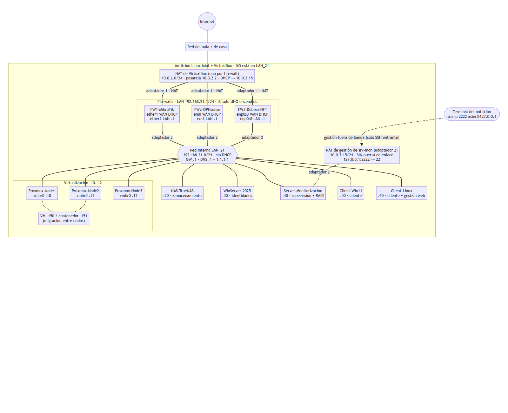

# ASIX ThinkLab · «Naix un sistema» V2.0 — Entorno individual de Asier

Proyecto individual de 1º ASIX (CIP FP Batoi, curso 2026-2027). Simulación en VirtualBox del sistema informático de la empresa: comunicaciones, virtualización, almacenamiento/copias, servidores y clientes.

- **Repositorio:** https://github.com/asierlinares08-web/thinklab-individual-21
- **Red LAN:** red interna de VirtualBox `LAN_21`, 192.168.21.0/24 (puesto 21 del aula). Esquema: [`diagramas/red-lan21.png`](diagramas/red-lan21.png) · WAN de los firewalls por NAT (DHCP)
- **Anfitrión:** Linux Mint + VirtualBox
- **Metodología:** ThinkLoop (predicción → investigación/decisión → implementación → verificación → análisis)

## Entregas por tarea
Una carpeta por tarea, con todo lo de esa tarea (índice: [`entregas/`](entregas/)):

- [Tasca 0 · Muntatge de l’entorn de proves](entregas/Tasca-0/)
- [Tasca 1 · Necessitats i sistemes (grupo)](entregas/Tasca-1/)
- [Tasca 2 · Equips i perifèrics](entregas/Tasca-2/)
- [Tasca 3 · Rack i interconnexió (grupo)](entregas/Tasca-3/)
- [Tasca 4 · Disseny físic i lògic](entregas/Tasca-4/)
- [Tasca 5 · Instal·lació i comunicacions](entregas/Tasca-5/)
- [Tasca 6 · Emmagatzematge i recuperació](entregas/Tasca-6/)
- [Tasca 7 · Rendiment i diagnòstic](entregas/Tasca-7/)
- [Tasca 8 · Prova final](entregas/Tasca-8/)

## El entorno en un vistazo

| IP (LAN_21) | VM | Sistema | vCPU · RAM | Para qué | Documento |
|---|---|---|---|---|---|
| .1 | FW1-MikroTik / **FW2-OPNsense** / FW3-Debian-NFT (**solo uno encendido**: misma IP) | RouterOS 7.25.1 · OPNsense 26.7 · Debian 13 + nftables | 1 · 288 MB / 1 GB / 512 MB | Puerta de enlace, NAT, reglas y registro | [06 §1–3](docs/06-installacions.md) |
| .10–.12 | Proxmox-Node1/2/3 (clúster `thinklab`) | Proxmox VE 9.2 | 2 · 3 GB c/u | Virtualización: VM .150 y contenedor .151, migración | [06 §5](docs/06-installacions.md) |
| .20 | NAS-TrueNAS | TrueNAS CE 25.10 | 2 · 8 GB | Destino de las copias (NFS, SMB, SSH) y disco iSCSI del espejo | [06 §4](docs/06-installacions.md), [09](docs/09-copies-contingencia.md) |
| .30 | WinServer-2025 | Windows Server 2025 | 2 · 4 GB | Centralización | [06 §6](docs/06-installacions.md) |
| .40 | Server-Monitorizacion (srv-mon) | Debian 13 sin escritorio | 1 · 1 GB | Copias automáticas (`cron`), RAID 0/1/5, espejo iSCSI | [07](docs/07-raid.md), [09 §3](docs/09-copies-contingencia.md) |
| .50 | Client-Win11 | Windows 11 Pro 25H2 | 2 · 4 GB | Cliente Windows | [06 §8](docs/06-installacions.md) |
| .60 | Client-Linux | Debian 13 + Xfce | 2 · 3 GB | Cliente Linux y puesto de gestión web | [06 §9](docs/06-installacions.md) |

**Recursos (medidos en el PC de clase, 12 hilos y 31 GiB):** se puede trabajar con **hasta 8 VMs (28 GiB) a la vez sin que el equipo se bloquee**. El límite es la RAM y después el disco; la CPU no pasa del ~22 %. Por eso se trabaja por **escenarios** ([05-recursos](docs/05-recursos.md) §3, [08-rendiment](docs/08-rendiment.md)).

**Problemas resueltos:** 27 incidencias documentadas con síntoma → hipótesis → prueba → solución → tiempo ([10-incidencies](docs/10-incidencies.md)). Las más útiles para aprender:
- KVM cargado y VirtualBox 7.0 a la vez: funciona con VT-x (comprobado, [05 §4](docs/05-recursos.md)).
- OPNsense pone LAN y WAN al revés al instalar; Windows en EFI espera una tecla para arrancar del DVD (19).
- Cada adaptador NAT de VirtualBox tiene su propia red (10.0.2/10.0.3) (24).
- Los discos `sdX` cambian de nombre al reiniciar: en la configuración se usan UUID, LABEL o `by-path` (26).
- Un `fstab` con un disco que falta y **root bloqueado** → se entra por GRUB con `systemd.mask=` (27, provocada; 2 min 10 s).

**Scripts** (todo lo automatizable, comentado en castellano): crear las VMs, inventario y tests del PC, copias de cada equipo, copias automáticas, medir el rendimiento, RAID y espejo iSCSI → [`scripts/README.md`](scripts/README.md).

## Índice
| Documento | Contenido | Tarea |
|---|---|---|
| [00-prediccions](docs/00-prediccions.md) | Predicciones iniciales y revisión final | — |
| [01-requisits](docs/01-requisits.md) | Requisitos del entorno y de cada sistema | T0, T5 |
| [02-inventari](docs/02-inventari.md) | PC de clase vs PC de casa, cuellos de botella, tests | T2 |
| [03-sistemes](docs/03-sistemes.md) | Sistemas elegidos, versión, fuente oficial, integridad | T5 |
| [04-disseny](docs/04-disseny.md) | Esquema de red, interfaces y montaje en VirtualBox | T4 |
| [05-recursos](docs/05-recursos.md) | Tabla de VMs y escenarios de arranque | T0, T4 |
| [06-installacions](docs/06-installacions.md) | Instalación y configuración de cada sistema | T5 |
| [07-raid](docs/07-raid.md) | RAID 0/1/5 y espejo entre equipos | T6 |
| [08-rendiment](docs/08-rendiment.md) | Rendimiento, saturación y optimizaciones | T7 |
| [09-copies-contingencia](docs/09-copies-contingencia.md) | Copias, recuperaciones y tiempos | T5, T6 |
| [10-incidencies](docs/10-incidencies.md) | Problemas encontrados y solución | T0, T5 |
| [11-us-ia](docs/11-us-ia.md) | Registro del uso de IA | — |
| [12-defensa](docs/12-defensa.md) | Preguntas de defensa | T8 |

Esquemas en [`diagramas/`](diagramas/) · Evidencias en [`evidencias/`](evidencias/) · Scripts en [`scripts/`](scripts/).

> Las credenciales se custodian fuera del repositorio, como pide el enunciado.
