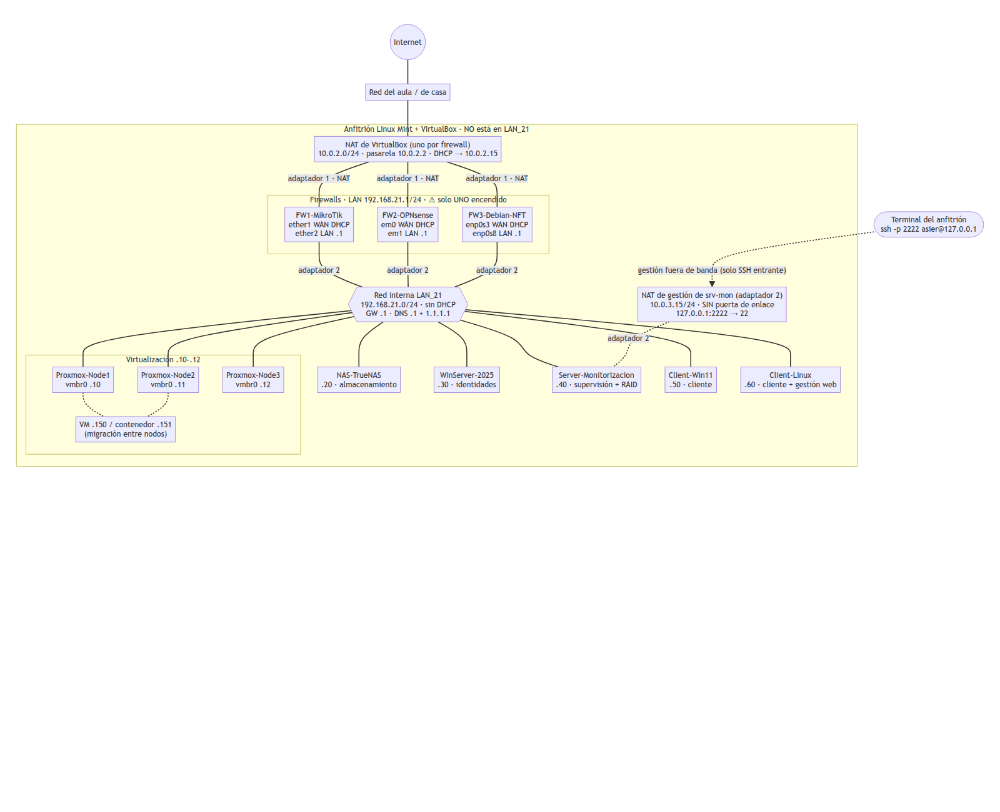
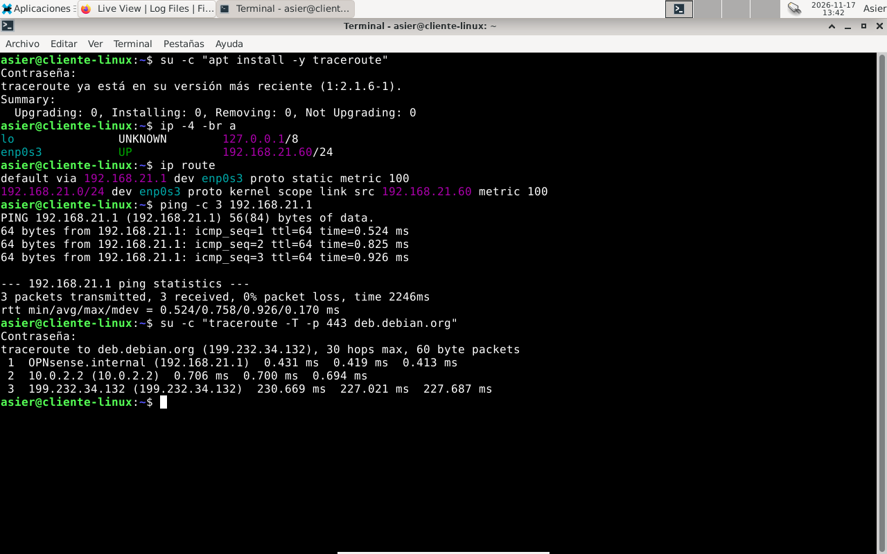

# 04 · Diseño físico y lógico de mi entorno (Tasca 4)

> Diseño **definitivo**: red interna `LAN_21`. Sustituye al primer diseño con red solo-anfitrión.
> Esquema: [`diagramas/red-lan21.mmd`](../diagramas/red-lan21.mmd) (Mermaid, fuente) y [`diagramas/red-lan21.png`](../diagramas/red-lan21.png).

Demuestra: cómo se conecta cada VM. Los 3 firewalls tienen un pie en el NAT de VirtualBox (WAN) y otro en la red interna LAN_21. Todos los demás equipos solo están en LAN_21, y el anfitrión queda fuera de la LAN.

## 1. Montaje en VirtualBox
| Red | Tipo de adaptador en VirtualBox | Direccionamiento | Quién está |
|---|---|---|---|
| **WAN** | **NAT**. Cada VM tiene su propio NAT, aislado de los demás | DHCP de VirtualBox: **10.0.2.15/24**, puerta de enlace **10.0.2.2**, DNS el del NAT | Adaptador 1 de los 3 firewalls |
| **LAN_21** | **Red interna** con el nombre `LAN_21` (es como un switch virtual que solo ven las VMs) | **192.168.21.0/24**, todo estático, **sin DHCP** | Adaptador 2 de los firewalls + el **único** adaptador de los demás equipos |

- **El anfitrión NO está en LAN_21.** No tiene IP en esa red y no puede hacer ping ni abrir las WebUI.
- **Gestión web:** desde el **navegador de Client-Linux (192.168.21.60)**.
- **Capturas:** `scripts/captura.sh <tasca> <descripción> vm <VM>` usa `VBoxManage controlvm <VM> screenshotpng` desde el anfitrión, sin tocar la VM.
- **Scripts para dentro de las VMs:** se publican en el repo y en la VM se descargan con `git clone https://github.com/asierlinares08-web/thinklab-individual-21.git`.
- **Proxmox:** su adaptador va en modo promiscuo **«Permitir todo»**. Si no, las VM y contenedores de dentro (.150/.151) no tienen red, porque usan MACs que VirtualBox no conoce.

### ⚠️ Regla de oro: solo UN firewall encendido
FW1, FW2 y FW3 tienen **la misma IP de LAN (192.168.21.1)**, así cualquiera de los tres sirve de puerta de enlace sin cambiar nada en los clientes.
Si se encienden dos a la vez, hay **dos MAC para la misma IP**: un conflicto ARP en el que cada cliente usa la MAC que le contestó la última vez y la conexión se corta a ratos.
Antes de arrancar un firewall, compruébalo con `VBoxManage list runningvms`.

## 2. Plan de direcciones (criterio por bloques)
| Bloque | IP | VM (grupo `/ThinkLab-asier`) | Función |
|---|---|---|---|
| Puerta de enlace | **.1** | `FW1-MikroTik` · `FW2-OPNsense` · `FW3-Debian-NFT` | Firewall/NAT (uno cada vez) |
| Virtualización | **.10 / .11 / .12** | `Proxmox-Node1` / `Proxmox-Node2` / `Proxmox-Node3` | Clúster Proxmox |
| Almacenamiento | **.20** | `NAS-TrueNAS` | Copias de seguridad |
| Identidades | **.30** | `WinServer-2025` | Centralización (el dominio se explica) |
| Supervisión | **.40** | `Server-Monitorizacion` | Infraestructura, RAID, copias automáticas |
| Clientes | **.50** | `Client-Win11` | Cliente Windows |
| Clientes | **.60** | `Client-Linux` | Cliente Linux + puesto de gestión web |
| (dentro de Proxmox) | **.150 / .151** | VM Debian y contenedor LXC | Migración entre nodos |

**Por qué por bloques:** por **orden y facilidad de diagnóstico**, no por rendimiento.
- Al ver una IP en un log o en `ping`, sé enseguida qué tipo de equipo es.
- Puedo escribir reglas de firewall por rangos, por ejemplo «los clientes .50–.60 no entran en la gestión de Proxmox .10–.12».
- Queda hueco para crecer dentro de cada bloque (.13 para un cuarto nodo, .21 para un segundo NAS…).

## 3. Configuración de cada interfaz
Máscara de toda la LAN: **255.255.255.0 (/24)**.

| VM | Interfaz | Adaptador VirtualBox | IP / máscara | Puerta de enlace | DNS | Método |
|---|---|---|---|---|---|---|
| FW1-MikroTik | `ether1` (WAN) | 1 · NAT | 10.0.2.15/24 | 10.0.2.2 | el del DHCP | DHCP |
| FW1-MikroTik | `ether2` (LAN) | 2 · Red interna `LAN_21` | 192.168.21.1/24 | — | — | Estática |
| FW2-OPNsense | `em0` (WAN) | 1 · NAT | 10.0.2.15/24 | 10.0.2.2 | el del DHCP | DHCP |
| FW2-OPNsense | `em1` (LAN) | 2 · Red interna `LAN_21` | 192.168.21.1/24 | — | — | Estática |
| FW3-Debian-NFT | `enp0s3` (WAN) | 1 · NAT | 10.0.2.15/24 | 10.0.2.2 | el del DHCP | DHCP |
| FW3-Debian-NFT | `enp0s8` (LAN) | 2 · Red interna `LAN_21` | 192.168.21.1/24 | — | — | Estática |
| Proxmox-Node1 / 2 / 3 | `vmbr0` (puente sobre la NIC) | 1 · `LAN_21` (promiscuo «Permitir todo») | .10 / .11 / .12 /24 | 192.168.21.1 | 192.168.21.1, 1.1.1.1 | Estática |
| NAS-TrueNAS | LAN | 1 · `LAN_21` | 192.168.21.20/24 | 192.168.21.1 | 192.168.21.1, 1.1.1.1 | Estática |
| WinServer-2025 | Ethernet | 1 · `LAN_21` | 192.168.21.30/24 | 192.168.21.1 | 192.168.21.1, 1.1.1.1 (hasta que tenga el rol DNS) | Estática |
| Server-Monitorizacion | LAN | 1 · `LAN_21` | 192.168.21.40/24 | 192.168.21.1 | 192.168.21.1, 1.1.1.1 | Estática |
| Client-Win11 | Ethernet | 1 · `LAN_21` | 192.168.21.50/24 | 192.168.21.1 | 192.168.21.1, 1.1.1.1 | Estática |
| Client-Linux | LAN | 1 · `LAN_21` | 192.168.21.60/24 | 192.168.21.1 | 192.168.21.1, 1.1.1.1 | Estática |
| VM de migración | `net0` → `vmbr0` | (dentro de Proxmox) | 192.168.21.150/24 | 192.168.21.1 | 192.168.21.1, 1.1.1.1 | Estática |
| Contenedor de migración | `eth0` → `vmbr0` | (dentro de Proxmox) | 192.168.21.151/24 | 192.168.21.1 | 192.168.21.1, 1.1.1.1 | Estática |
| Anfitrión Linux Mint | — | **No está en LAN_21** | — | — | — | — |

Las interfaces de la VM de migración, del contenedor, de TrueNAS, de Server-Monitorizacion y de Client-Linux todavía no las sé: el nombre real (`enp0s3`, `ens18`, `eth0`…) se apunta después de instalarlas.

**DNS:** el primario es el firewall (.1). Con OPNsense (Unbound) y MikroTik (`/ip dns allow-remote-requests=yes`) el firewall resuelve. El Debian con nftables **no tiene DNS**, así que entonces se usa el secundario **1.1.1.1**, que sale por el NAT. Con cualquier firewall activo, los nombres se resuelven.

## 4. Camino del tráfico (de un cliente a Internet)
Client-Linux (192.168.21.60) → red interna `LAN_21` → LAN del firewall activo (192.168.21.1) → **NAT/masquerade del firewall** (cambia el origen por 10.0.2.15) → WAN → **NAT de VirtualBox** (10.0.2.2, cambia el origen por la IP del anfitrión) → red del aula o de casa → Internet.

Hay **dos NAT seguidos**: el del firewall (el que configuro yo) y el de VirtualBox. Se demostrará con `traceroute` desde Client-Linux: el primer salto será 192.168.21.1 y el segundo 10.0.2.2.

## 5. Verificación (Apte+, Fase 3)
| Prueba | Desde | Hacia | Resultado | Evidencia |
|---|---|---|---|---|
| `ip -4 -br a` / `ip route` | Client-Linux | — | `enp0s3` 192.168.21.60/24; `default via 192.168.21.1` | `evidencias/tasca4/client-linux-ip-ruta-ping-traceroute.png` |
| `ping` puerta de enlace | Client-Linux | 192.168.21.1 | 3/3 · 0 % de pérdida · 0,76 ms | (misma) |
| `traceroute -T -p 443` a Internet | Client-Linux | deb.debian.org | **1 → 192.168.21.1 (OPNsense)** · **2 → 10.0.2.2 (NAT de VirtualBox)** · 3 → 199.232.34.132 (destino) | (misma) |
| Salida a Internet por HTTPS | Client-Linux | deb.debian.org | `HTTP/1.1 200 OK` | `evidencias/tasca5/client-linux-prueba-http-bloqueado-https-ok.png` |
| Configuración de interfaces y rutas del firewall | FW2-OPNsense | — | WAN em0 10.0.2.15/24 (pasarela 10.0.2.2), LAN em1 192.168.21.1/24 | `evidencias/tasca5/fw2-opnsense-interfaces-wan-lan.png`, `…login-asier-version-antes.png` |
| `ping` entre VMs | Client-Linux | .20 / .40 | (cuando estén instaladas: P9/P10) | |

Demuestra: el camino del §4 es real. El primer salto es el firewall (**192.168.21.1**), el segundo la pasarela del NAT de VirtualBox (**10.0.2.2**), y luego el destino. Del 2 se pasa directamente al destino porque el NAT de VirtualBox no es un router: abre la conexión desde el anfitrión, así que los routers del aula y de Internet no responden al traceroute. Se usó TCP al 443 porque el aula bloquea el ping.

## 6. Red de gestión fuera de banda
**Qué:** `Server-Monitorizacion` tiene un **adaptador 2 NAT** (VirtualBox lo numera 10.0.3.0/24) con IP estática **10.0.3.15/24 y SIN puerta de enlace** (`/etc/network/interfaces.d/gestion`) y un reenvío de puerto **127.0.0.1:2222 → 22**. Desde el terminal del anfitrión: `ssh -p 2222 asier@127.0.0.1` (con clave). Desde srv-mon se salta con **clave SSH** al resto: `fw1`, `fw3`, `pve1-3` (root, la clave se comparte por `/etc/pve/priv/authorized_keys`), `nas`, `vm150` (`~/.ssh/config` de asier). OPNsense **no** necesita SSH: se usa su API con un usuario `copias` que solo tiene los privilegios de copias (la API de firmware devuelve 403).

**Por qué:** el anfitrión no está en LAN_21 y teclear en consolas o leer capturas es lento y propenso a errores. Así las copias, el RAID y las mediciones se hacen con comandos y salidas de texto.

**No se salta el firewall** (evidencia [`gestion-fuera-banda-srv-mon.txt`](../evidencias/tasca4/gestion-fuera-banda-srv-mon.txt)). Demuestra: srv-mon tiene dos tarjetas (`intnet` y `nat`), la de gestión **sin puerta de enlace**, `ip_forward = 0` y el puerto 2222 escuchando solo en `127.0.0.1` del anfitrión:
- La ruta por defecto sigue siendo `default via 192.168.21.1`; `ip route get 1.1.1.1` sale por `enp0s3` y `traceroute` da 1.º salto 192.168.21.1 (firewall) y 2.º 10.0.2.2 (NAT del firewall).
- `ip_forward = 0` en srv-mon: no enruta, nadie de la LAN puede usarlo de atajo.
- El reenvío solo escucha en `127.0.0.1:2222` del anfitrión (no es accesible desde la red del aula) y solo deja **entrar** SSH.

Demuestra: hay una entrada de administración solo para el anfitrión, y todo el tráfico de la LAN hacia Internet sigue pasando por el firewall activo.
