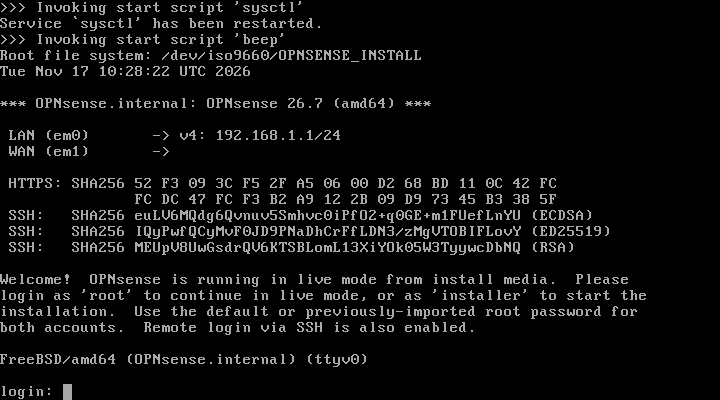

# 05 · Recursos y escenarios de arranque (Tasca 0 / Tasca 4)

## 1. Recursos del anfitrión
PC de clase: Intel Core Ultra 5 125H (14 núcleos / 18 hilos) y **32 GB de RAM DDR5** (2 × 16 GB, 30,6 GB usables). Las VMs van en un SSD externo por **USB**, a 5 Gbit/s.
Fuente: [`evidencias/tasca2/inventario-clase.txt`](../evidencias/tasca2/inventario-clase.txt); detalle en [02-inventari](02-inventari.md).

Reserva para el propio anfitrión (Mint + navegador + VirtualBox): **6 GB de RAM** → quedan **26 GB para las VMs**.

## 2. Tabla de máquinas (P2 · creada con `scripts/11-crear-vms.sh`)
Valores **reales**, comprobados con `VBoxManage showvminfo` después de crearlas: [`evidencias/tasca0/vms-creadas.txt`](../evidencias/tasca0/vms-creadas.txt). Esa evidencia demuestra que las 11 VMs están en `/ThinkLab-asier` con la CPU, la RAM, los discos, la red, la VT-x anidada, el promiscuo, EFI, TPM 2.0 y las claves de Secure Boot de la tabla. La segunda ejecución del script salta las 11, así que el script es repetible.

Para todas las VMs:
- Grupo VirtualBox `/ThinkLab-asier`, en `~/VirtualBox VMs/ThinkLab-asier/` (en el disco USB).
- Discos **VDI dinámicos**: solo ocupan lo que se usa.
- Controlador **SATA (AHCI)**, porque Windows Server no arranca desde IDE.
- Tarjeta de red **Intel PRO/1000 MT** (82540EM), para que las interfaces se llamen `em0/em1`, `enp0s3/enp0s8` y `ether1/ether2`.
- Sin audio ni USB.

| VM | Tipo VBox | vCPU | RAM | Disco(s) | Adaptadores | Extras | Justificación |
|---|---|---|---|---|---|---|---|
| FW1-MikroTik | Linux26_64 | 1 | 288 MB | `chr-7.25.1.vdi` (imagen oficial descomprimida, 128 MB) | 1 NAT · 2 LAN_21 | Arranca del disco, sin ISO | CHR se distribuye ya instalado como disco VDI. RAM: la fórmula oficial de RouterOS v7 es 256 + 8 × CPU × (interfaces − 1) = **264 MB** con 1 CPU y 2 interfaces. Se redondea a **288 MB** para no quedar por debajo del mínimo |
| FW2-OPNsense | FreeBSD_64 | 1 | 3 GB → **1 GB** (P18) | 16 GB | 1 NAT · 2 LAN_21 | ISO OPNsense 26.7 | El manual oficial pide **3 GB para que funcione el instalador**. Después se baja a 1 GB como optimización candidata del **P18**, midiendo antes y después |
| FW3-Debian-NFT | Debian12_64 ¹ | 1 | 512 MB | 8 GB | 1 NAT · 2 LAN_21 | ISO Debian 13.1 | Mínimo oficial de Debian sin escritorio: 512 MB y 4 GB de disco. Se instala con el instalador de **texto** (con < 780 MB el gráfico no va) |
| Proxmox-Node1/2/3 | Debian12_64 ¹ | 2 | 3 GB c/u | 32 GB c/u | 1 LAN_21 (promiscuo «permitir todo») | **VT-x anidada** · ISO Proxmox 9.2 | Mínimo oficial: 1 GB para pruebas. Con 3 GB caben dentro la VM .150 (512 MB) y el contenedor .151 (256 MB). El promiscuo deja pasar las MAC de las VM internas; la VT-x anidada deja a Proxmox virtualizar |
| NAS-TrueNAS | Debian12_64 ¹ | 2 | 8 GB | 16 GB sistema + **20 GB copias** | 1 LAN_21 (virtio desde el P18) | ISO TrueNAS 25.10.7 | **Mínimo oficial de TrueNAS: 8 GB** y 2 núcleos. TrueNAS necesita un disco solo para el sistema y otro aparte para el pool de copias (a227) |
| WinServer-2025 | Windows2022_64 ¹ | 2 | 4 GB | 50 GB | 1 LAN_21 | **EFI** · VBoxSVGA 128 MB de vídeo · ISO `w2k25.iso` | Oficial: 2 GB, y **4 GB recomendado con escritorio**; disco mínimo 32 GB. EFI como en un servidor actual |
| Server-Monitorizacion | Debian12_64 ¹ | 1 | 1 GB | 10 GB + **7 × 1 GB** | 1 LAN_21 (virtio desde el P18) · 2 NAT de gestión (04 §6) | ISO Debian 13.1 | RAM recomendada de Debian sin escritorio: 1 GB. Los 7 discos de 1 GB son para RAID 0, 1 y 5 y la prueba de fallo (P15) |
| Client-Win11 | Windows11_64 | 2 | 4 GB | 64 GB | 1 LAN_21 | **EFI + Secure Boot + TPM 2.0** · VBoxSVGA 128 MB de vídeo · ISO `win11.iso` (25H2) | **Mínimos oficiales exactos** de Windows 11: 2 núcleos, 4 GB, 64 GB, UEFI con Secure Boot y TPM 2.0 |
| Client-Linux | Debian12_64 ¹ | 2 | 3 GB | 25 GB | 1 LAN_21 | VMSVGA 128 MB de vídeo · ISO Debian 13.1 (el escritorio se elige al instalar) | Debian con escritorio recomienda 2 GB. Se da 1 GB más porque es la **consola de gestión** con navegador (WebUI de OPNsense, Proxmox y TrueNAS) |

¹ VirtualBox 7.0.20 no tiene los tipos «Debian 13» ni «Windows Server 2025». Se usan los más cercanos (`Debian12_64`, `Windows2022_64`), que solo ponen valores por defecto y no limitan nada.

**Disco:** como mucho 312 GB si los discos dinámicos se llenaran del todo. Hay 693 GB libres. Recién creadas, las 11 VMs ocupan **53 MB** (VDI dinámicos vacíos + la CHR).

**RAM con todo encendido** (un solo firewall, OPNsense a 3 GB): 3 + 9 + 8 + 4 + 1 + 4 + 3 = **32 GB** → **no cabe** en los 26 GB disponibles. Por eso se trabaja por escenarios.

**Estado final (después del P18):** FW2 tiene **1 GB** y srv-mon y TrueNAS usan la tarjeta **virtio-net** (más rápida, 08 §5). Con todo encendido: 1 + 9 + 8 + 4 + 1 + 4 + 3 = **30 GB**, todavía por encima de lo que cabe sin swap (~27–28 GiB). **Medido en el P17:** hasta **8 VMs (28 GiB)** a la vez sin bloquear el equipo; el límite es la RAM y después el disco ([08-rendiment](08-rendiment.md) §4).

## 3. Escenarios de arranque (RAM total según la propuesta P2)
Todos llevan **1 firewall** (regla de oro: nunca dos a la vez) y **Client-Linux**, que es el puesto de gestión web.

| Escenario | VMs encendidas | RAM total | ¿Cabe en 26 GB? | Para qué |
|---|---|---|---|---|
| A · Comunicaciones | 1 firewall + Client-Linux | MikroTik: **3,3 GB** · Debian: **3,5 GB** · OPNsense: **6 GB** | ✅ | Instalar y probar cada firewall: NAT, reglas, logs |
| B · Clúster | FW2-OPNsense + Proxmox-Node1/2/3 + Client-Linux | **15 GB** (13 GB con OPNsense a 1 GB) | ✅ | Clúster y migración |
| C · Copias | FW2-OPNsense + NAS-TrueNAS + Server-Monitorizacion + Client-Linux | **15 GB** (+ el equipo que se copia, hasta 4 GB → **19 GB**) | ✅ | Copias y recuperación |
| D · Windows | FW2-OPNsense + WinServer-2025 + Client-Win11 + Client-Linux | **14 GB** | ✅ | Instalación y copias de Windows |

En los escenarios B, C y D va FW2-OPNsense porque no tiene el límite de 1 Mbit/s de la CHR gratuita y tiene DNS propio.
Las RAM son de diseño. Lo que de verdad aguanta el equipo se mide en la Tasca 7 (P17).

## 4. Comprobación de arranque con KVM cargado (P2)
Comprobación previa del anfitrión: [`comprobacion-host.txt`](../evidencias/tasca0/comprobacion-host.txt). Demuestra: la CPU tiene VT-x, hay ~30 GB de RAM, las VMs van en un disco **USB** (`/home` en `sda`) y está el **aviso de KVM cargado** que se comprueba en este apartado.

El anfitrión tiene cargados `kvm_intel` y `kvm` (riesgo nº 1 previsto en el plan: `VERR_VMX_IN_VMX_ROOT_MODE`). Se arrancó **solo FW2-OPNsense**:
- `VBoxManage startvm` → «successfully started», y el estado se mantiene en `running`.
- `VBox.log`: «HM: HMR3Init: VT-x w/ nested paging and unrestricted guest execution hw support», sin ningún `VERR_`.

Demuestra: con KVM cargado, VirtualBox sí puede usar VT-x. OPNsense 26.7 (amd64) arranca desde la ISO en modo *live* y llega al `login:` del instalador.
⚠️ Para el P3: OPNsense ha puesto por su cuenta **LAN = em0** y **WAN = em1**, al revés de nuestro diseño (em0 = WAN por NAT, em1 = LAN_21). Hay que **reasignar las interfaces** en la consola.

## 5. Entorno de pruebas terminado (a17 · P13)
Con el P13, **las 11 VMs del diseño (§2) están instaladas, configuradas y probadas**, cada una con su instantánea de base para volver atrás si una prueba sale mal:

| VM | Estado | Última instantánea | Dónde está documentada |
|---|---|---|---|
| FW1-MikroTik | RouterOS 7.25.1 (al día) | `P8-fw1-base` | 06 §1 |
| FW2-OPNsense | 26.7.9_3 | `antes-desactivar-http` (+ `P3`, `P6`) | 06 §2 |
| FW3-Debian-NFT | Debian 13.7, nftables | `P13-fw3-actualizado` | 06 §3 |
| Proxmox-Node1/2/3 | PVE 9.2.28, clúster `thinklab`, VM 150 + CT 151 | `P11c-migracion` | 06 §5 |
| NAS-TrueNAS | 25.10.8, pool `copias` | `P13-truenas-25.10.8` | 06 §4 |
| WinServer-2025 | 26100.33438 | `P12-winserver-base` | 06 §6 |
| Server-Monitorizacion | Debian 13.7 + 7 discos para el RAID | `P10-srv-mon-base` | 06 §7 |
| Client-Win11 | Win11 Pro 25H2 (Windows Update pendiente) | `P13-win11-base` | 06 §8 |
| Client-Linux | Debian 13.7 + XFCE (puesto de gestión) | `P4-client-linux-base` | 06 §9 |

Todas en el grupo `/ThinkLab-asier`, en la red interna `LAN_21` y arrancadas por escenarios (§3), con un solo firewall encendido. Las instantáneas se listan con `VBoxManage snapshot <VM> list`.
