# 06 · Instalación y configuración de los sistemas (Tasca 5)

> **En pocas palabras:** he instalado los 9 sistemas del laboratorio (3 firewalls, 3 servidores de virtualización, un servidor de copias, un servidor Windows, un servidor Linux y 2 ordenadores de usuario). A cada uno le he puesto un usuario para administrarlo, una dirección fija en la red de la empresa y las últimas actualizaciones. Después he comprobado que todos salen a Internet a través del firewall y que las reglas bloquean lo que tienen que bloquear. Al final (§12), una revisión final confirma que todo sigue funcionando.

**Predicción** · **Requisitos y origen** (ver 03) · **Instalación** (opciones elegidas: firmware, particionado, sistema de ficheros) · **Usuario de administración** · **Red** · **Actualización y versión** · **Pruebas** (permitida/bloqueada + log, si aplica) · **Copia** (ver 09) · **Qué respondería en la defensa**.

### Firmware, arranque, particionado y sistema de ficheros de los 9 sistemas
Datos de `VBoxManage showvminfo` (firmware y orden de arranque) y de la instalación de cada apartado.

| Sistema | Firmware | Orden de arranque | Particionado | Sistema de ficheros | Por qué |
|---|---|---|---|---|---|
| FW1-MikroTik (CHR 7.25.1) | BIOS | Disco | El que trae la imagen VDI oficial (no se elige) | El propio de RouterOS | El CHR se distribuye ya instalado; lo único que se decide es la RAM y las tarjetas |
| FW2-OPNsense 26.7 | BIOS | Disco | GPT, guiado por el instalador (`/dev/gpt/rootfs`) | **UFS** | UFS gasta menos RAM que ZFS; en un firewall no hacen falta las instantáneas de ZFS (§2) |
| FW3-Debian-NFT (Debian 13) | BIOS | DVD (vacío) → disco | MBR, guiado: todo en una partición + swap | ext4 | Lo más simple: un firewall sin datos no necesita separar `/home` ni `/var` |
| Proxmox-Node1/2/3 (VE 9.2) | BIOS | DVD (vacío) → disco | Guiado en `/dev/sda`: LVM con `root` + `local-lvm` (thin) | ext4 (+ LVM-Thin para las VMs) | ZFS pide mucha RAM y cada nodo solo tiene 3 GB (§5) |
| NAS-TrueNAS (CE 25.10) | BIOS | DVD (vacío) → disco | Disco de 16 GB solo para el sistema (`boot-pool`) + disco de 20 GB para datos | **ZFS** (los dos) | TrueNAS solo usa ZFS y exige separar el disco del sistema del de datos (§4) |
| WinServer-2025 | **UEFI** | Disco → DVD | GPT, por defecto del instalador (lo normal: EFI + MSR + C: + recuperación; **N/C**, se vería con `Get-Partition`) | NTFS (EFI en FAT32) | Windows actual se instala en UEFI/GPT; controlador SATA porque el IDE da problemas (§6) |
| Server-Monitorizacion (Debian 13) | BIOS | DVD (vacío) → disco | MBR, guiado solo en `sda`: `/` + swap; `sdb–sdh` sin tocar | ext4 (y ext4 dentro de cada RAID) | Los 7 discos de 1 GB se reservan para el laboratorio de RAID (§7) |
| Client-Win11 (25H2) | **UEFI + Secure Boot + TPM 2.0** | Disco → DVD | GPT, por defecto del instalador | NTFS (EFI en FAT32) | Windows 11 **exige** UEFI, Secure Boot y TPM 2.0; sin ellos no se instala (§8) |
| Client-Linux (Debian 13 + escritorio) | BIOS | DVD (vacío) → disco | MBR, guiado: todo en una partición + swap | ext4 | Un cliente sin datos de empresa en local: lo importante está en las copias de `/home` |

«DVD (vacío)»: la ISO se quitó después de instalar, así que la BIOS pasa directamente al disco. En los Windows el disco va primero y la ISO puesta no molesta.

## 1. MikroTik CHR — a203–a209
> P8 (PC de casa). RouterOS no se «instala»: el CHR se distribuye como **imagen de disco ya instalada** (VDI oficial). Se arranca, se entra y se configura por consola.

**Predicción:** no indicada.

**Requisitos y origen:**
- CHR 7.25.1, imagen VDI oficial de mikrotik.com, verificada ([03-sistemes](03-sistemes.md)). Fórmula oficial de RAM: 264 MB con 2 interfaces; la VM tiene **288 MB y 1 vCPU** ([01-requisits](01-requisits.md)). Con todo funcionando quedan **79 MiB libres** (captura de versión), así que la RAM es suficiente.
- **Licencia gratuita (`free`)**: no caduca, pero **limita cada interfaz a 1 Mbit/s de subida** (de lo que sale por ella). Medido abajo.

**Interfaces** (comprobado por MAC con `/interface ethernet print` frente a `VBoxManage showvminfo`; la captura no se publica porque sale la MAC): `ether1` = adaptador 1 = **NAT (WAN)** · `ether2` = adaptador 2 = **LAN_21**.

**Pasos** (todos con `VBoxManage keyboardputstring`; la consola de RouterOS usa teclado americano, el mismo que envía VBoxManage):

| # | Qué se hizo | Por qué |
|---|---|---|
| 1 | Primer login `admin` sin contraseña → licencia: `n` | Es el usuario de fábrica del CHR |
| 2 | El asistente «Change your password» se saltó (el Enter anterior dejó vacío `new password>`) → Ctrl+C → **`/password`** (interactivo: antigua vacía, nueva y confirmación, ocultas con `****`) | `/password` no deja la contraseña en la pantalla ni en el historial de comandos |
| 3 | `/tool fetch url="https://raw.githubusercontent.com/…/fw1-mikrotik.rsc"` → `status: finished`, `code: 200` | El router descarga el script del repo público por la WAN |
| 4 | `/import file-name=fw1-mikrotik.rsc` → «Script file loaded and executed successfully»; el prompt pasa a `FW1-MikroTik` | Aplica toda la configuración de una vez |
| 5 | `/user add name=asier group=full` → RouterOS 7 **pide la contraseña interactivamente** | Así tampoco queda escrita en ningún sitio |
| 6 | `/quit` → login como `asier` → entra (`[asier@FW1-MikroTik] >`) | Comprobar que el usuario de administración funciona |

**Script** [`configs/fw1-mikrotik/fw1-mikrotik.rsc`](../configs/fw1-mikrotik/fw1-mikrotik.rsc) (comentado línea a línea, sin contraseñas). Cada orden comprueba antes si ya existe (`:if ([:len [... find ...]] = 0)`), así que se puede importar dos veces sin duplicar nada:
- `/system identity set name=FW1-MikroTik`
- Cliente DHCP en `ether1` solo si no existe. **El CHR ya trae uno de fábrica** (`client1`), así que no se creó otro.
- `192.168.21.1/24` en `ether2`.
- NAT `srcnat` · `masquerade` al salir por `ether1`.
- Filtro `forward`: `in-interface=ether2 protocol=tcp dst-port=80 action=drop log=yes log-prefix="P8-BLOQUEO-HTTP"`.
- `/ip dns set allow-remote-requests=no`: **sin servidor DNS en el router**; los clientes usan 1.1.1.1 de secundario, igual que con FW3.

**Versión, licencia y usuarios:**

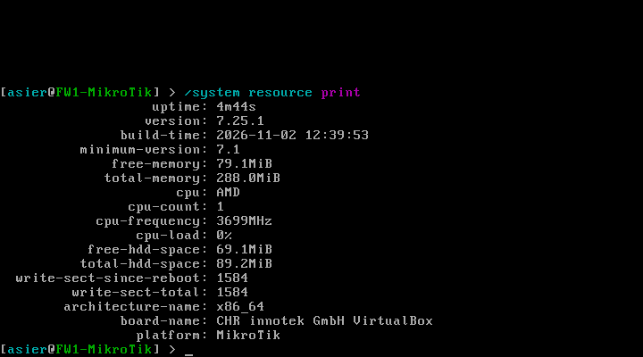

Demuestra: **RouterOS 7.25.1** en `x86_64` sobre VirtualBox, 1 CPU, 288 MiB de RAM (79 MiB libres) y 89 MiB de disco.

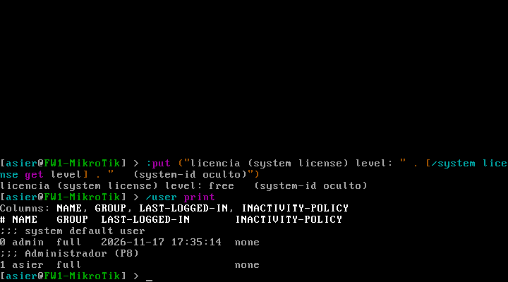

Demuestra: licencia **`free`** (el `system-id` se oculta porque identifica esta instalación, como un número de serie) y los usuarios `admin` y **`asier`, los dos del grupo `full`** (todos los permisos).

**Red:**

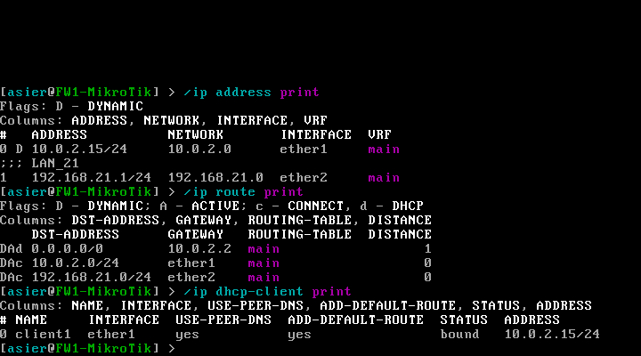

Demuestra: `ether1` = **10.0.2.15/24** dinámica (`D`, por DHCP, `bound`) · `ether2` = **192.168.21.1/24** (comentario `LAN_21`) · ruta por defecto `0.0.0.0/0` por **10.0.2.2** (`DAd`: dinámica, activa, del DHCP) · las dos redes conectadas (`DAc`).

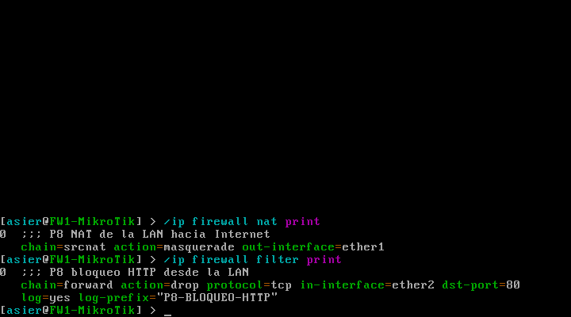

Demuestra: la regla de **masquerade** (salida por `ether1`) y la regla de **bloqueo** del puerto 80 en `forward`, con `log=yes` y el prefijo. El CHR **no trae reglas de filtro**, así que todo lo demás pasa (en RouterOS, sin reglas, se acepta).

**Prueba permitida y bloqueada (desde Client-Linux, después de `sudo ip neigh flush all`):**

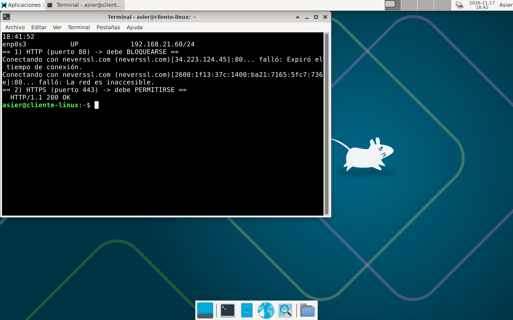

Demuestra: `http://neverssl.com` (**puerto 80**) → «Expiró el tiempo de conexión»: **bloqueado** · `https://deb.debian.org` (**puerto 443**) → `HTTP/1.1 200 OK`: **permitido**.


Demuestra: `sudo traceroute -T -p 443`: **192.168.21.1** (FW1) → **10.0.2.2** (NAT de VirtualBox) → deb.debian.org. Igual que con FW3: el NAT de VirtualBox oculta los routers de Internet.

**Límite de 1 Mbit/s de la licencia gratuita (medido):**

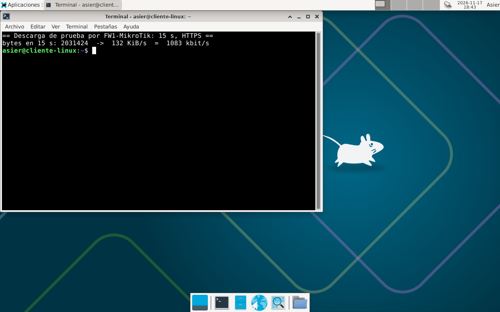

Demuestra: en 15 s de descarga por HTTPS llegan **2.031.424 bytes = 132 KiB/s ≈ 1.083 kbit/s**. Con la misma conexión, el anfitrión mide **95 Mbit/s** ([02-inventari](02-inventari.md)). Es el límite de la licencia `free`: **lo que el router envía por cada interfaz** va a 1 Mbit/s como mucho. Una descarga del cliente **sale por `ether2`** hacia la LAN, así que también se limita. Conclusión práctica: **con FW1 encendido, las descargas grandes van lentísimas** (una ISO de 700 MB tardaría ~1 h 30 min). Para actualizar o hacer `git clone`, mejor FW2 o FW3.

**Registro del bloqueo** (`/log print where message~"P8"`). Las MAC se ocultan con un bucle de RouterOS que corta el texto con `:pick`:

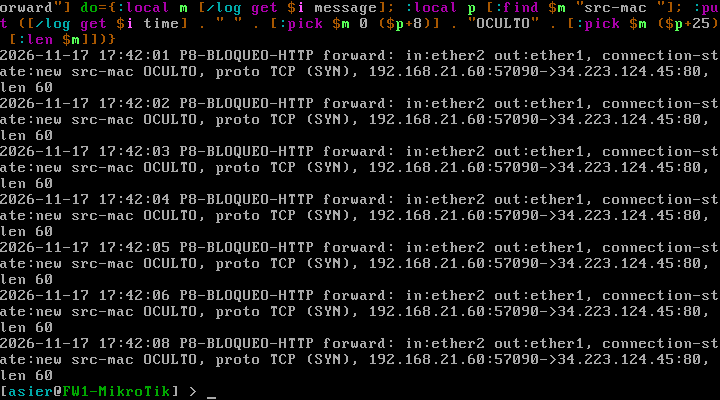

`HH:MM:SS P8-BLOQUEO-HTTP forward: in:ether2 out:ether1, connection-state:new src-mac OCULTO, proto TCP (SYN), 192.168.21.60:57090->34.223.124.45:80, len 60`

| Campo | Qué significa |
|---|---|
| `HH:MM:SS` | Hora **del router**, que va en UTC (sin zona horaria ni NTP configurados): una hora menos que la hora real. Para comparar logs de equipos distintos habría que ponerles la misma zona horaria |
| `P8-BLOQUEO-HTTP` | El prefijo de la regla: dice **qué regla** actuó |
| `forward` | La cadena: el paquete **atravesaba** el router (no iba dirigido a él) |
| `in:ether2 out:ether1` | Entró por la **LAN** y habría salido por la **WAN** |
| `connection-state:new` | Es una **conexión nueva** (no una respuesta a algo ya permitido) |
| `src-mac OCULTO` | MAC de origen (la de Client-Linux). En el repo se oculta |
| `proto TCP (SYN)` | TCP, primer paquete del saludo inicial: la conexión **no llega a empezar** |
| `192.168.21.60:57090` | **Origen**: Client-Linux y su puerto aleatorio. Es el **mismo en las 7 líneas**: reintentos de la misma conexión |
| `->34.223.124.45:80` | **Destino**: neverssl.com, **puerto 80** (HTTP), lo que hace coincidir la regla |
| `len 60` | Tamaño del paquete (60 bytes, un SYN normal) |

Las horas (:01, :02, :03, :04, :05, :06, :08) muestran que el cliente reintenta durante los 10 s del `wget -T 10`. **Diferencia con nftables (P7):** RouterOS escribe el log en frases más legibles (`in:… out:…`, `connection-state`), mientras que el kernel de Linux da campos sueltos (`IN= OUT= SRC= DST=`) con más detalle (TTL, ID, ventana TCP).

**Instantánea:** `P8-fw1-base` (con la VM apagada).

**Qué respondería en la defensa:** lo tengo preparado en mis apuntes de defensa (ISO-RA1 · MikroTik).

## 2. OPNsense (FW2-OPNsense) — a210–a216
> P3: instalación y configuración por consola. La WebUI, las reglas y el log se hacen en el P6, y la copia y la errada controlada en el P14.

**Predicción:** no indicada.

**Requisitos y origen:**
- OPNsense 26.7 amd64, imagen `dvd` con SHA256 verificado ([03-sistemes](03-sistemes.md)).
- El manual oficial pide 3 GB de RAM para que funcione el instalador. La VM tiene **3 GB** ahora y se bajará a 1 GB en el P18, midiendo antes y después.

**Instalación (enviando teclas con `VBoxManage controlvm FW2-OPNsense keyboardputstring/keyboardputscancode` y comprobando cada pantalla con `screenshotpng`):**

| # | Qué se hizo | Por qué |
|---|---|---|
| 1 | Entrar con el usuario `installer` y la contraseña pública del instalador | Así arranca el instalador en lugar del modo *live* |
| 2 | **Teclado US** (por defecto) | `VBoxManage keyboardputstring` envía las teclas como un teclado **americano**. Con teclado español, símbolos como `/`, `-` o `:` saldrían cambiados |
| 3 | **Install (UFS)** en el disco **ada0 (16 GB)**. El cd0 (la ISO) no se toca | **UFS** es el sistema de ficheros clásico de FreeBSD: sencillo y con poco consumo de RAM. **ZFS** añade sumas de comprobación, instantáneas y RAID por software, pero usa mucha RAM como caché (ARC). Con 1 GB de RAM (objetivo del P18), UFS es lo adecuado |
| 4 | Contraseña de **root**, la de la convención del laboratorio (solo en `CREDENCIALES-PRIVADAS.md`) | Se tecleó desde un fichero temporal (`keyboardputfile`), que se borró al terminar, para que no apareciera en ningún comando ni registro |
| 5 | **Halt now** en lugar de *Reboot now* → con la VM apagada, se **quita la ISO** y se pone el disco como primer arranque (`storageattach … emptydrive`, `--boot1 disk`) | Si la ISO sigue puesta, la VM vuelve a arrancar el instalador. No se quitó antes porque el instalador se ejecutaba **desde** la ISO |
| 6 | Primer arranque desde el disco: «Root file system: **/dev/gpt/rootfs**» | Demuestra que arranca el sistema instalado, ya no la ISO (`/dev/iso9660/…`) |

**Usuario de administración:** `root` con la contraseña de la convención. El usuario personal `asier` se crea en la WebUI (P6).

**Red (consola):**

| # | Opción de la consola | Qué se hizo | Por qué |
|---|---|---|---|
| 7 | **1) Assign interfaces** | Sin LAGG ni VLAN · **WAN = em0** · **LAN = em1** | El instalador había puesto LAN = em0 por su cuenta. Se comprobó por la MAC que em0 es el adaptador 1 de VirtualBox (NAT) y em1 el adaptador 2 (LAN_21) |
| 8 | (automático) | WAN em0 recibe **10.0.2.15/24** del DHCP de VirtualBox | Es la IP que siempre da el NAT de VirtualBox; su pasarela es 10.0.2.2 |
| 9 | **2) Set interface IP address** → LAN | IPv4 estática **192.168.21.1/24** · **sin puerta de enlace** · **sin IPv6** · **sin servidor DHCP** · WebUI en **HTTPS** | La LAN no lleva puerta de enlace porque es el firewall quien hace de puerta para los demás. Sin DHCP porque todo el laboratorio es estático y no queremos dos servidores DHCP si se cambia de firewall |
| 10 | Dos preguntas que no estaban previstas: «¿generar un certificado nuevo?» y «¿restaurar los valores por defecto del acceso web?» | **n** en las dos (la opción por defecto) | La instalación es nueva: ya tiene su certificado autofirmado y el acceso web por defecto |

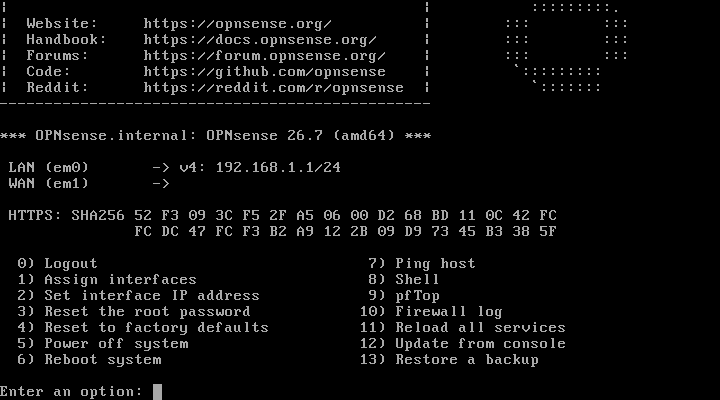

Demuestra: el sistema instalado es **OPNsense 26.7 (amd64)** y ya arranca desde el disco. Es la captura justo después de entrar como root, antes de reasignar las interfaces (por eso todavía sale LAN = em0).

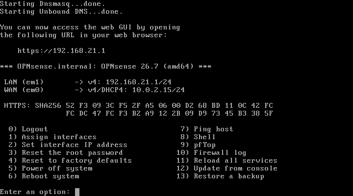

Demuestra: la configuración final es **WAN (em0) = 10.0.2.15/24 por DHCP** y **LAN (em1) = 192.168.21.1/24**, y la WebUI está en `https://192.168.21.1`.

**Pruebas de funcionamiento (opción 7, ping):**

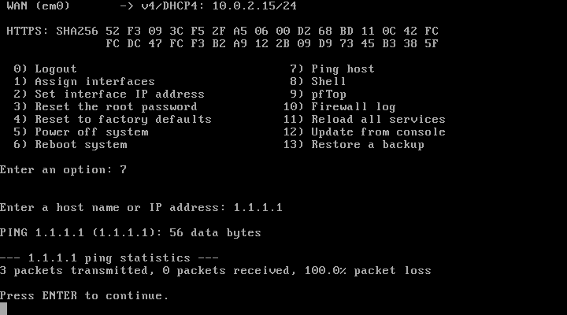

Demuestra: el ping a 1.1.1.1 sale de OPNsense pero **no vuelve ninguna respuesta (100 % de pérdida)**. Desde el anfitrión pasa lo mismo, así que es la **red del aula, que bloquea el ping (ICMP) hacia Internet**, como ya se vio en el P1. No es un fallo de OPNsense.

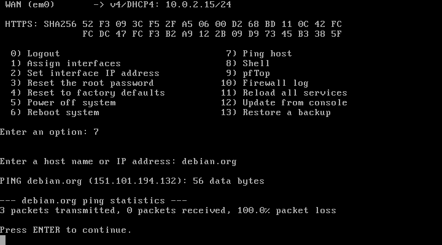

Demuestra: OPNsense **resuelve el nombre** debian.org → 151.101.194.132, así que su DNS sale a Internet por la WAN. Los pings se pierden por el mismo bloqueo del aula.

**Prueba de salida a Internet por HTTPS** (opción 8, Shell). El aula bloquea el ping, pero no HTTPS:

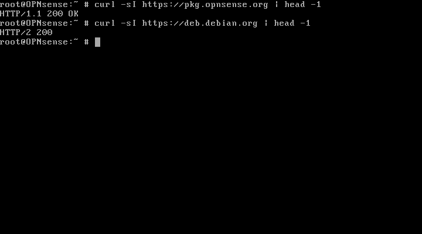

Demuestra: el firewall **sí sale a Internet**. `curl -sI https://pkg.opnsense.org` responde `HTTP/1.1 200 OK` y `curl -sI https://deb.debian.org` responde `HTTP/2 200`. Una respuesta 200 solo puede llegar si la WAN, el NAT de VirtualBox, el DNS y el enrutamiento funcionan. Con esto queda comprobado el funcionamiento (a210) sin esperar al ping de casa.

**¿Por qué la LAN ya saldrá a Internet sin tocar nada?** Al instalarse, OPNsense crea dos cosas por defecto:
- Un **NAT de salida automático**: todo lo que sale por la WAN desde la LAN se traduce a la IP de la WAN (10.0.2.15).
- Una **regla en la LAN** («Default allow LAN to any») que deja salir a cualquier destino a los equipos de la LAN.

Con las dos juntas, un cliente con puerta de enlace 192.168.21.1 ya tiene Internet. Se comprobará desde Client-Linux en el P4 y el P6.

**Instantánea:** `P3-opnsense-base` (`VBoxManage snapshot FW2-OPNsense take`), tomada con la VM encendida. Es el punto de vuelta atrás para la errada controlada del P14.

**Actualización y versión:** 26.7 instalada desde la ISO y actualizada a 26.7.9_3 en el P6 (ver abajo).

### 2.1 P6 · OPNsense por la WebUI
> Con el ratón en Firefox de Client-Linux (`https://192.168.21.1`). Las capturas se hicieron con `VBoxManage screenshotpng`. La corrección de la regla (mover arriba, poner la descripción y aplicar) se hizo **con el teclado** (`VBoxManage`).

**Predicción:** no indicada.

| # | Cómo | Qué se hizo | Por qué |
|---|---|---|---|
| 1 | A mano | Entrar como root → asistente inicial → **Abort** | Para no cambiar nada de lo configurado por consola (IPs, sin DHCP) |
| 2 | A mano | **System → Access → Users → +**: usuario `asier`, grupo **admins**, contraseña de la convención. Cerrar sesión y entrar como `asier` | Cada administrador con su usuario: queda registrado quién hace qué y no se usa root para el trabajo diario |
| 3 | A mano | **System → Firmware**: 96 actualizaciones (298,8 MiB) → Update → reinicio. Unos 21 min en total | Actualizar antes de «producción» corrige fallos y agujeros de seguridad (a79) |
| 4 | A mano + teclado (`VBoxManage`) | **Firewall → Rules → LAN**: regla **Block · TCP · LAN net → any · puerto 80 (HTTP) · Log · «P6 bloqueo HTTP»**, puesta **la primera** | El firewall usa la **primera regla que coincide**. Al principio quedó debajo de «Default allow LAN» y no habría bloqueado nada (incidencia 5). Se movió arriba con el botón «←», le puso la descripción y pulsó Apply |
| 5 | A mano | Prueba desde Client-Linux con `wget --spider` a HTTP y a HTTPS | Comprobar una conexión **bloqueada** (80) y otra **permitida** (443) |
| 6 | A mano | **Firewall → Log Files → Live View**, filtro `P6` | Ver en el registro que es esa regla la que bloquea |
| 7 | A mano | `ip -4 -br a`, `ip route`, `ping`, `su -c "traceroute -T -p 443 deb.debian.org"` | Demostrar el camino de los paquetes (a129/a149). TCP 443 porque el aula bloquea el ping. `su -c` porque `asier` no tiene `sudo` |
| 8 | A mano | **System → Configuration → Backups → Download configuration** → `~/Descargas` de Client-Linux | Copia manual de la configuración, para la recuperación del P14 |

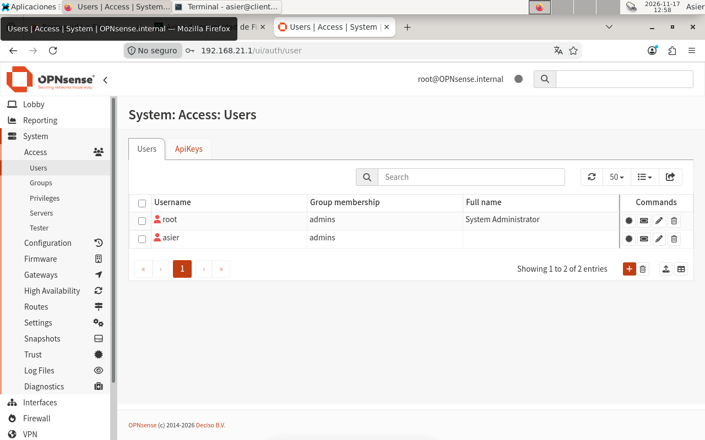

Demuestra: hay dos administradores, `root` y **`asier`**, los dos en el grupo **admins** (a211).

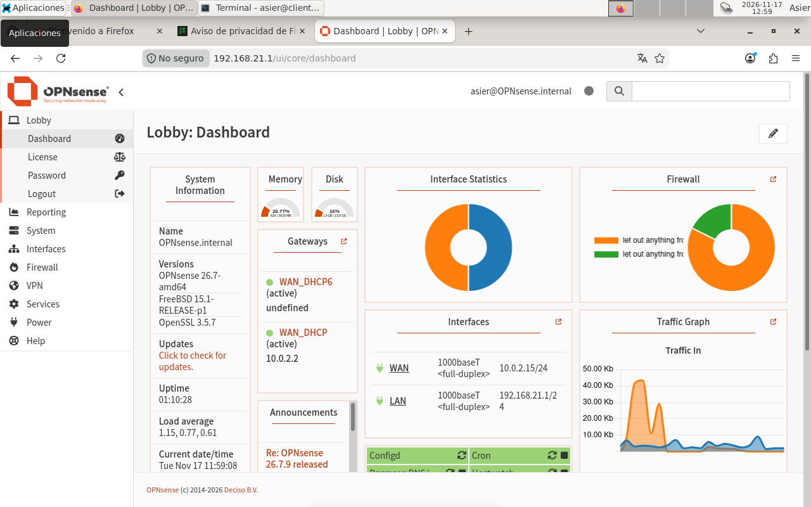

Demuestra:
- `asier` puede entrar en la WebUI (arriba pone `asier@OPNsense.internal`).
- La versión **antes** de actualizar es **26.7** (FreeBSD 15.1-RELEASE-p1).
- La memoria usada es el 20,8 % de 3 GB, un dato útil para el P18.

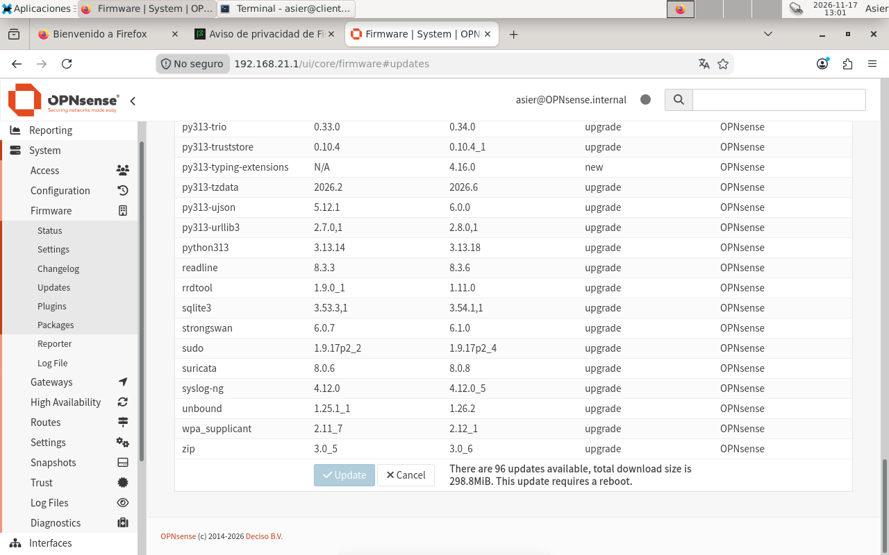

Demuestra: el sistema encontró **96 actualizaciones (298,8 MiB)** que necesitan reiniciar.

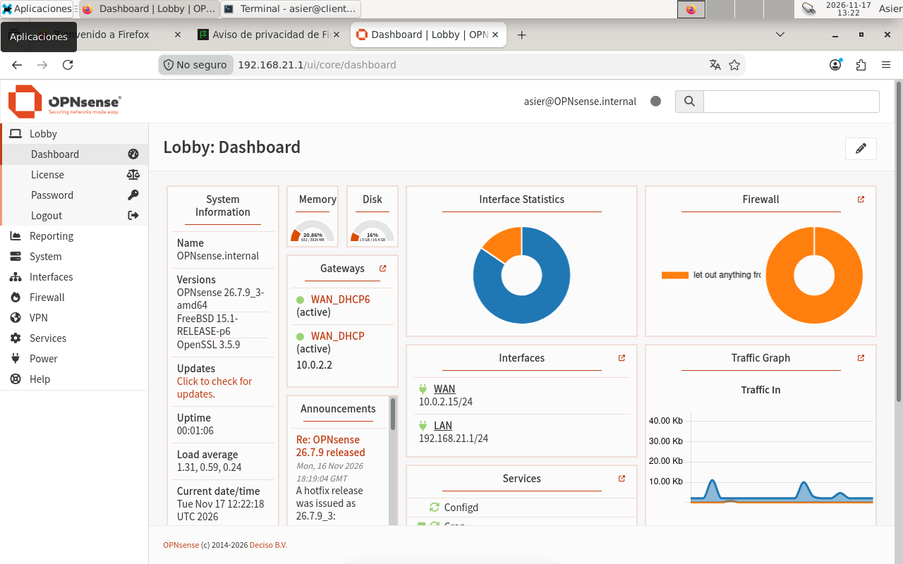

Demuestra: **después** de actualizar es **26.7.9_3** (FreeBSD 15.1-RELEASE-p6), con un *uptime* de 1 min, o sea, acaba de reiniciar.

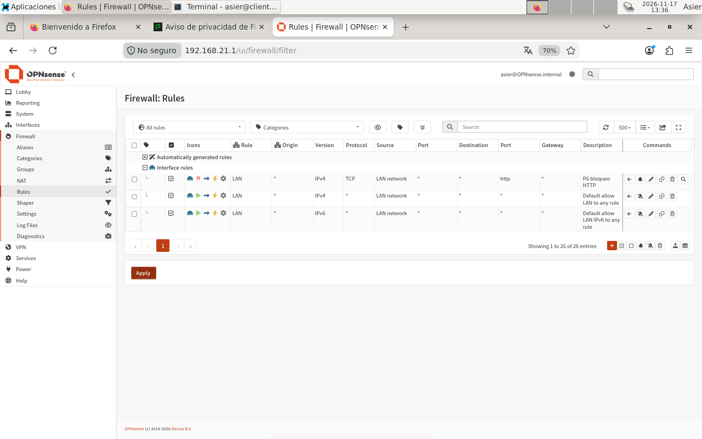

Demuestra: en LAN, la **primera** regla es Block · IPv4 · TCP · LAN network → \* · puerto **http** · con log (campana) · «P6 bloqueo HTTP», y debajo están las dos «Default allow».

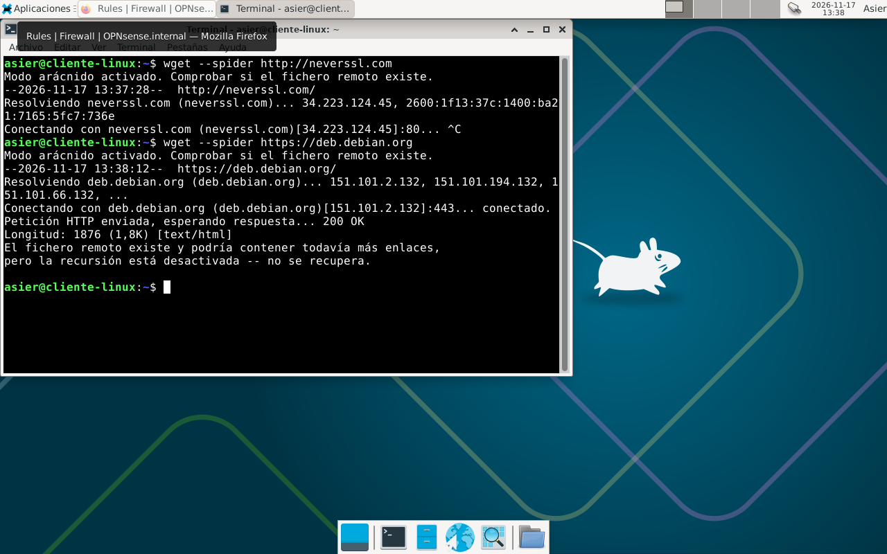

Demuestra:
- **Bloqueada:** `wget http://neverssl.com` se queda en «Conectando con … :80…» sin respuesta. *Block* descarta el paquete sin avisar, así que el cliente espera hasta que se corta con Ctrl+C.
- **Permitida:** `wget https://deb.debian.org` → «conectado» y **200 OK**.

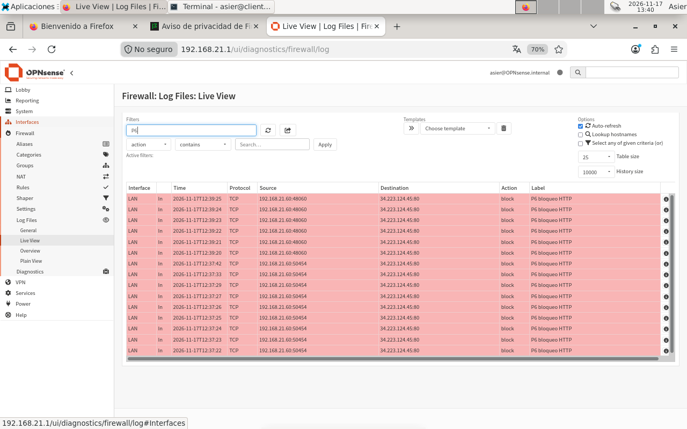

Demuestra: el registro guarda cada intento bloqueado con la etiqueta de la regla. **Cómo se lee** una línea:

| Columna | Ejemplo | Significado |
|---|---|---|
| Interface | LAN | Tarjeta del firewall por la que entró el paquete (em1, la red de la empresa) |
| (dirección) | in | El paquete **entraba** en el firewall |
| Time | AAAA-MM-DDTHH:MM:SS | Fecha y hora en **UTC** (una hora menos que en España) |
| Protocol | TCP | Tipo de conexión; HTTP va sobre TCP |
| Source | 192.168.21.60:48060 | Quién: Client-Linux, con un puerto de origen al azar |
| Destination | 34.223.124.45:80 | A dónde: neverssl.com, puerto 80 = HTTP |
| Action | block | Qué hizo el firewall: lo descartó |
| Label | P6 bloqueo HTTP | Qué regla lo decidió |

Hay **varias líneas por cada `wget`** porque el cliente no recibe respuesta y reintenta (t=0, +1 s, +2 s…). Los dos grupos de puertos (50454 y 48060) son los dos `wget` lanzados.

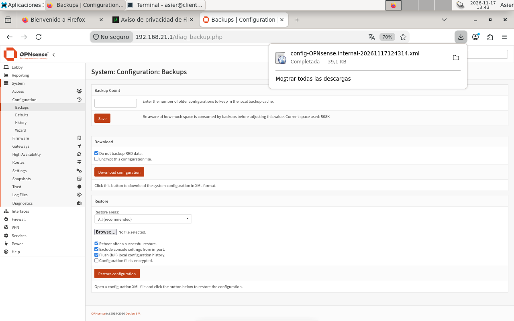

Demuestra: se descargó la copia **`config-OPNsense.internal-<fecha>.xml` (39,1 KB)** en Client-Linux. La copia **no** se sube al repositorio: contiene los *hash* de las contraseñas.

**Instantánea:** `P6-opnsense-reglas` (VM FW2-OPNsense).

### 2.2 Regla «P6 bloqueo HTTP» desactivada para el P11

**Por qué:** la prueba de bloqueo ya está hecha y tiene sus evidencias (apartado 2.1). Los instaladores de Debian y de Proxmox usan réplicas `http://` (incidencia 12), y en el P11 se instalan tres nodos de Proxmox. La regla se **desactiva**, no se borra, así que para la defensa se puede volver a activar con un clic (y Apply).

**Cómo (por comandos):**
1. Instantánea **`antes-desactivar-http`** de FW2-OPNsense, con la VM apagada. Es el punto de vuelta atrás.
2. Firefox de Client-Linux → `https://192.168.21.1/ui/firewall/filter` (en la 26.7, Firewall → Rules), con el usuario `asier`.
3. Interruptor «Enabled» de la fila «P6 bloqueo HTTP» → la fila se queda en gris → **Apply**. Se manejó con el teclado por `VBoxManage`. Para no pulsar a ciegas, el clic se hizo desde la consola web de Firefox (Ctrl+Mayús+K) sobre el elemento exacto de esa fila. Antes se comprobó que solo **una** fila contenía «P6 bloqueo».
4. Se descartó hacerlo desde la shell de FW2 editando `/conf/config.xml`, porque así se salta las comprobaciones de la WebUI y un XML mal escrito puede dejar el firewall sin reglas.

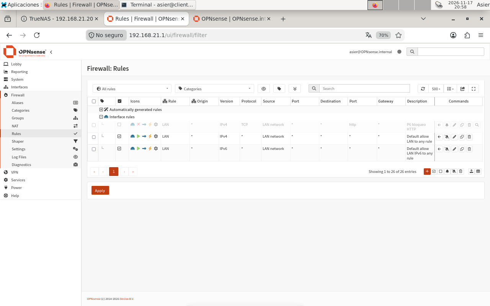

Demuestra: después de recargar la página, la regla «P6 bloqueo HTTP» sigue la primera, pero **en gris** (desactivada), y las dos «Default allow» siguen activas. El cambio está guardado.

**Comprobación en el firewall** (shell de FW2, solo lectura): `pfctl -sr` ya **no** tiene ninguna regla con `port = http`. En el registro del filtro, el tráfico de Client-Linux a neverssl.com sale como `pass,out` por em0.

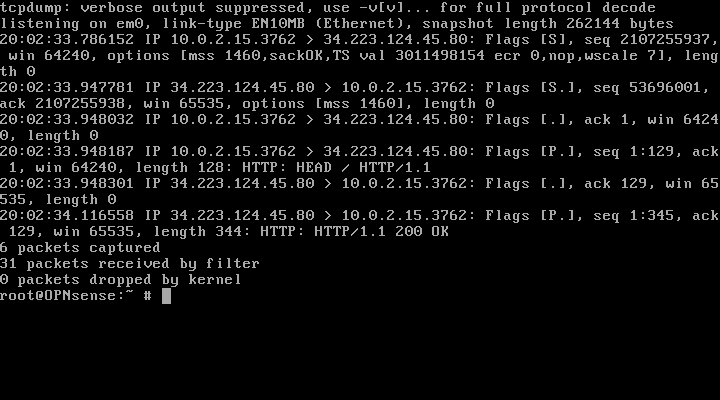

Demuestra: en la WAN (em0) se ve la conexión completa de Client-Linux (ya con NAT, 10.0.2.15) a neverssl.com:80: SYN → SYN-ACK → `HEAD / HTTP/1.1` → **`HTTP/1.1 200 OK`**.

**Comprobación desde Client-Linux:**

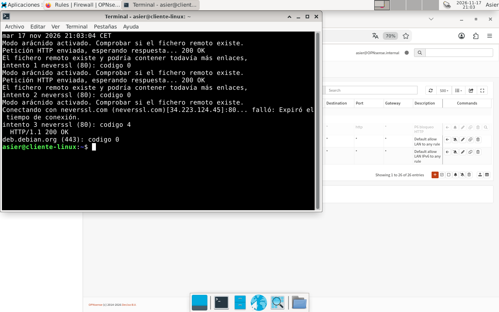

Demuestra: `wget --spider http://neverssl.com` → **200 OK** en 2 de 3 intentos, y `https://deb.debian.org` sigue en **200 OK**. En otra prueba, `http://deb.debian.org/debian/` y `http://download.proxmox.com/` dieron **200 OK**, que es lo que necesita el P11.

**El 3.er intento a neverssl.com falló** (tiempo agotado). No es el firewall, porque ese tráfico sale con `pass` y la regla ya no está cargada. Es un fallo **intermitente** fuera de FW2: el SYN sale por la WAN y no vuelve respuesta. **N/C** dónde se pierde (NAT de VirtualBox, red de casa o el propio neverssl.com). Prueba que lo confirmaría: `tcpdump` en em0 durante 10 intentos seguidos, comparando con 10 intentos a `http://deb.debian.org` (incidencia 13).

**Para la defensa:** volver a activar la regla (el mismo interruptor + Apply) y repetir el `wget` → vuelve a quedarse en «Conectando…».


## 3. Debian con nftables — a217–a223
> P7 (PC de casa). Es el firewall más «a mano» de los tres: no tiene WebUI, todo son ficheros de texto.

**Predicción:** no indicada.

**Requisitos y origen:**
- Debian 13 sin escritorio pide 512 MB de RAM y 2 GB de disco (con escritorio, 1 GB y 10 GB). La VM tiene **512 MB, 1 vCPU y 8 GB** ([05-recursos](05-recursos.md)).
- Imagen: la misma netinst 13.1 verificada que el resto de Debian ([03-sistemes](03-sistemes.md)).
- Es la **primera VM que se enciende en el PC de casa** (AMD con `kvm_amd` cargado): arranca sin errores; el log de VirtualBox dice `HM: HMR3Init: AMD-V w/ nested paging`.

**Instalación.** Quién hizo cada paso:

| # | Cómo | Qué se hizo | Por qué |
|---|---|---|---|
| 1 | **A mano** | Arrancó el instalador en modo texto con síntesis de voz (el que se lanza solo tras la cuenta atrás), idioma inglés, red por **enp0s3** (DHCP), contraseñas de root y de `asier`, particionado guiado (todo en una partición + swap) | A mano, mientras se preparaban los ficheros |
| 2 | `VBoxManage` | Sin más soportes, réplica **deb.debian.org** (España), sin proxy, sin encuesta | Valores por defecto |
| 3 | `VBoxManage` | Programas: **solo** «SSH server» y «standard system utilities» | Un firewall no necesita escritorio: menos RAM, menos disco y menos cosas que actualizar |
| 4 | `VBoxManage` | GRUB en **/dev/sda** · quitar la ISO (`storageattach … emptydrive`) y reiniciar | Para que arranque del disco y no vuelva al instalador |
| 5 | `VBoxManage` | Como root: nombre **`fw3-debian`** (`hostnamectl` + `/etc/hosts`), instalar **sudo** y meter a `asier` en el grupo `sudo` | En el instalador se puso contraseña a root, así que Debian **no instala sudo**. Hace falta para la línea `… \| sudo bash` y para administrar sin entrar como root |
| 6 | `VBoxManage` | Aplicar la configuración con una línea (ver abajo) | Los ficheros están en el repo, comentados, y se descargan dentro de la VM |

**Usuarios de administración:** `root` (con la contraseña de la convención, solo para emergencias) y **`asier`, del grupo `sudo`** (el que se usa siempre). Ver la línea `groups=…27(sudo)` en la primera captura.

**Configuración** ([`configs/fw3-debian/`](../configs/fw3-debian/)), aplicada dentro de FW3 con:
```
wget -qO- https://raw.githubusercontent.com/asierlinares08-web/thinklab-individual-21/main/configs/fw3-debian/aplica.sh | sudo bash
```

| Fichero | Va a | Qué hace |
|---|---|---|
| `interfaces` | `/etc/network/interfaces` | `enp0s3` = WAN por **DHCP** (NAT de VirtualBox) · `enp0s8` = LAN **192.168.21.1/24**, **sin `gateway`** (la única ruta por defecto es la de la WAN) |
| `99-forward.conf` | `/etc/sysctl.d/` | `net.ipv4.ip_forward=1`: sin esto Linux no reenvía paquetes entre interfaces, no hace de router |
| `nftables.conf` | `/etc/nftables.conf` | **input** `policy drop`: solo lo establecido, loopback, ICMP y **SSH solo desde la LAN** · **forward** `policy drop`: lo establecido, **bloqueo de TCP 80 desde la LAN con log** `P7-BLOQUEO-HTTP` y, después, LAN→WAN permitido · **nat**: `masquerade` al salir por `enp0s3` |
| `aplica.sh` | — | Descarga los 3 ficheros, comprueba la sintaxis (`nft -c`), activa nftables al arrancar, aplica `ip_forward`, reinicia la red y enseña el resultado |

La sintaxis de `nftables.conf` se comprobó antes de subirla con `nft -c` en un espacio de red aislado del anfitrión (`unshare -rn`), sin tocar el firewall del anfitrión.

**Versión, red y funcionamiento:**

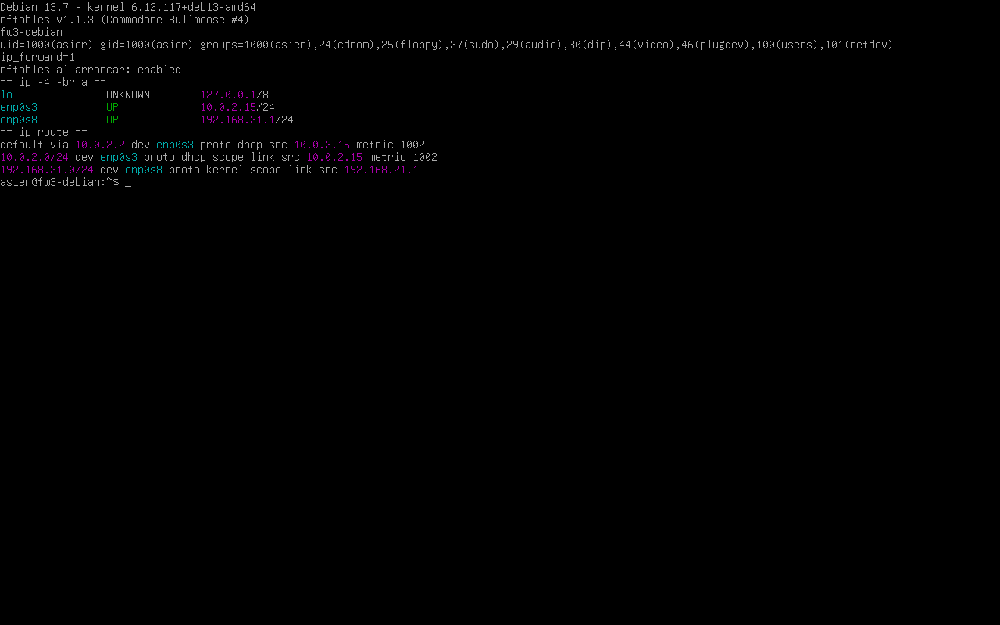

Demuestra:
- Es **Debian 13.7**, kernel 6.12.117, con **nftables v1.1.3**. Ya es la 13.7 aunque la ISO fuera la 13.1, porque la netinst descarga los paquetes al día (`apt` dijo «0 upgraded»).
- El equipo se llama `fw3-debian` y `asier` está en el grupo `sudo`.
- `ip_forward=1` y nftables arranca solo (`enabled`).
- **WAN** `enp0s3` = 10.0.2.15/24 (DHCP) y **LAN** `enp0s8` = **192.168.21.1/24**.
- Hay **una sola ruta por defecto**, por la WAN (10.0.2.2).

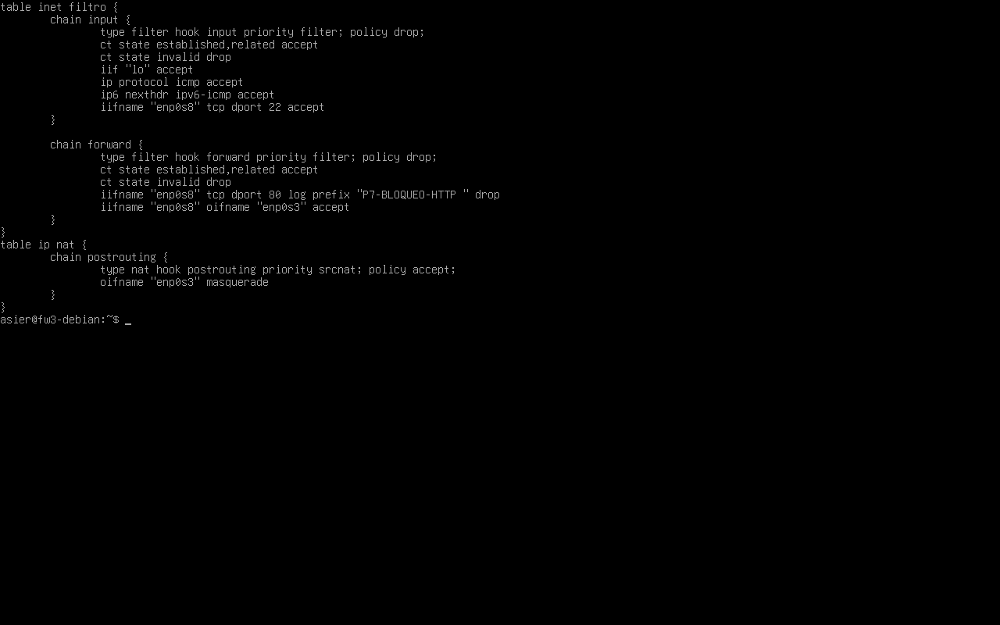

Demuestra: las reglas cargadas en el kernel (`nft list ruleset`) son las del fichero. Las dos cadenas de filtro tienen `policy drop` y la regla de bloqueo del puerto 80 está **antes** del `accept` LAN→WAN.

**Prueba permitida y bloqueada (desde Client-Linux, .60):**

Antes de probar: `ip neigh flush all` en Client-Linux. La .1 ahora es **otra máquina con otra MAC** (antes era OPNsense) y la caché ARP podía tener la vieja.

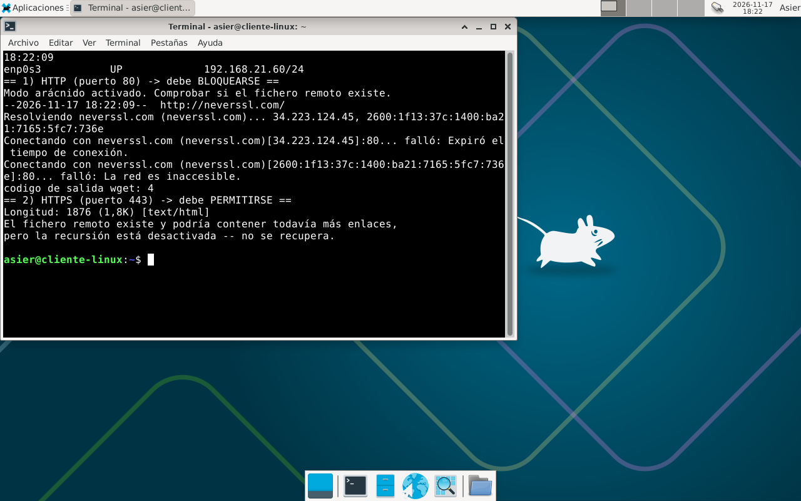

Demuestra:
- `wget --spider http://neverssl.com` (**puerto 80**) → «Expiró el tiempo de conexión», código 4: **bloqueado**. La regla hace `drop` (tira el paquete sin avisar), por eso el cliente espera hasta que se cansa en lugar de recibir un rechazo.
- `wget --spider https://deb.debian.org` (**puerto 443**) → el fichero existe: **permitido**.
- El DNS funciona (neverssl.com se resuelve) aunque FW3 no tiene servidor DNS, porque Client-Linux tiene **1.1.1.1 de DNS secundario** (decisión de diseño de [04-disseny](04-disseny.md)).

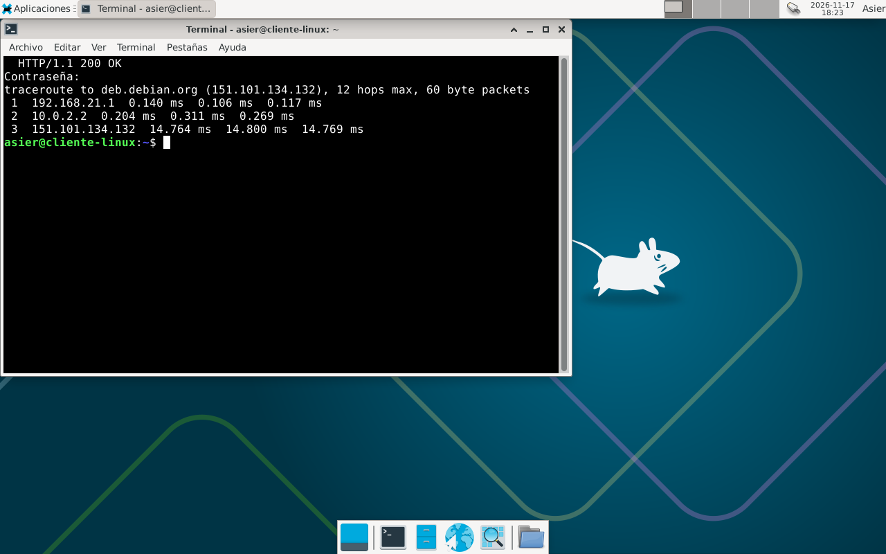

Demuestra: `HTTP/1.1 200 OK` por HTTPS, y el camino con `traceroute -T -p 443` (TCP al puerto 443, el mismo tipo de tráfico que se permite): **1)** 192.168.21.1 (FW3) → **2)** 10.0.2.2 (NAT de VirtualBox) → **3)** deb.debian.org. Solo salen 3 saltos porque el NAT de VirtualBox no es un router de verdad: abre él mismo la conexión hacia fuera, así que los routers de Internet no se ven.

**Registro del bloqueo** (`journalctl -k` en FW3; las MAC se ocultan con `sed`):

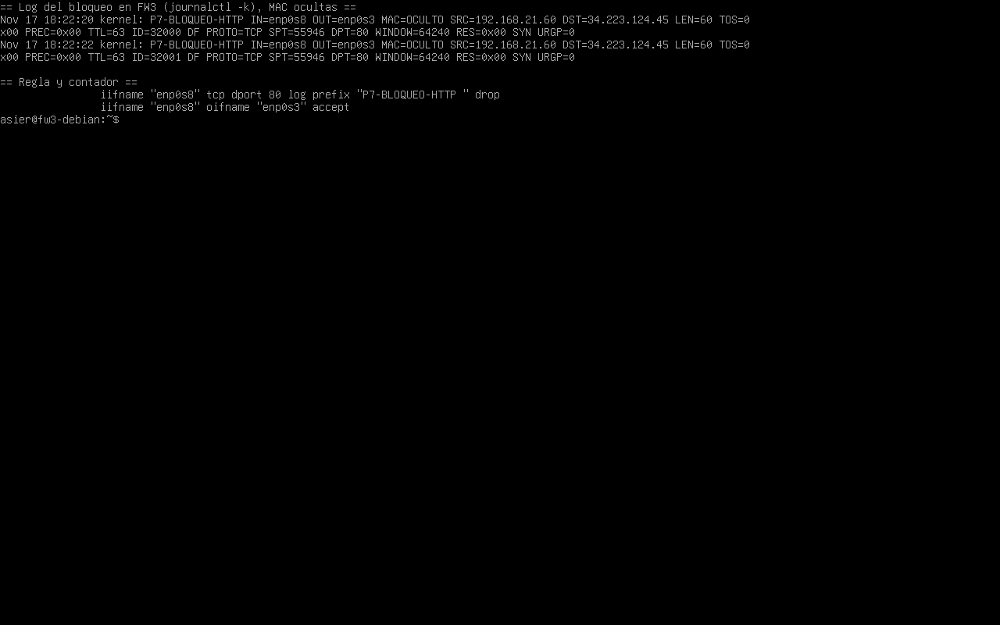

Demuestra: cada intento bloqueado deja una línea en el log del kernel con el prefijo de la regla. Cómo se lee:

| Campo | Valor | Qué significa |
|---|---|---|
| `P7-BLOQUEO-HTTP` | — | El prefijo que puse en la regla: dice **qué regla** ha actuado |
| `IN=enp0s8` | LAN | Por dónde **entró** el paquete al firewall |
| `OUT=enp0s3` | WAN | Por dónde **habría salido** si se hubiera dejado pasar (es tráfico de forward, LAN → Internet) |
| `MAC=` | [OCULTO] | MAC destino (la de FW3) + MAC origen (Client-Linux) + tipo `08:00` (IPv4) |
| `SRC=192.168.21.60` | Client-Linux | **Quién** lo intentó |
| `DST=34.223.124.45` | neverssl.com | **Adónde** quería ir |
| `PROTO=TCP` · `DPT=80` | HTTP | Protocolo y **puerto destino**: es lo que hace coincidir la regla |
| `SPT=55946` | — | Puerto origen, aleatorio del cliente. Es **el mismo en todas las líneas**: son reintentos de la **misma** conexión |
| `SYN` | — | Es el primer paquete de la conexión (el «¿hablamos?» de TCP). Se corta ahí, así que la conexión **ni siquiera empieza** |
| `TTL=63` | — | Salió del cliente con 64 y FW3 le restó 1 al enrutarlo: prueba de que el paquete **pasó por el router** antes de tirarse |
| `ID` 31998 → 32001 | — | Cada reintento es un paquete nuevo. Las horas (t=0, +1 s, +3 s, +5 s) muestran que TCP reintenta cada vez más espaciado |
| `LEN=60` · `WINDOW=64240` | — | Tamaño del paquete y ventana TCP; aquí no aportan nada |

**Instantánea:** `P7-fw3-base` (con la VM apagada).

**Qué respondería en la defensa:** lo tengo preparado en mis apuntes de defensa (ISO-RA1 · nftables).

## 4. TrueNAS — a224–a227, a259
> P9 (PC de casa). Servidor de copias de todo el laboratorio. Firewall activo: **FW2-OPNsense** (FW1 y FW3 apagados). Gestión desde el Firefox de Client-Linux.

**Predicción:** no indicada.

La instalación y la configuración se hicieron a mano en la WebUI. Las capturas se hicieron desde fuera (`VBoxManage screenshotpng`) y se comprobó cada una.

**Requisitos y origen:**
- TrueNAS Community Edition **25.10.7 «Goldeye»**, ISO oficial verificada ([03-sistemes](03-sistemes.md)). Mínimo oficial: **8 GB de RAM y 2 núcleos** → la VM tiene **8 GB y 2 vCPU** ([05-recursos](05-recursos.md)).
- **Dos discos:** **16 GB para el sistema** (TrueNAS ocupa el disco entero donde se instala y no deja guardar datos en él) y **20 GB para las copias** (a227).

**Instalación:**

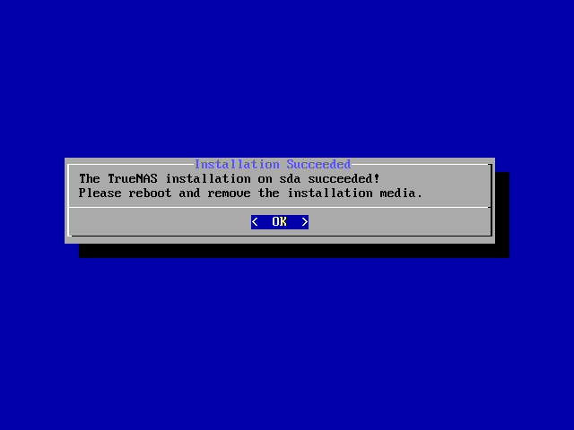

Demuestra: «The TrueNAS installation on **sda** succeeded»: el sistema está en el disco de 16 GB y el de 20 GB queda libre para el pool. Usuario de administración creado en el instalador: **`truenas_admin`**. Después se quitó la ISO (`storageattach … emptydrive`).

**Red** (consola de TrueNAS: *1) Configure network interfaces* → `enp0s3`: DHCP no, IPv6 automática no, alias `192.168.21.20/24` → aplicar y hacerlo permanente · *2) Configure network settings* → hostname `nas-truenas`, puerta de enlace `192.168.21.1`, DNS `192.168.21.1` y `1.1.1.1`). Al principio la consola decía «The web interface could not be accessed», porque LAN_21 no tiene DHCP.

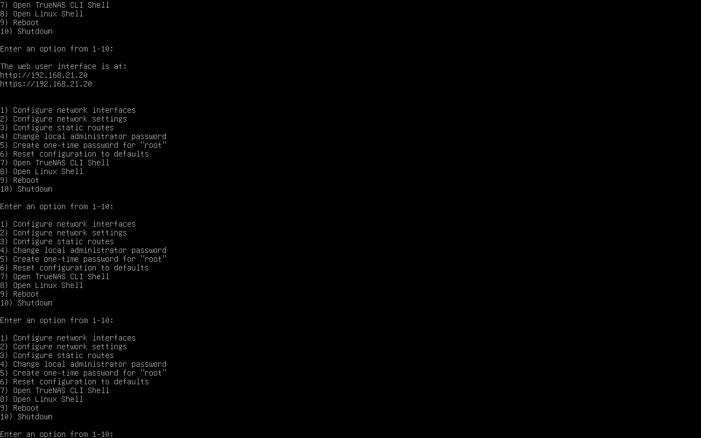

Demuestra: con la IP fija, la consola ya anuncia la WebUI en **http://192.168.21.20**.

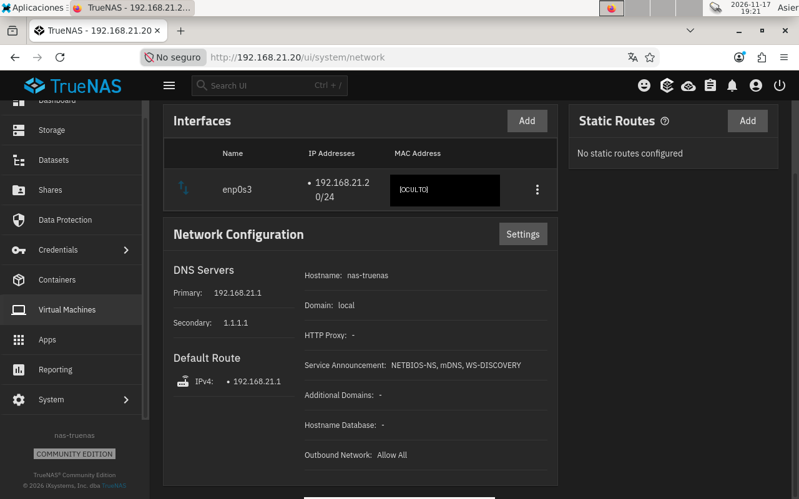

Demuestra: `enp0s3` = **192.168.21.20/24**, DNS **192.168.21.1** y **1.1.1.1**, ruta por defecto **192.168.21.1**, nombre **nas-truenas**. La MAC está tapada con `[OCULTO]`.

**Versión y funcionamiento:**

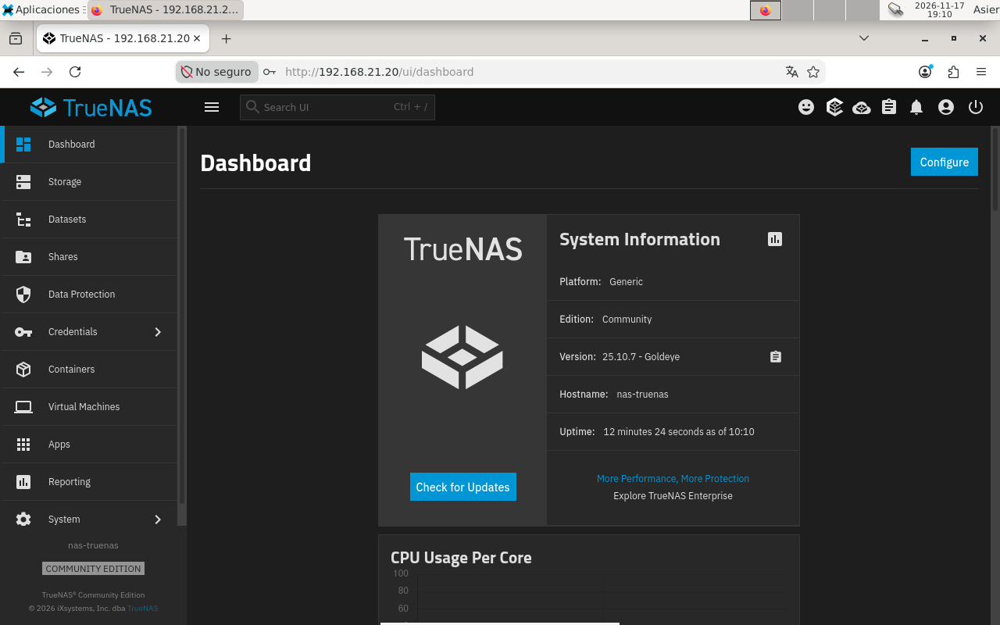

Demuestra: la WebUI responde desde Client-Linux (`http://192.168.21.20`), versión **25.10.7 - Goldeye**, edición **Community** y nombre de equipo `nas-truenas`. La hora estaba 9 horas atrasada porque TrueNAS viene con la zona horaria de EE. UU. → se cambió a **Europe/Madrid** (*Sistema → General → Localización*). La interfaz se puso en **español**.

**Usuarios de administración** (a225): `truenas_admin` (del instalador) y **`asier`** con rol **Full Admin** y acceso SMB:

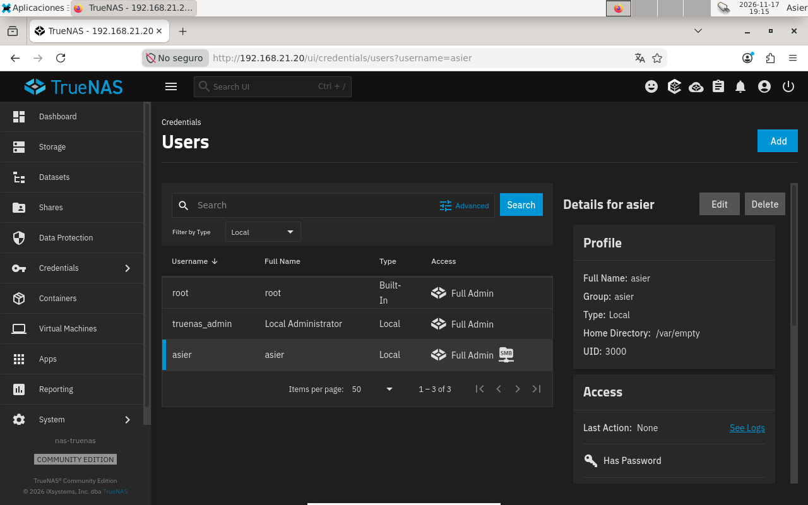

Demuestra: `asier` es **Full Admin**, tiene acceso **SMB** y «Has Password». **SSH desactivado a propósito**: TrueNAS exige una clave pública o permitir el login SSH con contraseña, y la regla del proyecto es **solo clave**. La clave se crea en Server-Monitorizacion en el P14, y entonces se activa (y se le da una carpeta personal, porque ahora es `/var/empty`).

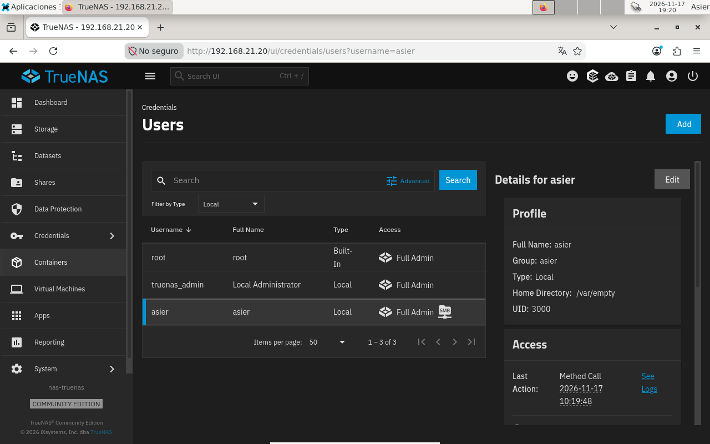

Demuestra que `asier` **entra**: *Last Action* pasa de «None» a la fecha y hora del login (en hora de EE. UU., 9 h menos que aquí), y en sus detalles ya no está el botón **Delete**, porque TrueNAS no deja que un usuario se borre a sí mismo. La sesión es la suya.

**Disco y espacio de copias** (a227, a259):

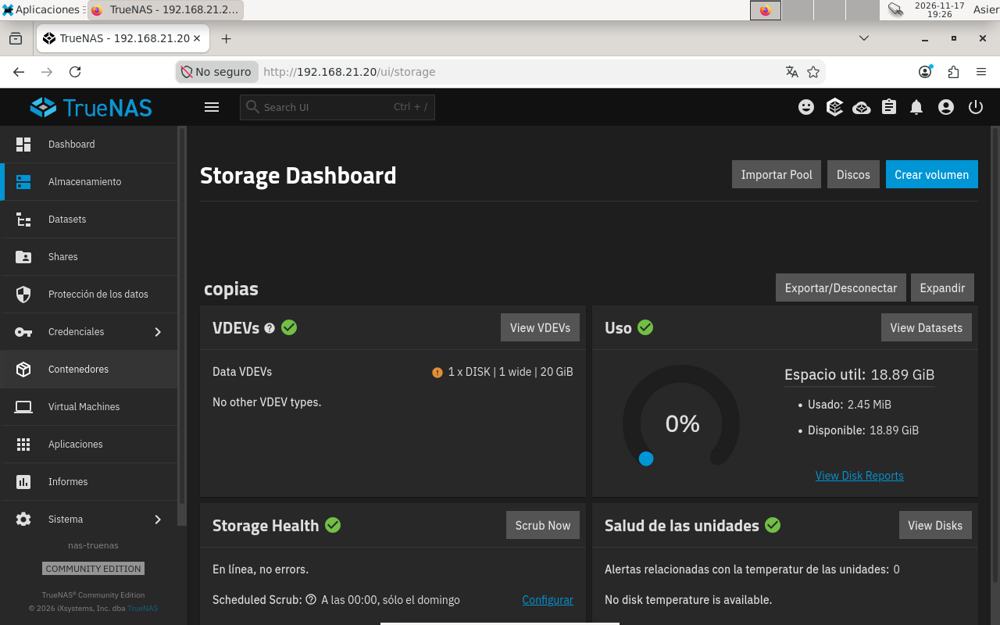

Demuestra: pool **`copias`** en el disco de **20 GiB**, *Stripe* de 1 disco (`1 x DISK | 1 wide`), **en línea y sin errores**, **18,89 GiB útiles** (ZFS reserva una parte para metadatos y un margen para no llenarse nunca al 100 %). El aviso naranja recuerda que **no hay redundancia**: es una decisión aceptada en el laboratorio, explicada en [09-copies-contingencia §1](09-copies-contingencia.md).

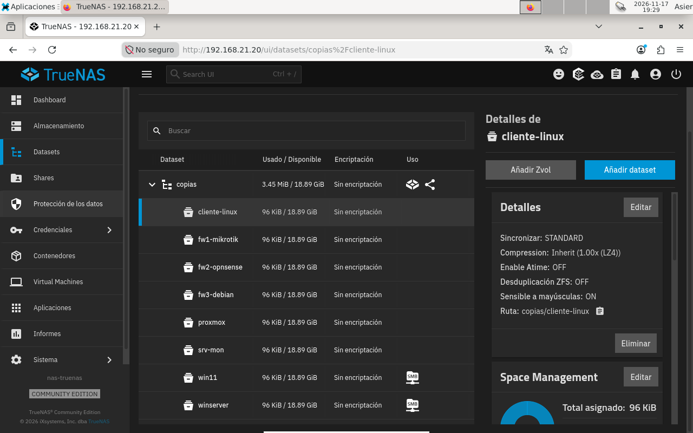

Demuestra: **un dataset por equipo** dentro de `copias`: `fw1-mikrotik`, `fw2-opnsense`, `fw3-debian`, `proxmox`, `srv-mon`, `cliente-linux` (preset *Generic*) y `winserver`, `win11` (preset *SMB*: permisos ACL y nombres sin distinguir mayúsculas, como Windows). Todos heredan la compresión **LZ4**.

**Servicios** (solo los que hacen falta para las copias del P14):

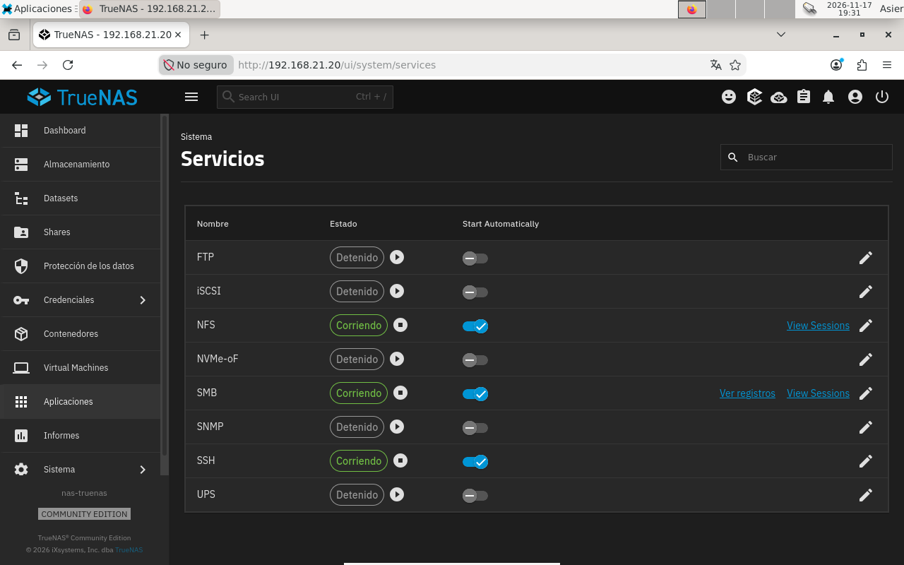

Demuestra: **NFS, SMB y SSH** «Corriendo» y con inicio automático; **FTP, iSCSI, NVMe-oF, SNMP y UPS** detenidos.
- **SMB** → Windows (WinServer y Win11): es su protocolo nativo de carpetas compartidas.
- **NFS** → Proxmox: lo admite directamente como almacenamiento para `vzdump`.
- **SSH** → Linux, OPNsense, MikroTik y el `cron` de Server-Monitorizacion: cifrado, con clave. La autenticación por contraseña está **desactivada**.
- **No FTP** (usuario y contraseña en texto claro) ni **iSCSI** (solo para el P19). Cada servicio parado es una puerta menos.

**Actualización** (a79, parte de TrueNAS):

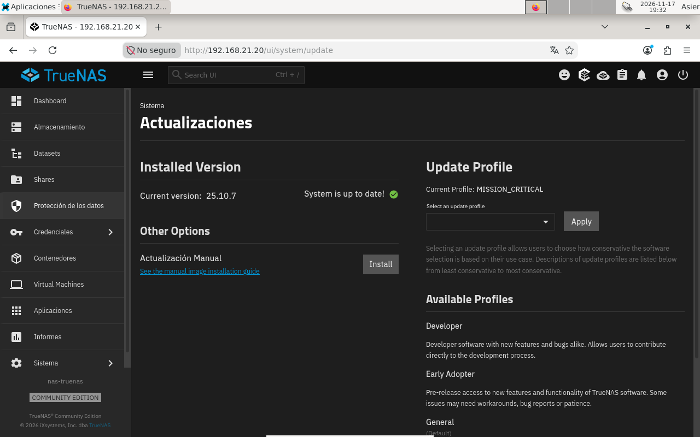

Demuestra: **antes 25.10.7 → después 25.10.7**, «System is up to date!». El perfil es **MISSION_CRITICAL**, el más conservador: solo ofrece versiones muy probadas, lo adecuado para un servidor de copias. **Corrección:** ese perfil escondía la 25.10.8; se pasó a GENERAL y se actualizó a **25.10.8** (§10, incidencia 22).

**Qué es copia, cómo y dónde (a259):** tabla completa en [09-copies-contingencia §1](09-copies-contingencia.md).

**Instantánea:** `P9-truenas-base` (con la VM apagada).

**Qué respondería en la defensa:** lo tengo preparado en mis apuntes de defensa (ISO-RA3 · TrueNAS).

## 5. Proxmox VE (clúster y migración) — a228–a232, a235, a236
> P11a (PC de casa): instalación de los 3 nodos. Se hace a mano en la ventana de cada VM y se comprueba con capturas. Firewall activo: **FW2-OPNsense** (HTTP permitido, apartado 2.2).

**Predicción:** no indicada.

**Datos de cada nodo** (los fija el plan de [04-disseny](04-disseny.md); el nombre y la IP **no se cambian** después de crear el clúster):

| VM | Nombre (FQDN) | IP/máscara | Puerta de enlace | DNS |
|---|---|---|---|---|
| Proxmox-Node1 | `pve1.thinklab.local` | 192.168.21.10/24 | 192.168.21.1 | 192.168.21.1 |
| Proxmox-Node2 | `pve2.thinklab.local` | 192.168.21.11/24 | 192.168.21.1 | 192.168.21.1 |
| Proxmox-Node3 | `pve3.thinklab.local` | 192.168.21.12/24 | 192.168.21.1 | 192.168.21.1 |

Por qué FQDN: el instalador de Proxmox **exige** nombre + dominio. `thinklab.local` es un dominio interno que no existe en Internet, así que no choca con nada.

> **Cambio respecto al plan:** el plan decía `thinklab.lan`, pero en la instalación se puso `thinklab.local`, el que venía en la lista de pantallas del instalador. Se deja así porque es lo más simple: cambiarlo obligaría a editar `/etc/hosts` y el dominio de búsqueda en cada nodo, y tiene que hacerse antes del clúster. Matiz: `.local` está reservado para mDNS (RFC 6762). En LAN_21 no hay mDNS, así que no debería afectar. **N/C**: no lo he comprobado en la práctica. Lo confirmaría `getent hosts pve1.thinklab.local` desde Client-Linux y ver si `avahi-daemon` está activo (`systemctl is-active avahi-daemon`).

#### 5.1 Instalación de los 3 nodos (PC de clase)
Los tres nodos se instalaron a mano: ext4 en `/dev/sda` (no ZFS, porque con 3 GB de RAM no da), zona Europe/Madrid, teclado español y la red fija de la tabla de arriba. Después se sacó la ISO (unidad SATA 1 vacía, comprobado con `VBoxManage showvminfo`) y se reiniciaron desde el disco.


Demuestra: el instalador de Proxmox-Node1 termina bien y apunta a https://192.168.21.10:8006.


Demuestra: el instalador de Proxmox-Node2 termina bien (192.168.21.11).

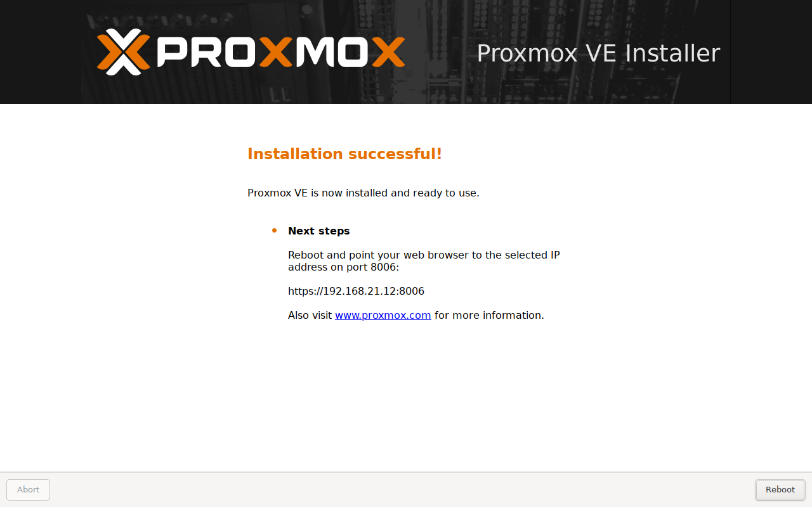
Demuestra: el instalador de Proxmox-Node3 termina bien y apunta a https://192.168.21.12:8006.


Demuestra: pve1 arranca desde el disco (ya sin ISO), llega al login y su WebUI está en 192.168.21.10:8006.


Demuestra: pve2 arranca desde el disco y su WebUI está en 192.168.21.11:8006.

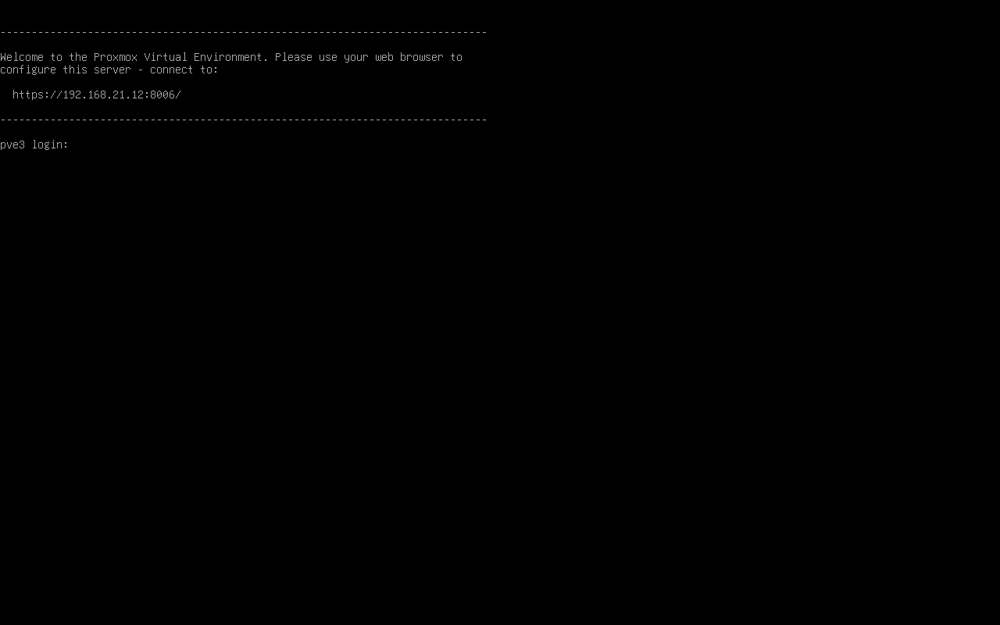
Demuestra: pve3 arranca desde el disco y su WebUI está en 192.168.21.12:8006.

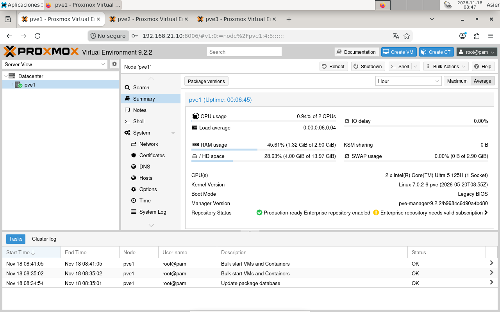
Demuestra: la WebUI de pve1 responde desde Client-Linux y la versión instalada es **Proxmox VE 9.2.2** (pve-manager/9.2.2, kernel 7.0.2-6-pve), con 2 vCPU y 2,9 GiB de RAM. También se ve que aún está activo el repositorio *enterprise* (necesita suscripción): se cambia en el paso siguiente.

**Repositorios (pve1 → Updates → Repositories).** Proxmox trae activado el repositorio *enterprise*, que sin suscripción de pago devuelve error 401 y no deja actualizar. Se desactiva y se añade el **no-subscription**: es gratuito y tiene los mismos paquetes, pero se publican antes, sin el periodo extra de pruebas del enterprise. Para un laboratorio vale; Proxmox lo desaconseja en producción. Cuidado: en la ventana **Add** el desplegable sale con «Enterprise» elegido. Si se pulsa Add sin cambiarlo, se vuelve a activar el enterprise (nos pasó la primera vez).

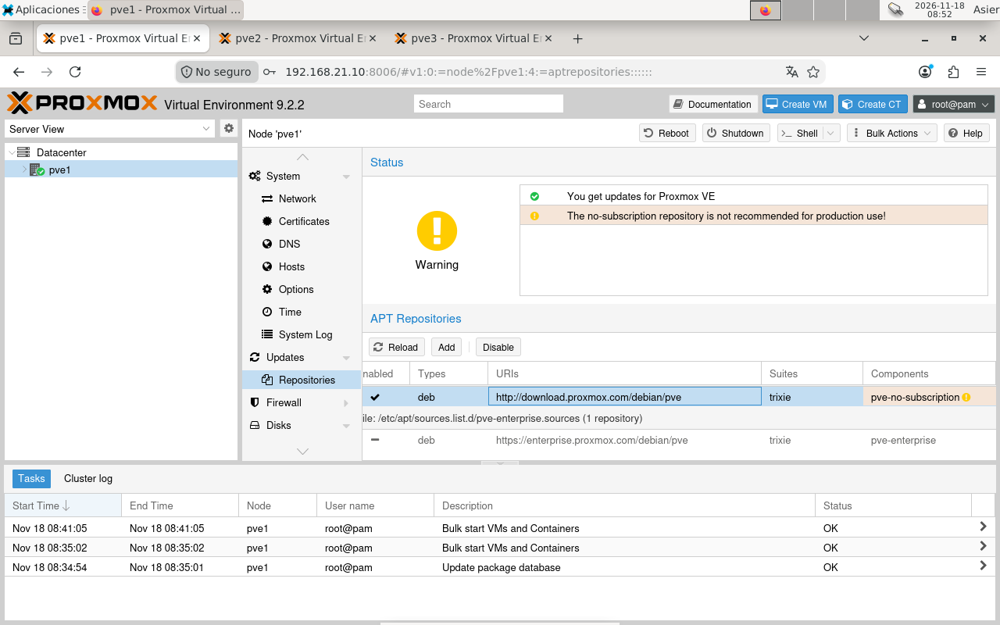
Demuestra: en pve1 el repositorio `pve-no-subscription` está activado (✔), `pve-enterprise` está desactivado (–) y Proxmox confirma «You get updates for Proxmox VE».

**Red y DNS (pve1 → System → DNS).** El instalador solo deja poner un DNS, así que el secundario `1.1.1.1` se añade aquí. Así el nodo resuelve nombres aunque el firewall activo sea FW3-Debian-NFT, que no tiene DNS.

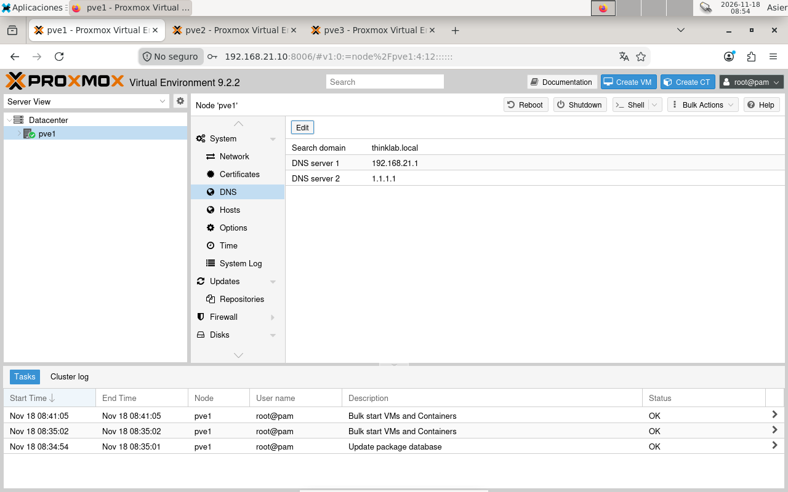
Demuestra: pve1 tiene el dominio de búsqueda `thinklab.local`, el DNS 1 `192.168.21.1` (firewall) y el DNS 2 `1.1.1.1`. La IP fija 192.168.21.10/24 se ve en la captura del primer arranque.

#### 5.2 pve1 terminado (WebUI desde Client-Linux)
Todo por la **WebUI** (regla del proyecto: Proxmox se configura por GUI), desde Firefox de Client-Linux: repositorios, DNS, Upgrade, usuario y permisos.

| Qué | Antes | Después |
|---|---|---|
| Versión (pve-manager) | 9.2.2 | **9.2.28** |
| Kernel | 7.0.2-6-pve | **7.0.14-29-pve** (después de reiniciar) |
| Paquetes pendientes | 212 | 0 |

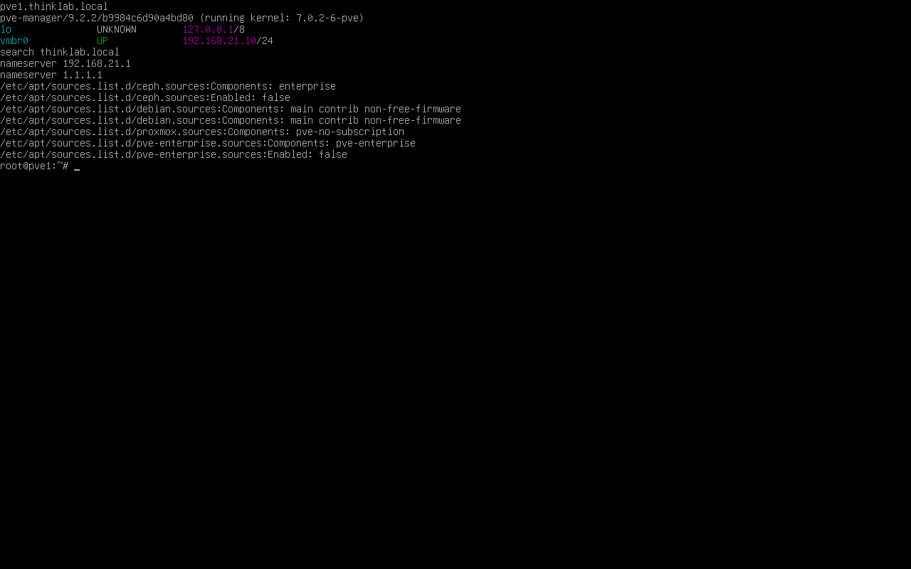
Demuestra (consola de pve1, antes del upgrade): nombre `pve1.thinklab.local`, 9.2.2, IP 192.168.21.10/24 en `vmbr0`, DNS 192.168.21.1 + 1.1.1.1, enterprise de pve y ceph con `Enabled: false` y `pve-no-subscription` activo.

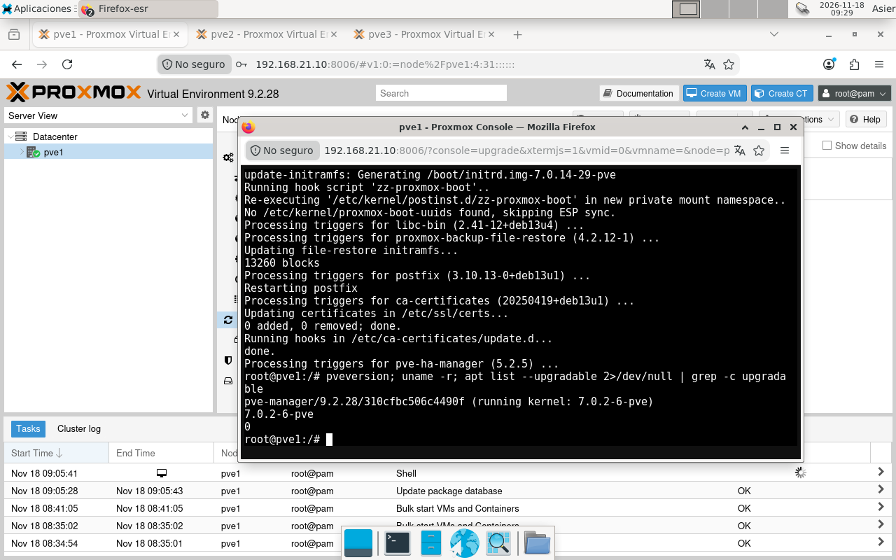
Demuestra: el Upgrade de la WebUI acaba sin errores, `pveversion` da 9.2.28 y quedan **0** paquetes por actualizar. Todavía corre el kernel antiguo, así que hay que reiniciar.

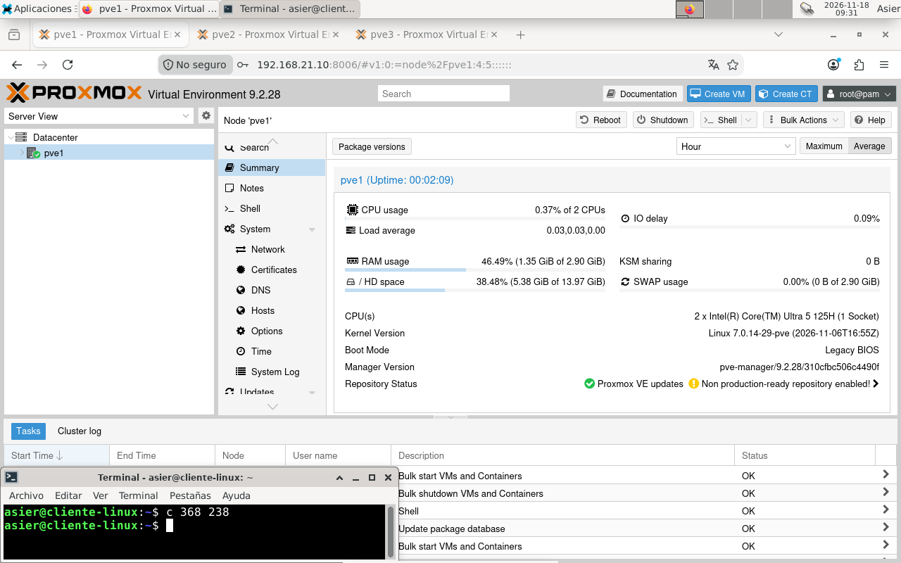
Demuestra: después del reinicio (uptime 2 min) pve1 arranca con el kernel **7.0.14-29-pve** y la WebUI dice 9.2.28, con el repositorio de actualizaciones correcto («Proxmox VE updates»).

**Usuario de administración `asier@pve`** (Datacenter → Permissions → Users → Add, realm *Proxmox VE authentication server*; Permissions → Add → User Permission: `/`, `asier@pve`, `Administrator`, Propagate). Solo se crea en pve1: al montar el clúster (P11b), la configuración de `/etc/pve` (usuarios y permisos) es la misma en todos los nodos.

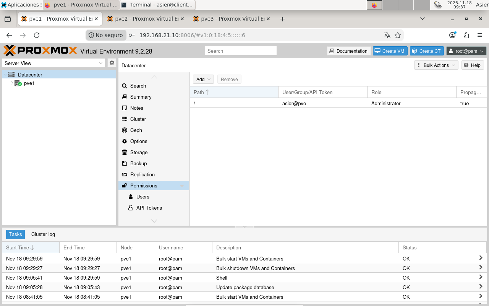
Demuestra: `asier@pve` tiene el rol **Administrator** en `/` (todo el Datacenter) con herencia (*Propagate* = true).

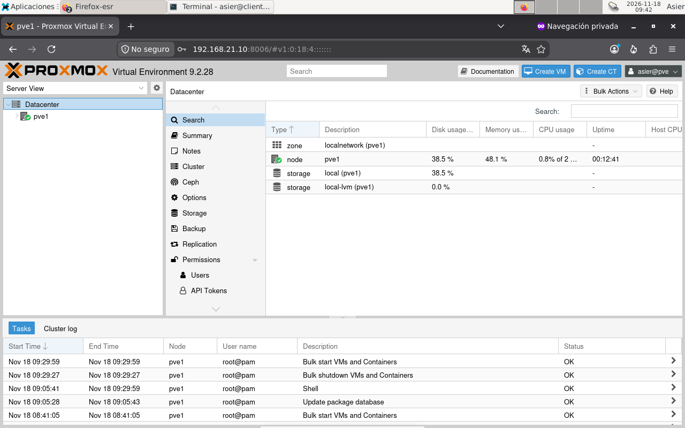
Demuestra: `asier@pve` entra en la WebUI (arriba a la derecha) y ve el Datacenter y el nodo pve1.

> Privacidad: el usuario `root@pam` tiene como email el del alumno (se puso en el instalador). No sale en ninguna evidencia publicada.

> Script `configs/proxmox/p11a-nodo.sh`: se preparó cuando el plan era hacerlo por consola. Hace lo mismo que estos pasos de la WebUI y se puede ejecutar dos veces sin duplicar nada. Se queda en el repo **como referencia**, pero no es lo que se usó para configurar los nodos.

#### 5.3 pve2 terminado (WebUI desde Client-Linux)
Mismos pasos que en pve1, en este orden: DNS → repositorios → Refresh → Upgrade → reinicio. Sin usuario `asier@pve`, porque llegará con el clúster.

| Qué | Antes | Después |
|---|---|---|
| Versión (pve-manager) | 9.2.2 | **9.2.28** |
| Kernel | 7.0.2-6-pve | **7.0.14-29-pve** (después de reiniciar) |
| Paquetes pendientes | 214 | 0 |


Demuestra (consola de pve2, antes de tocar nada): `pve2.thinklab.local`, 9.2.2, IP 192.168.21.11/24 en `vmbr0`, un solo DNS (192.168.21.1) y solo los repositorios *enterprise* de Proxmox (sin `Enabled: false`).

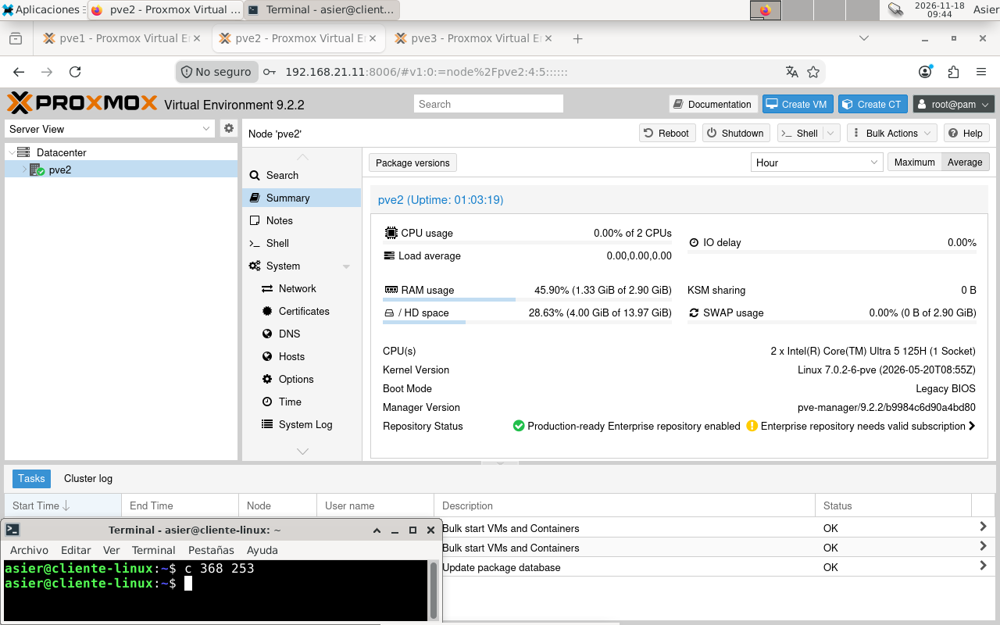
Demuestra: en la WebUI, pve2 tiene 9.2.2 con el kernel 7.0.2-6 y el repositorio *enterprise* activo, sin suscripción.

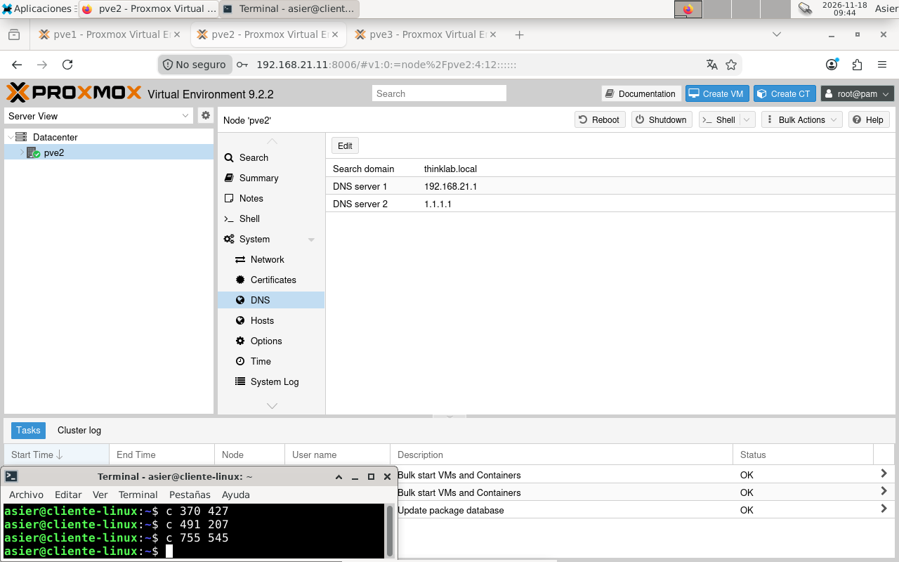
Demuestra: pve2 tiene el dominio de búsqueda `thinklab.local`, el DNS 1 192.168.21.1 y el DNS 2 1.1.1.1.


Demuestra: `ceph.sources` y `pve-enterprise.sources` con «Enabled: false» (–), `proxmox.sources` con `pve-no-subscription` activo (✔) y «You get updates for Proxmox VE».


Demuestra: «Your System is up-to-date», `pveversion` da 9.2.28, quedan 0 pendientes y Proxmox avisa de que hay que reiniciar por el kernel nuevo.


Demuestra: después del reinicio (uptime 1 min), pve2 arranca con el kernel 7.0.14-29-pve y pve-manager 9.2.28. La cabecera aún dice 9.2.2 porque la página no se había recargado.

#### 5.4 pve3 terminado (WebUI desde Client-Linux)
Mismos pasos y mismo resultado que en pve2.

| Qué | Antes | Después |
|---|---|---|
| Versión (pve-manager) | 9.2.2 | **9.2.28** |
| Kernel | 7.0.2-6-pve | **7.0.14-29-pve** (después de reiniciar) |
| Paquetes pendientes | 214 | 0 |


Demuestra (consola de pve3, antes de tocar nada): `pve3.thinklab.local`, 9.2.2, IP 192.168.21.12/24 en `vmbr0`, un solo DNS y solo los repositorios *enterprise* de Proxmox.


Demuestra: antes del upgrade, en la WebUI, 9.2.2 con el kernel 7.0.2-6 y el repositorio *enterprise* activo.


Demuestra: `thinklab.local`, DNS 1 192.168.21.1 y DNS 2 1.1.1.1.


Demuestra: enterprise de ceph y pve desactivados, `pve-no-subscription` activo y «You get updates for Proxmox VE».


Demuestra: «Your System is up-to-date», 9.2.28 y 0 pendientes. Todavía corre el kernel antiguo, por eso se reinicia.


Demuestra: después del reinicio, otro Upgrade da «0 upgraded» y corre el kernel **7.0.14-29-pve**. Esta consola se abrió por un clic equivocado en el botón Upgrade; no cambió nada y sirvió de comprobación.


Demuestra: Summary de pve3 con uptime de 2 min, kernel 7.0.14-29-pve y pve-manager 9.2.28.

#### 5.5 Resumen del P11a
Los 3 nodos tienen la **misma versión (9.2.28) y el mismo kernel (7.0.14-29)**, que es lo que conviene antes de unirlos en clúster. También tienen el repositorio no-subscription, DNS 192.168.21.1 + 1.1.1.1, IP fija en `vmbr0` (.10/.11/.12) y nombre `pveN.thinklab.local`. El usuario de administración `asier@pve` (Administrator en `/`) está en pve1 y pasará a los otros nodos con el clúster (P11b).

**Rúbrica:** a228 (instalado, versión comprobada y funciona), a229 (usuario de administración) y a230 (red de las interfaces: `vmbr0` con IP fija, puerta de enlace y DNS).

#### 5.6 P11b · Guía del clúster (en la WebUI, desde el Firefox de Client-Linux)
**Predicción:** no indicada.

Antes de empezar: los 3 nodos encendidos, FW2-OPNsense de firewall y **ninguna VM ni contenedor creados**. Un nodo con *guests* no se puede unir a un clúster.

1. **Crear el clúster en pve1.** Pestaña pve1 (`https://192.168.21.10:8006`, `root` · Linux PAM) → **Datacenter → Cluster → Create Cluster**.
   - *Cluster Name:* `thinklab` (sin espacios, máximo 15 caracteres; después **no se puede cambiar**).
   - *Cluster Network → Link 0:* `192.168.21.10`.
   - **Create** → espera a que salga **TASK OK** y cierra.
   📸 CAPTURA: la ventana de la tarea con TASK OK.
2. **Copiar los datos de unión.** En pve1: **Datacenter → Cluster → Join Information → Copy Information**. Así se copia un texto largo con la IP, la huella del certificado y la clave.
3. **Unir pve2.** Pestaña pve2 (`https://192.168.21.11:8006`, `root` · Linux PAM) → **Datacenter → Cluster → Join Cluster**.
   - Pega el texto en *Information* (Ctrl+V).
   - *Password:* la contraseña de **root de pve1** (ver CREDENCIALES-PRIVADAS.md).
   - *Cluster Network → Link 0:* `192.168.21.11`.
   - **Join 'thinklab'**. Al final la página pierde la conexión, porque el nodo cambia de certificado: es normal. Recarga con F5 y vuelve a entrar.
   📸 CAPTURA: la tarea de unión acabada (o el aviso de que hay que recargar).
4. **Unir pve3**, igual que pve2, desde `https://192.168.21.12:8006` y con *Link 0* `192.168.21.12`. Espera a que pve2 haya acabado: los nodos se unen **de uno en uno**.
5. **Comprobar.**
   - En pve1: **Datacenter → Summary** tiene que decir *Nodes: 3 online*, y en **Datacenter → Cluster** tienen que salir pve1, pve2 y pve3.
   📸 CAPTURA: Datacenter → Summary con los 3 nodos en verde.
   - En pve1: **pve1 → Shell** → `pvecm status`. Tienen que salir *Quorate: Yes* y *Expected votes / Total votes: 3*.
   📸 CAPTURA: la salida de `pvecm status`.
   - En una ventana privada, entra en **pve2** con `asier` · realm *Proxmox VE authentication server*. Si entra, el usuario creado en pve1 se ha compartido por el clúster.
   📸 CAPTURA: pve2 con `asier@pve` arriba a la derecha y los 3 nodos a la izquierda.

**Si algo falla:**
- *«corosync: … already exists»* o la unión se queda a medias: **no reintentes**. Para y avisa. Se vuelve a la instantánea `P11a-pveN-base` de ese nodo.
- *Permission denied* al unir: la contraseña es la de root de **pve1**, no la del nodo que se une.
- Las horas de los nodos tienen que coincidir. Proxmox trae `chrony`, que las sincroniza solo, así que no hay que tocar nada.

#### 5.7 P11b · Resultado (en la WebUI, unos 12 min)
Se siguió la guía de 5.6 sin incidencias: creó el clúster `thinklab` en pve1 y unió pve2 y pve3, de uno en uno.


Demuestra: *Create Cluster* genera la clave de corosync (`/etc/corosync/authkey`), escribe `/etc/pve/corosync.conf` y acaba en TASK OK.


Demuestra: pve2 se autentica contra pve1 (192.168.21.10), «Join request OK» y reinicia `pve-cluster`. El «401» de detrás es normal: el nodo cambia de certificado durante la unión.


Demuestra: lo mismo para pve3 (enlace del clúster por 192.168.21.12).


Demuestra: *Cluster: thinklab, Quorate: Yes*, **3 nodos online y 0 offline** (ID 1/2/3, IPs .10/.11/.12) y los recursos sumados (6 CPU y 8,7 GiB de RAM). En Tasks: Create Cluster, Join Cluster de pve2 y de pve3, todos OK.


Demuestra: `pvecm status` en pve1 da Transport `knet`, Secure auth `on`, **Expected votes 3 / Total votes 3 / Quorum 2 / Quorate Yes** y los 3 miembros con sus IPs.


Demuestra: `asier@pve`, creado **solo en pve1**, entra en la WebUI de **pve2** y ve los 3 nodos. La configuración de `/etc/pve` (usuarios y permisos) se comparte por el clúster.

**Quórum explicado:** con 3 votos, el clúster necesita **2** (más de la mitad) para seguir funcionando. Si se apaga 1 nodo, quedan 2 votos y sigue *Quorate*. Si se apagan 2, el que queda se bloquea en solo lectura (no deja arrancar ni cambiar VMs), para que dos partes separadas no tomen decisiones distintas (*split-brain*). **N/C**, prueba que lo confirmaría: apagar pve3 → `pvecm status` (Total votes 2, Quorate Yes) → apagar pve2 → Quorate No.

**Instantánea `P11b-cluster`**: los 3 nodos apagados a la vez con ACPI (15 s), una instantánea de cada uno y vueltos a encender. **Se restauran los 3 juntos**: si solo se vuelve atrás uno, su configuración del clúster no cuadraría con la de los otros.


Demuestra: después de apagar y encender los 3 nodos, el clúster vuelve solo: *Cluster: thinklab, Quorate: Yes*, 3 online. Lo comprueba `asier@pve` desde pve2.

**Rúbrica:** a232.

#### 5.8 P11c · Guía: VM y contenedor + migración (en la WebUI, desde Client-Linux)
**Predicción:** «los dos tardarán parecido, porque lo que más tarda es copiar el disco por la red y los dos discos son pequeños».

Plan: **VM 150** (Debian 13 sin escritorio, 192.168.21.150) y **contenedor 151** (Debian 13, 192.168.21.151) en **pve1**, con almacenamiento **local** (`local-lvm`). Después, **migración offline** (apagados) de la VM a pve2 y del contenedor a pve3, midiendo **tiempo** y **espacio**. El ID es igual que el final de la IP, para reconocerlos enseguida.

**A. Bajar la ISO y la plantilla (en pve1)**
1. **pve1 → local (pve1) → ISO Images → Download from URL.**
   - URL: `https://cdimage.debian.org/cdimage/archive/13.1.0/amd64/iso-cd/debian-13.1.0-amd64-netinst.iso` → **Query URL**.
   - Marca **Advanced → Hash algorithm: SHA-256** y pega el hash que ya verificamos en [03-sistemes](03-sistemes.md) (`658b28e2…65568b3`, completo allí).
   - **Download** → TASK OK. Proxmox comprueba el hash solo: si no coincidiera, borraría el fichero.
   📸 CAPTURA: la tarea con el hash comprobado y TASK OK.
2. **pve1 → local (pve1) → CT Templates → Templates** → busca `debian-13-standard` → **Download** → TASK OK.

**B. Crear la VM 150 (botón *Create VM*, arriba a la derecha)**
- *General:* Node `pve1`, VM ID `150`, Name `vm150-debian`.
- *OS:* ISO `debian-13.1.0-amd64-netinst.iso`, tipo Linux.
- *System:* lo que viene por defecto.
- *Disks:* `local-lvm`, **8 GB** (lo justo para Debian sin escritorio, y así la migración copia menos).
- *CPU:* 1 socket, **1 core**.
- *Memory:* **768 MB** (cada nodo tiene 2,9 GiB y Proxmox ya usa 1,4).
- *Network:* `vmbr0`, modelo VirtIO.
- **Finish** → selecciona la VM 150 → **Start** → **Console**. Instala Debian como el P10, sin escritorio:
  - Instalación de texto (*Install*).
  - Red manual: IP `192.168.21.150/24`, puerta de enlace `192.168.21.1`, DNS `192.168.21.1 1.1.1.1`, nombre `vm150`, dominio `thinklab.local`.
  - **Contraseña de root vacía** (root queda bloqueado y `asier` entra en el grupo `sudo`, igual que en Server-Monitorizacion; FW3, en cambio, sí tiene contraseña de root). Usuario `asier` con la contraseña del laboratorio (ver CREDENCIALES-PRIVADAS.md).
  - Réplica en red: **No** («continuar sin réplica en red»).
  - En «Selección de programas»: **nada extra**; solo «Utilidades estándar del sistema» (**desmarca** el escritorio).
  - Si no arranca por «KVM virtualisation configured, but not available», avisa (es la virtualización anidada): se arregla en *Options*.
   📸 CAPTURA: la consola de la VM 150 con el login y `ip -4 -br a` dando .150.

**Criterios decididos para la VM 150:**
| Criterio | Decisión | Por qué |
|---|---|---|
| Nombre | En Proxmox `vm150-debian`; *hostname* dentro de Debian `vm150` | En Proxmox el nombre dice qué SO lleva; dentro, corto como el resto de equipos. El número une los dos (ID 150 = IP .150) |
| root | **Sin contraseña**: root bloqueado y `asier` con `sudo` | Igual que en Server-Monitorizacion (FW3, en cambio, sí tiene contraseña de root): se administra con `sudo` (queda registrado quién hace qué) y no hay una cuenta root con contraseña que atacar |
| Réplica en red | **No**: solo el sistema base del netinst, sin programas extra | No depende de HTTP (en el aula va a ~100–200 kB/s, incidencia 16) y tarda menos. Además, un disco más pequeño hace que la migración copie menos |

**C. Crear el contenedor 151 (botón *Create CT*)**
- *General:* Node `pve1`, CT ID `151`, Hostname `ct151`, contraseña de root del laboratorio. **Unprivileged** marcado.
- *Template:* `debian-13-standard`.
- *Disks:* `local-lvm`, **4 GB**.
- *CPU:* 1 core. *Memory:* **256 MB**, swap 256 MB.
- *Network:* `eth0`, `vmbr0`, IPv4 **Static** `192.168.21.151/24`, Gateway `192.168.21.1`.
- *DNS:* usar los del host.
- **Finish** → **Start** → **Console** → entra como root → `ip -4 -br a` y `ping -c 2 192.168.21.1`.
   📸 CAPTURA: la consola del CT con la IP .151 y el ping bien.

**D. Antes de migrar, apunta el espacio**
- **pve1 → local-lvm (pve1) → Summary**: uso (GB y %). Haz lo mismo en **pve2** y **pve3**.
- **VM 150 → Hardware** y **CT 151 → Resources**: el tamaño del disco.
   📸 CAPTURA: local-lvm de pve1 antes.

**E. Migrar la VM 150 a pve2 (offline)**
1. VM 150 → **Shutdown** → espera a que salga *stopped*.
2. **Migrate** → Target node `pve2` → **Migrate**.
3. La tarea dice los **bytes copiados**, el **tiempo** y la velocidad. En *Tasks* salen *Start Time* y *End Time*.
   📸 CAPTURA: el log de la migración con el final (TASK OK, tamaño y tiempo).
4. Start de la VM en **pve2** → Console → login → `ip -4 -br a` (sigue en .150) → `ping -c 2 192.168.21.1`.
   📸 CAPTURA: la VM ya en pve2, funcionando.

**F. Migrar el contenedor 151 a pve3 (offline)**
1. CT 151 → **Shutdown** → **Migrate** → Target `pve3` → **Migrate**.
   📸 CAPTURA: el log con el final (tiempo y tamaño).
2. Start en **pve3** → Console → `ip -4 -br a` + ping.
   📸 CAPTURA: el CT en pve3, funcionando.

**G. Después: el espacio otra vez**
- local-lvm de **pve1** (tiene que haber bajado), de **pve2** y de **pve3** (tienen que haber subido).
   📸 CAPTURA: local-lvm de pve2 después.

#### 5.9 P11c · Resultados
**A. ISO y plantilla (en pve1, como `asier@pve`)**


Demuestra: Proxmox descarga `debian-13.1.0-amd64-netinst.iso` (783 MiB, unos 4 min, 3,16 MB/s por HTTPS), comprueba el SHA-256 oficial («checksum verified») y acaba en TASK OK. La tarea la hace `asier@pve`, no root.


Demuestra: la plantilla `debian-13-standard_13.1-2` (124 MB) se descarga, Proxmox comprueba su checksum y acaba en TASK OK. Tardó **16 min 36 s (127 kB/s)**, frente a los 3,16 MB/s de la ISO (incidencia 16). Se ve otra tarea parada a propósito («received interrupt»).

**B. VM 150 reinstalada (por la consola noVNC)**
- Con 768 MiB el instalador entra en *low memory mode* y va **en inglés** (incidencia 18). Se elige país **Spain**, teclado **Spanish** y zona **Madrid**.
- La primera vez no arrancó el ISO («Booting from Hard Disk...», incidencia 17). Se puso `ide2` el primero en *Boot Order*. Al acabar se quitó el ISO (*CD/DVD → Do not use any media*), así que arranca del disco aunque `ide2` siga el primero.
- Criterios aplicados: red manual `192.168.21.150/24` · gw `.1` · DNS `192.168.21.1 1.1.1.1`, *hostname* `vm150`, dominio `thinklab.local`, **root sin contraseña**, usuario `asier`, guiado en una partición (ext4 8,1 GB + swap 503 MB), **sin réplica en red** («Continue without a network mirror? Yes») y solo «standard system utilities» (sin réplica es lo único que ofrece). GRUB en `/dev/sda`.
- Tiempo: unos **22 min** desde el menú «Install» hasta el login (en el P10, sin anidar, fue menos: aquí Debian corre dentro de Proxmox, que corre dentro de VirtualBox).


Demuestra: la VM 150 arranca del disco con el nombre `vm150`. `ens18` tiene **192.168.21.150/24** y la ruta por defecto va por .1. El ping a la puerta de enlace da **0 % de pérdida**. `asier` está en el grupo **27(sudo)** y `sudo passwd -S root` da **`root L`**: root está **bloqueado** (sin contraseña), como se decidió.

**C. CT 151 (por la WebUI)**


Demuestra: el resumen antes de *Finish*: `vmid 151`, `hostname ct151`, `unprivileged 1`, 1 core, 256 MiB de RAM y 256 MiB de swap, `rootfs local-lvm:4` (4 GiB), plantilla `debian-13-standard_13.1-2`, `net0` en `vmbr0` con `192.168.21.151/24` y gw `.1`, en el nodo pve1.


Demuestra: el CT se crea en **7 s** y arranca en **~1 s**. Dentro, `ct151` tiene `eth0` con **192.168.21.151/24**, ruta por .1, ping a la puerta de enlace con 0 % de pérdida y `/` de 3,9 G (570 M usados).

**D. Espacio antes** (`local-lvm`, *Summary* de cada nodo)


Demuestra: `local-lvm` de pve1 con **2,24 GB usados de 13,20 GB (16,98 %)**: los discos de la VM 150 y del CT 151. Las de pve2 ([antes](../evidencias/tasca5/proxmox-p11c-espacio-pve2-antes.png)) y pve3 ([antes](../evidencias/tasca5/proxmox-p11c-espacio-pve3-antes.png)) dan **0 B de 13,20 GB**.

**E. Migración offline de la VM 150 a pve2**


Demuestra: *VM 150 - Migrate (pve1 → pve2)*: crea el volumen en pve2, copia **8 589 934 592 bytes (8,6 GB / 8,0 GiB) en 36,3 s (237 MB/s)**, borra el disco de pve1 y acaba con «migration finished successfully (duration 00:00:40)», TASK OK.


Demuestra: la VM 150 arranca en el nodo **pve2** (tarea *VM 150 - Start* en pve2) y sigue con 192.168.21.150/24 y ping a .1 bien. Por fuera ha cambiado de nodo y por dentro nada.

**F. Migración offline del CT 151 a pve3**


Demuestra: *CT 151 - Migrate (pve1 → pve3)*: copia **4 294 967 296 bytes (4,3 GB / 4,0 GiB) en 17,4 s (247 MB/s)** y acaba con «duration 00:00:22», TASK OK.


Demuestra: el CT 151 arranca en **pve3** (*CT 151 - Start* en pve3) con 192.168.21.151/24 y ping a .1 bien.

**G. Espacio después**


Demuestra: pve1 se queda en **0 B** (Proxmox borra el disco del origen al acabar). pve2 ([después](../evidencias/tasca5/proxmox-p11c-espacio-pve2-despues.png)) pasa a **1,40 GB (10,58 %)** y pve3 ([después](../evidencias/tasca5/proxmox-p11c-espacio-pve3-despues.png)) a **624,34 MB (4,73 %)**.

**Tabla de resultados (a236)**

| | VM 150 → pve2 | CT 151 → pve3 |
|---|---|---|
| Tamaño del disco (asignado) | 8 GiB | 4 GiB |
| Datos de verdad dentro | ~1,4 GB | ~0,6 GB |
| Bytes copiados por la red | 8,6 GB (todo el disco) | 4,3 GB (todo el disco) |
| Tiempo de copia / total | 36,3 s / **40 s** | 17,4 s / **22 s** |
| Velocidad media | 237 MB/s | 247 MB/s |
| Espacio en el destino después | 1,40 GB | 624 MB |
| Espacio en el origen después | 0 (se borra) | 0 (se borra) |
| Tiempo de arranque después | ~1 s la orden (Debian completo, unos 20 s) | ~1 s |

**Interpretación:**
- **Predicción** («tardarán parecido, porque lo que más tarda es copiar el disco y los dos son pequeños»): **acierta a medias**. Lo que manda es copiar el disco, sí, pero la VM tardó casi el **doble** (40 s frente a 22 s). La razón es que su disco asignado es el doble (8 GiB frente a 4 GiB). La velocidad fue casi igual (237 y 247 MB/s), así que **tiempo ≈ tamaño asignado ÷ velocidad**.
- **Se copia el disco entero, no solo lo usado:** la VM tenía ~1,4 GB de datos y se copiaron 8,6 GB. La migración con disco local copia el volumen bloque a bloque (`dd`), ceros incluidos. En el destino, LVM-Thin no guarda los bloques que son ceros, por eso ocupa 1,40 GB y no 8.
- **¿Por qué el CT es más ligero?** No lleva kernel propio ni swap dentro del disco y la plantilla ya viene instalada (570 MB). Además se le dio un disco más pequeño. Si los discos asignados fueran iguales, la diferencia de tiempo sería mucho menor (N/C; prueba: migrar un CT de 8 GiB y comparar).
- **¿Qué limita la velocidad?** Los ~240 MB/s (≈1,9 Gbit/s) salen de una red **virtual** entre VMs del mismo PC (VirtualBox, red interna), con el disco del anfitrión detrás. Con una red física de 1 Gbit/s, el máximo sería ~118 MB/s y la VM tardaría unos 75 s. **N/C** cuál de los dos (disco del anfitrión o CPU que cifra el SSH) es el cuello de botella. Prueba: `iperf3` entre nodos y `pveperf` en `local-lvm`.
- **Hay corte de servicio:** es *offline*, la VM estuvo parada ~2 min en total (apagar + migrar + arrancar).

**Mejoras posibles:**
1. **Almacenamiento compartido** (NFS en TrueNAS, P14): el disco no se mueve, solo la configuración, así que la migración baja a segundos.
2. **Migración en caliente** (*online*) con almacenamiento compartido: la VM no se apaga y el corte es de milisegundos.
3. **Discos ajustados** al uso real (o `qcow2`/thin con *discard*): menos bytes que copiar.
4. **Red de migración dedicada** y más rápida (Datacenter → Options → Migration settings), para no competir con el tráfico de los usuarios.

### Ventajas e inconvenientes de virtualizar servidores
### Contenedores vs máquinas virtuales: cuándo usar cada uno
### Migración: tiempo, espacio y posibles mejoras
## 6. Windows Server 2025 — a237–a241
> P12 (PC de clase). Escenario: **FW2-OPNsense + WinServer-2025**, nada más encendido.

**Predicción:** no indicada.

**Requisitos y origen:** ISO de evaluación `w2k25.iso` (26100.1742, es-ES, SHA-256 en [03-sistemes](03-sistemes.md)). VM: 2 vCPU, 4 GB, disco 50 GB en controlador **SATA**, EFI, 1 adaptador en LAN_21 (Intel PRO/1000 MT).

#### 6.1 Instalación desatendida (a237)
**Qué es `VBoxManage unattended install`:** VirtualBox genera un fichero de respuestas (`autounattend.xml`) con la edición, el idioma, el usuario, la contraseña y el nombre, y lo pone en la VM junto a la ISO. Windows lo lee y se instala solo. En las empresas se usa lo mismo (ficheros de respuestas, WDS/MDT, plantillas) para que instalar 1 o 100 servidores dé **siempre el mismo resultado**, sin errores de tecleo y sin un técnico delante.

- `VBoxManage unattended detect` lee la ISO: 4 imágenes. La elegida es la **n.º 2: «Windows Server 2025 Standard Evaluation (experiencia de escritorio)»** (la n.º 1 es Server Core, sin escritorio).
- Orden (la contraseña se pasa con `--password-file` desde un fichero temporal con permisos 600, no en la línea de comandos):
  `VBoxManage unattended install WinServer-2025 --iso=…/w2k25.iso --image-index=2 --user=asier --password-file=<fichero> --hostname=winserver-2025.thinklab.local --locale=es_ES --country=ES --language=es-ES --time-zone=Europe/Madrid --install-additions --start-vm=headless`
- El XML generado: `ComputerName winserver-2025` (14 caracteres; NetBIOS admite 15), `asier` en `administrators;users`, `TimeZone Romance Standard Time` (= Madrid), **pero `InputLocale en-US`** (incidencia 20).
- Incidencia 19: en EFI la ISO pide «Press any key to boot from CD»; sin pulsar nada no arrancaba. Con reset + Espacio, empezó la instalación.
- Tiempo: **~20 min** hasta el escritorio con sesión iniciada, sin tocar nada.
- Guest Additions 7.0.20 instaladas (nivel 3), pero **`guestcontrol` no responde** («guest execution service is not ready»), ni después de reiniciar. **N/C** si es una incompatibilidad de las GA 7.0.20 con la build 26100. Por eso todo lo demás se hizo **por teclado** en una ventana de PowerShell como administrador (UAC → Sí).


Demuestra: `winver` → **Windows Server 2025 Standard Evaluation, versión 24H2 (compilación 26100.1742)**, la de la ISO.

#### 6.2 Complejidad de contraseñas (prueba de una predicción)
Se predijo que Windows Server no aceptaría la contraseña del laboratorio sin mayúscula. Prueba: crear un usuario `prueba` con las dos contraseñas. Se escriben con `Read-Host -AsSecureString` (salen `*********` y no quedan en el historial).


Demuestra: con la contraseña **sin mayúscula**, `New-LocalUser` falla con **`InvalidPasswordException`**. Antes, `w32tm /resync` deja la hora bien.


Demuestra: la directiva local tiene **`PasswordComplexity = 1`** (`secedit /export`). Con la variante **con mayúscula** el usuario `prueba` se crea (Enabled True) y se borra enseguida. **Predicción confirmada:** la complejidad pide 3 de estos 4 tipos de carácter: mayúsculas, minúsculas, números y símbolos. «letras minúsculas + números» son solo 2.
GUI: `secpol.msc` → Directivas de cuenta → Directiva de contraseñas → «La contraseña debe cumplir los requisitos de complejidad».

#### 6.3 Usuarios de administración (a238)

Demuestra: `Get-LocalUser`: **Administrador** y **asier** habilitados (Invitado y las cuentas del sistema, deshabilitadas). `Get-LocalGroupMember Administradores`: los dos son miembros. `runas /user:Administrador` con su contraseña → `whoami` = **`winserver-2025\administrator`**: el Administrador integrado **entra**. `asier` es la sesión iniciada.


Demuestra lo mismo por la interfaz: `lusrmgr.msc` → Grupos → **Propiedades de Administradores** → miembros **Administrador** y **asier**.

**Por qué dos administradores:** `asier` es la cuenta del día a día (con nombre, se sabe quién hizo qué). El **Administrador integrado** queda de reserva por si `asier` se bloquea. En producción se le cambiaría el nombre o se deshabilitaría, porque es el primer usuario que prueba un atacante.

#### 6.4 Red (a239)
Windows **sí** detecta la tarjeta (Intel PRO/1000 MT Desktop, `Up`): no hace falta cambiar el modelo (problema previsto en el plan del proyecto).

| Qué | Comando usado | Dónde se hace por GUI |
|---|---|---|
| Quitar DHCP | `Set-NetIPInterface -InterfaceAlias Ethernet -Dhcp Disabled` | `ncpa.cpl` → Ethernet → Propiedades → IPv4 → Propiedades → «Usar la siguiente dirección IP» |
| IP, máscara, puerta de enlace | `New-NetIPAddress -IPAddress 192.168.21.30 -PrefixLength 24 -DefaultGateway 192.168.21.1` | La misma ventana: Dirección IP, Máscara de subred, Puerta de enlace |
| DNS | `Set-DnsClientServerAddress -ServerAddresses 192.168.21.1,1.1.1.1` | La misma ventana: «Usar las siguientes direcciones de servidor DNS» |
| Sincronizar hora | `w32tm /resync /force` | Configuración → Hora e idioma → Fecha y hora → «Sincronizar ahora» |
| Teclado español | `Set-WinUserLanguageList es-ES` + `Set-WinDefaultInputMethodOverride 0C0A:0000040A` | Configuración → Hora e idioma → Idioma y región → Español (España) → ⋯ → Opciones de idioma → Teclados → Agregar «Español» y quitar «Estados Unidos» |
| Zona horaria | (ya la puso el XML) | `timedate.cpl` → Cambiar zona horaria |
| Usuario en Administradores | (ya lo puso el XML) | `lusrmgr.msc` → Grupos → Administradores → Agregar |
| Windows Update | `UsoClient StartInteractiveScan` | Configuración → Windows Update → Buscar actualizaciones |


Demuestra: `ncpa.cpl` → Ethernet → IPv4 → Propiedades: **192.168.21.30 / 255.255.255.0**, puerta de enlace **192.168.21.1**, DNS **192.168.21.1** y **1.1.1.1**.


Demuestra: `ipconfig` (sin `/all`, así no sale la MAC; la IPv6 `fe80::` de Windows es aleatoria, sin `ff:fe`) con la IPv4 .30 y la puerta de enlace .1. **Ping a .1: 2 enviados, 2 recibidos, 0 % perdidos.**


Demuestra: `Resolve-DnsName www.debian.org` resuelve (DNS por .1) y `Invoke-WebRequest https://www.debian.org` da **200 OK**: sale a Internet por HTTPS a través de FW2.

#### 6.5 Teclado, zona y hora

Demuestra: idioma `es-ES` con teclado **`0C0A:0000040A` (Español)**, zona **Romance Standard Time = (UTC+01:00) Madrid** y hora real.


Demuestra: Configuración → Hora e idioma → Idioma y región: Windows en **Español (España)** y país **España**. (La captura de la página «Teclados» se dejó: dos intentos fallidos por teclado; el teclado queda probado con la de PowerShell.)


Demuestra: `timedate.cpl`: la hora real y zona **(UTC+01:00) Bruselas, Copenhague, Madrid, París**.

**Hora atrasada 1 h (corregida):** la VM tenía `rtcuseutc=on` (VirtualBox da el reloj en UTC) y Windows lo lee como hora local. `w32tm /resync` la corrige mientras está encendida. Para que no vuelva a pasar al arrancar, se quita «Reloj de hardware en tiempo UTC» con la VM apagada (VirtualBox → Configuración → Sistema; `VBoxManage modifyvm --rtcuseutc off`).

#### 6.6 Windows Update (antes y después)
| | Antes | Después |
|---|---|---|
| Versión (`winver`) | 24H2, compilación **26100.1742** | 24H2, compilación **26100.33438** |
| Actualizaciones (`Get-HotFix`) | KB5043113 (la de la ISO) | + **KB5122871** (actualización acumulada), **KB5127690** (.NET), KB5122870 |
| Tiempo | — | ~30 min: buscar y descargar en t=0, instalar hasta ~+28 min y reinicio aplicando de +29 a +36 min |


Demuestra: Configuración → Windows Update encuentra y descarga la acumulada **KB5122871 (26100.33438)**, .NET, Defender y la MSRT.


Demuestra: las dos actualizaciones grandes quedan instaladas y en **«Reinicio pendiente»**.


Demuestra: después del reinicio, `winver` → **versión 24H2 (compilación de SO 26100.33438)**.


Demuestra: PowerShell como administrador: build **26100.33438**, `Get-HotFix` con KB5127690, KB5122871 y KB5122870, y **`AutoAdminLogon = 0`**.

Nota: mientras se instala, la pantalla de la VM (sin ventana, *headless*) no se redibuja si nadie la toca. Parecía colgada en el 78–89 % y estaba trabajando. Con una tecla (Mayús) se refresca.

#### 6.7 Seguridad después de la instalación
- **Inicio de sesión automático desactivado.** El `autounattend.xml` de VirtualBox deja `AutoAdminLogon=1` con `asier`: cualquiera que encienda la VM entra sin contraseña. Se pone a 0 (GUI: `netplwiz` → marcar «Los usuarios deben escribir su nombre y contraseña para usar el equipo»).
- **Ficheros de la instalación desatendida borrados** de la carpeta de la VM (`Unattended-*-autounattend.xml`, `…-aux-iso.viso`, `…-VBOXPOST.CMD`): el XML contiene la contraseña. También se quita el ISO auxiliar del puerto SATA 2.
- **Reloj:** `rtcuseutc off` con la VM apagada (VirtualBox → Configuración → Sistema → desmarcar «Reloj de hardware en tiempo UTC»).
- **Guest Additions:** `guestcontrol` empezó a responder **después** del reinicio de Windows Update, pero con permisos **limitados por el UAC** («Acceso denegado» en HKLM). Los cambios de administrador se hacen en un PowerShell elevado (UAC → Sí).

**Instantánea `P12-winserver-base`** (VM apagada).

### ¿Qué es un dominio y qué aporta a la empresa?
> En este proyecto el dominio **solo se explica**: no se monta.

**Qué es.** Un dominio (en Windows, **Active Directory**) es una base de datos central, en un servidor llamado **controlador de dominio**, donde se guardan todas las cuentas de usuario, los equipos y las normas de la empresa. Los ordenadores «se unen» al dominio y, a partir de ahí, preguntan al servidor quién puede entrar y qué puede hacer. Lo contrario es el **grupo de trabajo**: cada equipo tiene sus propios usuarios locales y no sabe nada de los demás.

**Qué aporta a la empresa:**
1. **Usuarios en un solo sitio.** Sin dominio, con 30 ordenadores, habría que ir equipo por equipo creando el usuario local **30 veces**: es lento y fácil equivocarse. Con dominio, la cuenta se crea **una sola vez** en el servidor y el trabajador puede iniciar sesión en **cualquiera** de los 30 equipos.
2. **Más seguridad cuando alguien se va.** Basta con **deshabilitar o borrar su usuario una vez** en el servidor para cortarle el acceso a toda la red al momento. Sin dominio, si se olvida borrar su cuenta en algún equipo (por ejemplo, uno que estaba apagado), **podría seguir entrando**.
3. **Normas para todos a la vez (GPO, directivas de grupo).** Por ejemplo, una directiva que **bloquee los pendrives USB** y que **no deje instalar programas** a los usuarios estándar. Así se evita que alguien meta malware desde un USB personal, que saque información confidencial o que instale software no autorizado que desconfigure el sistema. Sin dominio, esa configuración se tendría que hacer a mano en cada equipo.

**Lo que hace falta y lo que cuesta:** un servidor encendido siempre (mejor dos, por si uno falla), el rol de **DNS** (los equipos encuentran el dominio por DNS) y alguien que lo administre. Para una empresa de 2–3 equipos puede no compensar; a partir de unos pocos usuarios, sí.

**Relación con este proyecto:** `WinServer-2025` (192.168.21.30) sería el candidato a controlador de dominio (rol *AD DS* + *DNS*). Se deja preparado (IP fija, nombre definitivo `WINSERVER-2025`), pero no se promociona, porque la rúbrica individual solo pide explicarlo.

## 7. Servidor GNU/Linux de infraestructura (Server-Monitorizacion) — a242–a246
> P10 (PC de casa). Debian sin escritorio que hará el `cron` de copias (P14), el laboratorio RAID (P15) y el espejo iSCSI (P19). Firewall activo: **FW2-OPNsense**.

**Predicción:** no indicada.

**Requisitos y origen:**
- Debian 13 sin escritorio: mínimo oficial 512 MB y 2 GB de disco. La VM tiene **1 GB, 1 vCPU y 10 GB** + **7 discos de 1 GB** para el RAID ([05-recursos](05-recursos.md)).
- Imagen: la misma netinst **13.1** verificada que el resto de Debian ([03-sistemes](03-sistemes.md)).

**Instalación** (con `VBoxManage keyboardputstring`, mirando la pantalla antes de cada paso y de cada contraseña):

| # | Qué se hizo | Por qué |
|---|---|---|
| 0 | La VM no arrancaba («No bootable medium found!») → mover el DVD con la ISO del **puerto SATA 9 al 1** | La BIOS de VirtualBox no arranca desde los últimos puertos SATA (incidencia 11) |
| 1 | Idioma Español · España · teclado Español | Sistema en castellano y con el teclado del aula |
| 2 | El DHCP falla → **red manual**: 192.168.21.40, máscara 255.255.255.0, pasarela 192.168.21.1, DNS `192.168.21.1 1.1.1.1` | LAN_21 no tiene DHCP; IP fija según el plan (.40 = supervisión) |
| 3 | Nombre **`srv-mon`**, sin dominio | Corto y fácil de reconocer en logs y prompts |
| 4 | **Contraseña de root vacía** → root bloqueado y **`asier` en el grupo `sudo`** | Es lo que recomienda el instalador: se administra con `sudo` (queda registrado quién hizo qué) y no hay una cuenta root con contraseña que atacar |
| 5 | Particionado guiado **solo en `sda` (10,7 GB)**: `/` ext4 9,4 GB + swap 583 MB. **sdb–sdh sin tocar** | Los 7 discos de 1 GB son para el RAID del P15 |
| 6 | **Réplica HTTP inaccesible** → «continuar sin réplica en red» (con `<` = atrás) | Los tres firewalls **bloquean HTTP (TCP 80)** desde la LAN (P6/P7/P8) y el instalador usa `http://` (incidencia 12) |
| 7 | Programas: solo **«Utilidades estándar del sistema»** (sin réplica, SSH no se ofrecía) | El resto, por HTTPS después |
| 8 | GRUB en **`/dev/sda`** · quitar la ISO · reiniciar | Arrancar del disco del sistema, no de uno del RAID |


Demuestra: «ERROR: Réplica de Debian inválida»: el instalador no llega a `http://deb.debian.org` porque FW2 tira el tráfico al puerto 80 (regla «P6 bloqueo HTTP»).

**Solución: apt por HTTPS** ([`configs/debian/sources.list`](../configs/debian/sources.list), comentado):
```
sudo wget -qO /etc/apt/sources.list https://raw.githubusercontent.com/asierlinares08-web/thinklab-individual-21/main/configs/debian/sources.list
```


Demuestra: las tres fuentes (`trixie`, `trixie-updates` y `trixie-security`) van por **`https://`**. `apt update` descargó 17,2 MB en 5 s por FW2, el mismo firewall que bloquea HTTP. **No se tocó la regla del firewall**: se adapta el cliente al firewall, no al revés. HTTPS necesita `ca-certificates`, que ya venía instalado (301 certificados).

**Usuario de administración** (a243): `asier` en el grupo **`sudo`**; **root bloqueado** (sin contraseña, no se puede entrar como root).

**Red, versión y SSH** (a242, a244):


Demuestra: **Debian 13.7**, equipo `srv-mon`, `asier` en `sudo`, `enp0s3` = **192.168.21.40/24**, ruta por defecto por **192.168.21.1**, DNS **192.168.21.1** y **1.1.1.1** (`/etc/resolv.conf`), y **SSH `active` + `enabled`**. En esta captura el kernel aún es el **6.12.43** de la ISO: el nuevo no se carga hasta reiniciar.


Demuestra: `ping` a la puerta de enlace con **0 % de pérdida** (0,33 ms) · salida a Internet por HTTPS (**`HTTP/1.1 200 OK`**) · `lsblk`: **sda (10 G)** con `/` y swap, y **sdb–sdh (7 × 1 G) vacíos**, listos para el RAID del P15.

**Actualización** (a79, parte de Server-Monitorizacion): `sudo apt update && sudo apt full-upgrade -y`, y después reiniciar.


Demuestra: **antes 13.1 + kernel 6.12.43 (ISO) → después 13.7 + kernel 6.12.117**, **0 paquetes pendientes** y SSH activo después de reiniciar.

**Software** (a246, «de momento cap programari addicional»): solo **utilidades estándar + `openssh-server`**. SSH es lo mínimo para administrarlo sin escritorio y para las copias por SSH del P14. Nada más hasta que una tarea lo pida (`mdadm` en el P15, `open-iscsi` en el P19): cada paquete de más es algo más que actualizar y que puede fallar.

**Copias (a245):** qué se copia de este servidor está en [09-copies-contingencia §1](09-copies-contingencia.md); la copia se hace en el P14.

**Instantánea:** `P10-srv-mon-base` (con la VM apagada).

## 8. Windows 11 — a247–a250
> P13 (PC de clase). Mismo método que el P12: `unattended install`, PowerShell como administrador por teclado y, al lado, el camino por GUI. Escenario: **FW2-OPNsense + Client-Win11**.

**Predicción:** no indicada.

**Requisitos y origen:** ISO `win11.iso` 25H2 (26200.6584, es-ES, SHA-256 en [03-sistemes](03-sistemes.md)). VM: 2 vCPU, 4 GB, 64 GB SATA, **EFI + Secure Boot + TPM 2.0** (el script `11-crear-vms.sh` pone `--tpm-type 2.0` y carga las claves de Microsoft con `modifynvram enrollmssignatures`/`enrollorclpk`; se comprobó en el `.vbox` y con `modifynvram listvars`: PK, KEK y db).

#### 8.1 Instalación desatendida (a247)
- `unattended detect`: 11 ediciones. **Windows 11 Pro = imagen n.º 6**. Es la de empresa: Home **no** se puede unir a un dominio. Pro sí, y además trae BitLocker, Escritorio remoto (como servidor) y directivas de grupo.
- **Fallo 1:** se paró en «Clave de producto». La ISO comercial pide clave y el XML no la lleva. Se repitió con `--key=` y la **clave genérica de instalación de Windows 11 Pro** que publica Microsoft. Esta clave **solo instala, no activa**: es lo mismo que hacer clic en «No tengo clave de producto».
- Lo demás, igual que en el P12: `--user=asier --password-file=… --hostname=client-win11.thinklab.local --locale=es_ES --time-zone=Europe/Madrid --install-additions` y pulsar Espacio al arrancar (incidencia 19).
- Tiempo: **~10 min** hasta el escritorio, **sin OOBE ni cuenta Microsoft**: el XML crea la **cuenta local** y se salta las pantallas de bienvenida.
- **Contraseña de la convención: aceptada.** Windows 11 no exige complejidad a las cuentas locales (no hay directiva, ni dominio que la imponga). Al revés que Windows Server (P12 §6.2).

#### 8.2 Requisitos de Windows 11: TPM 2.0, Secure Boot y UEFI

Demuestra: `client-win11\asier`, edición **Professional**, 25H2 build 26200.6584, **Firmware: UEFI**, **SecureBoot: True** (`Confirm-SecureBootUEFI`), **TPM presente, listo y activado** (`Get-Tpm`), **SpecVersion 2.0**. La tarjeta Intel PRO/1000 MT está *Up* (no hace falta cambiar el modelo). El registro dice «Windows 10 Pro» en `ProductName`: es un fallo conocido de Microsoft, que no actualizó ese valor; `winver` y `msinfo32` dicen Windows 11.


Demuestra (GUI, `msinfo32`): **Microsoft Windows 11 Pro**, **Modo de BIOS: UEFI**, **Estado de arranque seguro: Activada**.


Demuestra (GUI, `tpm.msc`): «**TPM está listo para usarse**». El fabricante sale como IBM porque VirtualBox emula el TPM con *libtpms*, el TPM por software de IBM.

**Por qué los pide Windows 11:** TPM 2.0 guarda claves (BitLocker, Windows Hello) en un chip que no deja sacarlas. Secure Boot solo deja arrancar código firmado, así que frena los *bootkits*. UEFI es lo que hace posible Secure Boot. Sin ellos, el instalador no deja seguir.


Demuestra: `winver` → **Windows 11 Pro, versión 25H2 (compilación 26200.6584)**, la de la ISO.

#### 8.3 Usuario de administración (a248)

Demuestra: **asier** habilitado y en **Administradores**. El **Administrador integrado está deshabilitado** (lo normal en Windows 11: se trabaja con una cuenta con nombre). `AutoAdminLogon` **1 → 0**: el XML dejaba el inicio de sesión automático, igual que en el P12 (GUI: `netplwiz`).

#### 8.4 Red, teclado y hora (a249)
Comandos iguales que en el P12 (tabla de equivalencias GUI en §6.4), con la IP **192.168.21.50**.


Demuestra: hora sincronizada (`w32tm /resync`). `ipconfig` (sin la MAC; IPv6 de enlace local aleatoria) con **192.168.21.50 / 255.255.255.0** y puerta de enlace **.1**. **Ping a .1: 0 % perdidos.** `Invoke-WebRequest https://www.debian.org` → **200 OK**.


Demuestra: teclado **es-ES `0C0A:0000040A`**, zona **(UTC+01:00) Madrid** y hora real.

#### 8.5 Windows Update (✅ terminado)
Se lanzó *Configuración → Windows Update → Buscar actualizaciones* (t=0):


Demuestra: Windows Update encuentra la actualización acumulada **KB5132061 (26200.9974)**, .NET (KB5127690), Defender, la herramienta MSRT y un controlador de audio.


Demuestra (+13 min): MSRT **completada**, .NET en **reinicio pendiente**, Defender al 75 % y la acumulada **descargando al 6 %**. A ese ritmo quedaban más de 30 min, y se decidió parar para cerrar la sesión (apagado por ACPI, sin «guardar estado»).

- Versión actual: **25H2, 26200.6584** (la de la ISO). Objetivo: **26200.9974** (KB5132061).
- **En la sesión siguiente** se terminó con FW2 activo: KB5132061 instalada y apagado por ACPI con el reinicio pendiente. **Al volver a encenderla** aplica la actualización.


Demuestra: `winver` → **Windows 11 Pro 25H2, compilación 26200.9974**, la de la acumulada KB5132061. Antes era 26200.6584.


Demuestra: *Configuración → Windows Update* dice **«¡Todo está actualizado!»**: no queda nada pendiente ni reinicio por hacer.
- El controlador de audio «no se puede instalar porque hay otras en curso»: se reintenta solo después. No afecta a nada (la VM no usa audio).
- La clave genérica de instalación **no activa** Windows (§8.1, incidencia 23): Windows Update funciona igual sin activar (lo demuestran las capturas). Para el laboratorio vale; en una empresa haría falta una licencia (OEM, retail o por volumen/KMS).

## 9. Cliente GNU/Linux (Client-Linux) — a252–a255
> P4. Es el puesto de **gestión web** de la LAN: desde aquí se abren las WebUI de OPNsense, Proxmox y TrueNAS.

**Predicción:** no indicada.

**Requisitos y origen:**
- Debian 13 con escritorio pide 1 GB (2 GB recomendado) y 10 GB de disco. La VM tiene **3 GB, 2 vCPU y 25 GB** ([05-recursos](05-recursos.md)).
- Imagen: la misma netinst 13.1 verificada para todos los Debian ([03-sistemes](03-sistemes.md)).

**Instalación.** Cómo se hizo cada paso: con `VBoxManage keyboardputstring/scancode` y una captura en cada pantalla o a mano en la ventana de la VM.

| # | Cómo | Qué se hizo | Por qué |
|---|---|---|---|
| 1 | `VBoxManage` | Menú de arranque → **Install** (modo texto) | Es más fácil de manejar con teclas que el instalador gráfico |
| 2 | `VBoxManage` | Idioma **Español** · ubicación **España** · teclado **Español** | Sistema en castellano y con el teclado del aula. En el instalador solo se escribieron números y puntos, que salen igual con teclado US y español |
| 3 | `VBoxManage` | El DHCP falla (en LAN_21 no hay servidor DHCP) → **Configurar la red manualmente** | La LAN es estática a propósito |
| 4 | `VBoxManage` | IP **192.168.21.60** · máscara **255.255.255.0** · pasarela **192.168.21.1** · DNS **192.168.21.1 1.1.1.1** | La IP sin `/24` porque con teclado español la `/` no sale bien; la máscara se pone en su propia pantalla. Las dos DNS: el firewall y una de reserva |
| 5 | **A mano** | Nombre del equipo, dominio, contraseñas de root y del usuario `asier`, disco (guiado, todo en una partición, disco de 25 GB), réplica `deb.debian.org` y selección de programas | El trabajo por `VBoxManage` se cortó a mitad del P4 y se siguió a mano. **Resultado comprobado después:** equipo **`cliente-linux`**. El plan decía `client-linux`, pero **se deja así**, escritorio **Xfce** con LightDM, **sin GNOME** (no hay `gnome-shell` ni `gdm3`) y **sin servidor SSH** (no hay `openssh-server`) |
| 6 | (automático) | GRUB en **/dev/sda**, el disco principal | Para que arranque desde el disco de 25 GB |
| 7 | `VBoxManage` | En la pantalla «Instalación completada» se **quita la ISO** (`storageattach … emptydrive`) y luego Continuar | El instalador de Debian ya se ejecuta desde la RAM, así que se puede quitar sin riesgo. Si no, volvería a arrancar el instalador |

**Tiempo de descarga por FW2-OPNsense** (log del instalador `/var/log/installer/syslog`, horas en UTC):
- Sistema base: **151 MB en 1 min 5 s (2.326 kB/s)**.
- Entorno de escritorio (tasksel): **747 MB en 17 min 6 s (728 kB/s)**.
- La parte de programas duró unos 24 min.
- La descarga del escritorio fue más lenta que la del sistema base y que la que mide el anfitrión (3,7–5,8 MB/s en el P1). La causa está **N/C**: puede ser la red del aula en ese momento, la réplica, o el firewall con 1 vCPU. Se comprueba repitiendo la descarga con `wget` desde Client-Linux y midiendo la CPU de OPNsense con `top` (P17).


Demuestra: los paquetes se descargaron por la red, pasando por FW2-OPNsense. Sale cuánto se descargó y cuánto tardó cada parte. Es también la prueba de que **la LAN sale a Internet a través de OPNsense** (a213): 900 MB descargados desde un equipo de la LAN sin tocar ninguna regla.

**Usuarios de administración:** `root` (contraseña de la convención) y el usuario `asier`. `asier` **no** está en el grupo `sudo`, así que para administrar se usa `su`. Es lo que pasa cuando en el instalador de Debian se pone contraseña a root.
**Actualización (P7):** `asier` ya está en el grupo `sudo` (`su - -c 'usermod -aG sudo asier'`; `sudo` ya venía instalado). Se nota en la siguiente sesión.

**Versión y funcionamiento:**


Demuestra: el sistema es **Debian 13 (trixie) 13.7** con el kernel 6.12.117 y el escritorio **XFCE**, y la sesión es del usuario `asier`. Ya es la 13.7 aunque la ISO fuera la 13.1, porque el instalador descarga los paquetes al día desde la réplica.

**Red:**


Demuestra:
- `enp0s3` tiene **192.168.21.60/24**.
- La ruta por defecto va a **192.168.21.1** (FW2-OPNsense).
- Los DNS son **192.168.21.1 y 1.1.1.1** (los gestiona NetworkManager).
- El ping al firewall da **0 % de pérdida**.
- `wget --spider https://deb.debian.org` responde **`HTTP/1.1 200 OK`**: el cliente **sale a Internet a través de OPNsense**, con el NAT y la regla por defecto, sin haber tocado nada.

Cambios respecto a lo pedido:
- Se usó **`wget`** en lugar de `curl` porque `curl` no viene instalado en Debian con escritorio, y así no hubo que instalar nada.
- Se usó `ip -4 -br a` porque la dirección IPv6 `fe80::…` se forma a partir de la MAC, y el repositorio es público.

**Instantánea:** `P4-client-linux-base`.

## 10. Actualización antes de producción — a79
> P13, paso 6–7 (PC de clase). Criterio: **antes de ponerlo «en producción», cada sistema con la última versión estable de su rama** y comprobado después (versión + que sigue funcionando). Cada sistema se actualiza con **su propia herramienta oficial**.

| Sistema | Herramienta | Antes | Después | Comprobación de que funciona | Evidencia |
|---|---|---|---|---|---|
| FW1-MikroTik | `/system package update check-for-updates` (canal *stable*, HTTPS) | 7.25.1 | **7.25.1** (ya era la última) | «System is already up to date»; la consulta sale a Internet por `ether1` | captura de abajo |
| FW2-OPNsense | *System → Firmware* (WebUI) | 26.7 | **26.7.9_3** (96 paquetes, ~21 min) | Arranca, NAT y reglas OK (P6) | §2 |
| FW3-Debian-NFT | `apt update && apt full-upgrade` | 13.7 | **13.7** (0 paquetes) | `enp0s3` y `enp0s8` *UP*, nftables 1.1.3 | captura de abajo |
| Proxmox-Node1/2/3 | *Updates → Upgrade* (WebUI), repositorio no-subscription | 9.2.2 · kernel 7.0.2-6 | **9.2.28** · kernel **7.0.14-29** | Clúster Quorate, migraciones OK (P11b/c) | §5.2–5.4 |
| NAS-TrueNAS | *Sistema → Actualizar* | 25.10.7 | **25.10.8** (kernel 6.12.113) | WebUI responde, *uptime* 4 min tras reiniciar | capturas de abajo |
| WinServer-2025 | Windows Update | 26100.1742 | **26100.33438** (KB5122871 + .NET) | Red .30, ping y HTTPS (P12) | §6.6 |
| Server-Monitorizacion | `apt full-upgrade` | 13.1 · kernel 6.12.43 | **13.7** · kernel 6.12.117 | SSH activo tras reiniciar | §7 |
| Client-Linux | instalado con los paquetes al día (netinst) | — | **13.7** · kernel 6.12.117 | Navegador y WebUIs (todas las fases) | §9 |
| Client-Win11 | Windows Update | 26200.6584 | **26200.9974** (KB5132061 + .NET) | Inicia sesión, «Todo está actualizado», IP .50 (VirtualBox la ve) | §8.5 |

**Resultado:** los 9 sistemas al día y comprobados → **a79 cumplida**.


Demuestra: en FW1, el canal es **stable** por **HTTPS** con comprobación de certificado; `installed-version` **7.25.1** = `latest-version` **7.25.1** → «System is already up to date». No hace falta instalar nada.


Demuestra: FW3 es **Debian 13.7**, kernel 6.12.117, nftables 1.1.3; `apt` → «All packages are up to date» y **0** por actualizar; las dos interfaces siguen *UP* (WAN 10.0.2.15, LAN 192.168.21.1).

**TrueNAS: por qué al principio «no había» actualización (25.10.7 → 25.10.8).**
Primero la WebUI decía «System is up to date» con la 25.10.7. Después se miró por consola (`midclt call update.status`):


Demuestra: con el perfil **MISSION_CRITICAL**, `new_version` = `null` (no ofrece nada). La lista de perfiles disponibles que devuelve el sistema es *Developer*, *Early Adopter* y **General (Default)**: MISSION_CRITICAL no sale entre los disponibles de esta edición (Community).


Demuestra: al cambiar a **GENERAL** aparece la **25.10.8** (perfil `GENERAL`), con notas de seguridad: kernel 6.12.113 con más de 1.600 CVE corregidos y fallos de NFS/SMB.


Demuestra: descarga de la actualización (1,87 GiB a ~26 MiB/s).


Demuestra: después de reiniciar, versión **25.10.8**, kernel **6.12.113-production+truenas**, perfil GENERAL y `new` = `null` (ya no hay nada más). *Uptime* 4 min: ha reiniciado bien. Instantánea `P13-truenas-25.10.8`.

**Interpretación:** cada versión de TrueNAS lleva una etiqueta de perfil (se ve en el manifiesto: `"profile":"GENERAL"`). La 25.10.8 venía etiquetada como GENERAL y el NAS pedía MISSION_CRITICAL, así que no la ofrecía; al pasar a GENERAL, sí. Hecho comprobado: el cambio de perfil es lo único que cambió entre las dos consultas. **N/C** la regla exacta de qué perfiles ve cada uno (prueba: leer la página «Update Profiles» de la documentación oficial de TrueNAS 25.10). Por qué estaba en MISSION_CRITICAL tampoco está comprobado (N/C). GENERAL es el perfil por defecto («software probado en campo») y es el adecuado aquí. Lección: «está al día» depende de **qué canal** estás mirando (incidencia 22).

## 11. Problemas posibles, configuraciones críticas y tiempo de respuesta — a258
> P16. Parte 1: qué puede fallar en cada sistema y qué configuración es crítica (sale de lo que ha pasado de verdad en el proyecto, [10-incidencies](10-incidencies.md)). Parte 2: una **incidencia de arranque provocada** con el tiempo de respuesta medido.

**Predicción:** no indicada.

### 11.1 Problemas posibles y configuraciones críticas por sistema
| Sistema | Problema posible (instalación o arranque) | Configuración crítica (si está mal, el equipo no sirve) | Cómo se detecta | Tiempo de respuesta visto |
|---|---|---|---|---|
| Firewalls (FW1/2/3) | Dos encendidos a la vez → IP .1 duplicada (conflicto ARP); OPNsense asigna LAN/WAN al revés | IP de LAN, NAT (`masquerade`), interfaz WAN/LAN correcta | `VBoxManage list runningvms`; ping al .1 y a 1.1.1.1 | Errada de config: 25 s – 2 min 47 s (09 §2) |
| Proxmox | VM anidada sin VT-x o NIC sin modo promiscuo → VMs sin red; cambiar nombre/IP de un nodo **después** del clúster rompe el clúster | `/etc/hosts`, IP de `vmbr0`, quórum (2 de 3 nodos) | `pvecm status` (*Quorate*), *Summary* del nodo | VM que no arrancaba del ISO: ~5 min (incidencia 17) |
| NAS-TrueNAS | Sin un disco aparte para datos no se puede crear el pool; perfil de actualizaciones que esconde versiones | Pool `copias`, recursos NFS/SMB y sus permisos | `zpool status`, *Shares* | Perfil de actualizaciones: ~20 min (incidencia 22) |
| WinServer / Win11 | EFI esperando «Press any key» (no arranca del DVD); el instalador para en la clave de producto; NIC no detectada | Red estática y DNS (sin DNS no hay Windows Update ni dominio), complejidad de contraseñas | Captura de la consola; `ipconfig`, `winver` | ~2 min (incidencia 19) y ~10 min (23) |
| Debian (srv-mon, FW3, Client-Linux, vm150) | **`/etc/fstab` con un disco que no existe → modo de emergencia**; repositorio solo de CD → no se puede instalar nada | `fstab` (con `nofail` en lo que no es imprescindible), `interfaces`, `sources.list`, `mdadm.conf` | Consola (`TIME … Timed out waiting for device`), `systemctl --failed` | **4 min (provocada, abajo)**; repositorio de CD: ~25 min (incidencia 25) |
| Server-Monitorizacion (RAID) | Un disco del RAID falla; los discos cambian de nombre al reiniciar | `mdadm.conf` por UUID, `fstab` por LABEL | `/proc/mdstat` (`[U_]`) | Reconstrucción: 7 s por GB (07 §1) |

**Configuraciones críticas que se protegen con copia** (P14): la IP de LAN y las reglas de los firewalls, `/etc/pve` en Proxmox, la base de datos de TrueNAS, `fstab`/`mdadm.conf`/`interfaces` en srv-mon.

### 11.2 Incidencia de arranque provocada y tiempo de respuesta (srv-mon)
**Errada:** en `/etc/fstab` la línea del RAID 5 pasa a `LABEL=raid6` (no existe) y **sin `nofail`**: es el error típico al escribir a mano un `fstab`. Antes se hizo una instantánea de VirtualBox (`P16-antes-fstab`) por si algo salía mal; no hizo falta y se borró al acabar. **srv-mon tenía esa instantánea previa como punto de retorno, así que se trató como una VM desechable:** si la reparación hubiera salido mal, se volvía al estado de antes en segundos.


Demuestra: systemd espera 90 s el disco `raid6`, falla `local-fs.target` y entra en **modo de emergencia**. Pero dice **«Cannot open access to console, the root account is locked»**: en srv-mon **root no tiene contraseña** (se instaló así, con `asier` en `sudo`), así que la consola de emergencia **no deja entrar**.


Demuestra: solución sin disco de rescate. En GRUB se pulsa **«e»** y se añade al final de la línea `linux` **`systemd.mask=mnt-raid5.mount`** (que no intente montar ese disco). Ctrl+X para arrancar.

Después, por SSH: `/` estaba en **solo lectura** (no llegó a remontarse), así que `mount -o remount,rw /`, se corrige la línea (`LABEL=raid5` + `nofail`), `mount /mnt/raid5` (SHA-256 del fichero de prueba OK) y se reinicia: arranque normal (`running`).

| Momento | Tiempo |
|---|---|
| Reinicio con el `fstab` mal | t=0 |
| Modo de emergencia (después de 90 s de espera de systemd) | +1 min 31 s |
| **Detección** en la consola | +1 min 51 s |
| SSH otra vez disponible (arranque con `systemd.mask`) | +3 min 27 s |
| `fstab` corregido y reinicio | +3 min 40 s |
| Arranque normal | +4 min 1 s |

**Tiempo de respuesta:** **2 min 10 s** desde la detección hasta dejarlo bien. **Sin servicio:** 3 min 25 s (contando los 90 s fijos de systemd). Texto con la sonda y la cronología: [`srv-mon-p16-incidencia-arranque.txt`](../evidencias/tasca5/srv-mon-p16-incidencia-arranque.txt). Demuestra: la sonda SSH cada 2 s del anfitrión marca la caída en +2 s y la vuelta en +3 min 27 s y +4 min 1 s (mismo t=0 que la tabla).

**Análisis:**
- **`nofail` es una configuración crítica:** con él, un disco de datos que falta no para el arranque (el sistema arranca y el disco sale como no montado). Sin él, un disco de datos tumba el servidor entero.
- **Root bloqueado es más seguro, pero complica las emergencias.** Hay que saber entrar por GRUB (`systemd.mask=…`, o `init=/bin/bash` si hace falta una *shell* sin contraseña) o tener un disco de rescate. En un servidor real hay que **proteger GRUB con contraseña**, porque si no, cualquiera con acceso a la consola puede hacer lo mismo (N/C: no se ha configurado en el laboratorio).
- **Sin consola no habría solución remota:** el SSH cae con el arranque. En VirtualBox la consola está siempre; en un servidor físico hace falta acceso físico o una consola remota (iDRAC/iLO/IPMI).
- **Antes de reiniciar, comprobar:** `findmnt --verify` avisa del error del `fstab` **antes** del reinicio (lo dijo después: «unreachable on boot required source: LABEL=raid6»).


## 12. Chequeo funcional final
> Revisión antes de la entrega: ¿sigue funcionando todo lo montado? Un solo firewall encendido cada vez (misma IP .1). Client-Linux ejecuta `scripts/60-chequeo-cliente.sh` y deja la salida en TrueNAS; srv-mon la recoge por la red de gestión. Windows, con `VBoxManage guestcontrol`.

| Escenario | Comprobación | Resultado |
|---|---|---|
| 1 · FW2-OPNsense | Client-Linux: ping .1, `wget` HTTPS → 200, `traceroute` (1.er salto .1, 2.º 10.0.2.2 = NAT de VirtualBox) | ✅ OK |
| 1 | Proxmox: `pvecm status` → clúster `thinklab`, **Quorate: Yes**, 3 votos; VM150 (pve2) y CT151 (pve3) arrancan y responden | ✅ OK |
| 1 | TrueNAS: pool `copias` **ONLINE**, 0 errores, 3,9 GB usados de 19,5 GB; copias en los 8 datasets | ✅ OK |
| 1 | srv-mon: `md1` [UU], `md5` [UUU], espejo `md2` [UU] (sdb local + sdi iSCSI, sesión `LOGGED_IN`); `crontab` 02:30; copias automáticas lanzadas a mano → «Fin (todo OK)», ahora también con los 3 nodos | ✅ OK |
| 2 · FW3-Debian-NFT | Client-Linux: ping .1, HTTPS 200, traceroute por .1 | ✅ OK (el primer ping falló por la caché ARP: incidencia 28) |
| 3 · FW1-MikroTik | Client-Linux: ping .1, HTTPS 200, traceroute por .1; RouterOS 7.25.1 | ✅ OK |
| 4 · FW1 + Windows | WinServer-2025 (.30) y Client-Win11 (.50): IP/24, GW .1, DNS .1 + 1.1.1.1, ping .1 3/3, HTTPS 200, `tracert` por .1 | ✅ OK |

Texto completo: [`chequeo-final.txt`](../evidencias/tasca8/chequeo-final.txt). Demuestra: con cada uno de los 3 firewalls los equipos de la LAN salen a Internet **pasando por el .1**, y los servicios (clúster, NAS, RAID, espejo, copias automáticas) siguen en marcha dos días después de montarlos. Única falla: el ping justo después de cambiar de firewall, que se arregla solo (incidencia 28).
