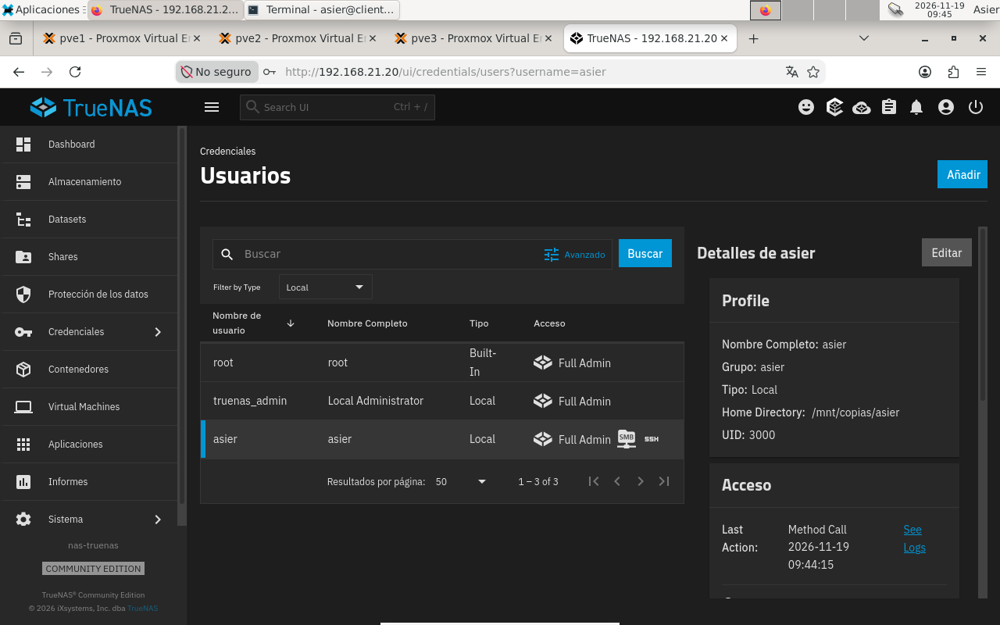
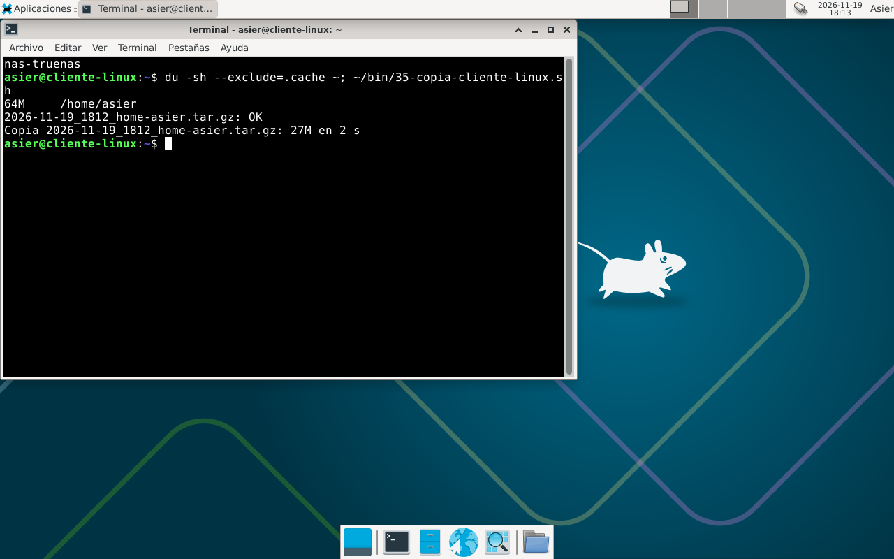
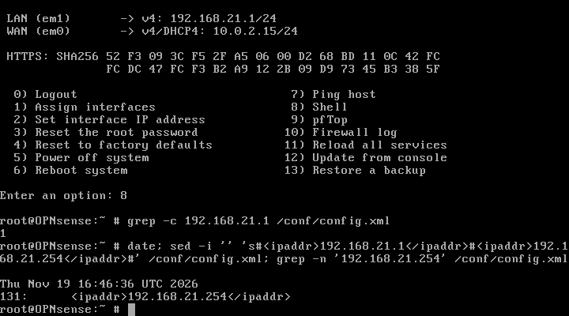
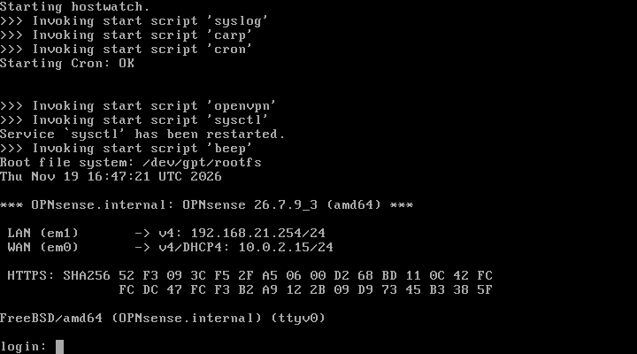
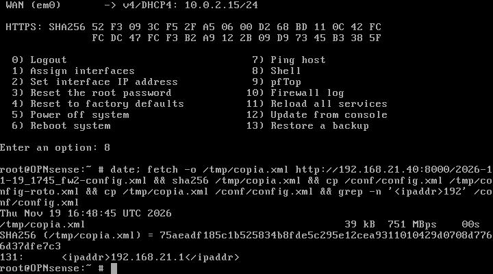
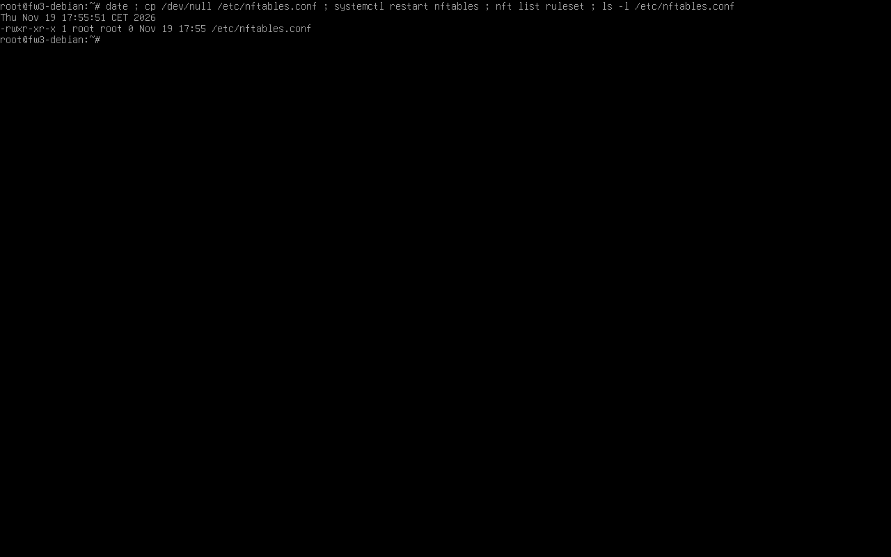
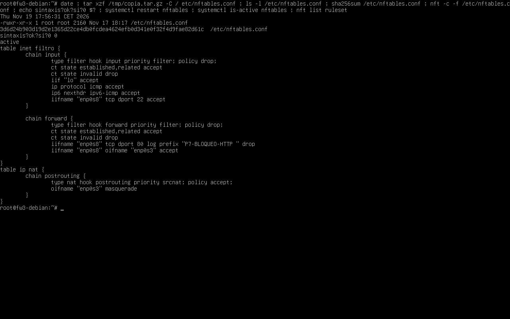

# 09 · Copias, recuperación y contingencia (Tasca 5 / 6)

> **En pocas palabras:** todos los equipos guardan su configuración (y los usuarios sus documentos) en un mismo servidor de copias, el NAS. No copio lo que se puede volver a instalar en minutos, solo lo que costaría horas rehacer. He estropeado a propósito cada firewall y lo he arreglado con su copia, midiendo cuánto tiempo estuvo sin servicio. También he borrado un documento de un usuario y lo he recuperado idéntico. Las copias más importantes se hacen solas cada noche.

Destino de todas las copias: **TrueNAS 192.168.21.20**, dataset `copias/<equipo>/`.

## 1. Qué se copia, cómo y dónde (P9)

**Criterio:** se copia lo que **no se puede volver a generar rápido**, es decir, la **configuración** (horas de trabajo) y los **datos** (lo que no existe en otro sitio). **No** se copia lo que se reinstala desde la imagen oficial en minutos (el sistema operativo y los programas), ni lo que es temporal (cachés, logs en RAM). Así las copias son **pequeñas** (el pool tiene 18,89 GiB útiles) y **rápidas de restaurar**: reinstalar desde la ISO + cargar la configuración.

**Dónde:** TrueNAS `192.168.21.20`, pool `copias` (1 disco de 20 GB), **un dataset por equipo**. Así se pueden dar permisos, cuotas e instantáneas por separado, y lo que se borra o se llena en uno no afecta a los demás.

**Cómo:** solo tres protocolos (servicios activos en TrueNAS), cada uno donde es el nativo:
- **SSH/SFTP** (cifrado) para Linux, firewalls y el `cron` de Server-Monitorizacion, siempre con **clave SSH**, no con contraseña.
- **SMB** para Windows.
- **NFS** para Proxmox.

| Equipo | Qué copio | Qué NO copio y por qué | Cómo (protocolo) | Dónde (dataset) |
|---|---|---|---|---|
| FW1-MikroTik | `/export` (configuración en texto, legible y comparable) + `/system backup save` (binario: incluye usuarios y contraseñas, cifrado con contraseña) | RouterOS (se recupera con la imagen CHR oficial en 2 min), la licencia y los logs (se guardan en RAM y se pierden al reiniciar) | **SSH/SFTP**: `/tool fetch upload=yes mode=sftp` | `copias/fw1-mikrotik` |
| FW2-OPNsense | `config.xml` (*System → Configuration → Backups*): **toda** la configuración en un fichero | El sistema y los paquetes (ISO + restaurar el XML), logs, cachés y la base de datos de informes | **API HTTPS** de OPNsense con un usuario que solo puede hacer copias (P14a; así no hace falta activar SSH en el firewall) | `copias/fw2-opnsense` |
| FW3-Debian-NFT | `/etc/nftables.conf`, `/etc/network/interfaces`, `/etc/sysctl.d/99-forward.conf` y la lista de paquetes (`dpkg --get-selections`) | El sistema (reinstalar 10 min + `aplica.sh`), `/var/log` y `/tmp`. Además, la configuración ya está versionada en Git (`configs/fw3-debian/`) | **SSH/SFTP** (`scp`) | `copias/fw3-debian` |
| Proxmox VE | Copias `vzdump` de la VM `.150` y del contenedor `.151` (completos y comprimidos) + `/etc/pve` (configuración del clúster) | El propio Proxmox de cada nodo (reinstalar desde la ISO) y las ISOs y plantillas (se vuelven a descargar) | **NFS** (almacenamiento NFS en *Datacenter → Storage*, desde la GUI) | `copias/proxmox` |
| WinServer-2025 | Carpetas de datos compartidas + exportación de la configuración de roles. Estado del sistema (*System State*, con AD si hubiera dominio): **N/C**, puede ocupar varios GB; se mide en el P14 si cabe en el pool | Windows y programas (se reinstalan desde la ISO), archivo de paginación, temporales | **SMB** (`\\192.168.21.20\winserver`), con Copias de seguridad de Windows Server o `robocopy` | `copias/winserver` |
| Server-Monitorizacion | Scripts y `crontab` de las copias, `/etc` (`mdadm.conf`, `ssh`), la **clave pública** SSH (nunca la privada) | El sistema (reinstalar), los discos del laboratorio RAID (son de prueba) y los logs | **SSH** (`rsync`/`scp`) | `copias/srv-mon` |
| Client-Win11 | La carpeta del usuario (Documentos, Escritorio, Imágenes) | Windows y programas (se reinstalan), cachés del navegador y temporales | **SMB** (`\\192.168.21.20\win11`), con Historial de archivos o `robocopy` | `copias/win11` |
| Client-Linux | `/home/asier` **sin** `~/.cache` | El sistema y el escritorio (se reinstalan), la caché. No tiene servidor SSH: es él quien envía | **SSH** (`rsync`/`scp` hacia TrueNAS) | `copias/cliente-linux` |
| NAS-TrueNAS (el propio) | La configuración (*Sistema → General → Manage Configuration → Download File*) | Los datos de `copias` (ya **son** las copias) | Descarga por la WebUI desde Client-Linux | **Fuera del NAS** (en Client-Linux y en el anfitrión, nunca en el repositorio público, porque lleva datos sensibles): si el NAS se pierde, su configuración no puede estar dentro de él |

**Límites honestos de este diseño:**
- **Un solo disco y sin redundancia.** Si falla el disco de copias, se pierden **las copias**, no los equipos. Es un riesgo aceptado en el laboratorio porque todos los discos virtuales están en el **mismo SSD USB**: un espejo de dos VDI en el mismo disco físico no protege de nada. Una empresa usaría un espejo o un RAIDZ con discos físicos distintos **y** una copia fuera del NAS (regla **3-2-1**).
- **NAS y equipos en el mismo SSD.** Esto no es 3-2-1: una avería del SSD lo pierde todo. Lo que lo compensa es el repositorio Git (configuraciones de texto) y las instantáneas de VirtualBox.

### 1.1 Cómo se hacen las copias de los firewalls (P14a)
Todas las lanza **Server-Monitorizacion** (`srv-mon`, .40) con `scripts/30-copia-firewall.sh`: averigua qué firewall está encendido (los tres son el .1), descarga su configuración y la deja en TrueNAS con fecha y su huella SHA-256, que se vuelve a comprobar ya en el NAS (`sha256sum -c`). Sin contraseñas: SSH con clave a FW1, FW3 y TrueNAS, y la **API** de OPNsense con el usuario `copias`, que solo puede hacer copias. El mismo script es el que lanzará `cron` en el P14c (a105).

Para que `asier` pueda escribir, las carpetas `fw1-mikrotik`, `fw3-debian`, `srv-mon` y `cliente-linux` pasan a ser suyas (`filesystem.chown` de la API de TrueNAS) y el script las deja en `700`: las copias de FW1 llevan los usuarios del router y solo las puede leer `asier`.

Demuestra: en TrueNAS, `asier` tiene la carpeta personal `/mnt/copias/asier` y los accesos **SMB** y **SSH** (este último con la clave de srv-mon).

Demuestra: en *Credenciales → Usuarios*, `asier` es **Full Admin** con acceso **SMB** y **SSH**, su carpeta personal es `/mnt/copias/asier` y la última autenticación (por SSH con clave) quedó registrada.

| Firewall | Qué se guarda | Cómo | Tamaño | Fichero en TrueNAS |
|---|---|---|---|---|
| FW1-MikroTik | `/export terse` (texto) + `/system backup save` (binario) | SSH con clave (`asier`, `/user ssh-keys`) | 852 B + 21 KB | `copias/fw1-mikrotik/AAAA-MM-DD_HHMM_*` |
| FW2-OPNsense | `config.xml` completo | API HTTPS `GET /api/core/backup/download/this` (usuario `copias`) | 40 KB | `copias/fw2-opnsense/AAAA-MM-DD_HHMM_*` |
| FW3-Debian-NFT | `tar` de `nftables.conf`, `interfaces` y `sysctl.d` + `dpkg --get-selections` | SSH con clave (`asier`, sin sudo: los ficheros se pueden leer) | 1,8 KB + 7,7 KB | `copias/fw3-debian/AAAA-MM-DD_HHMM_*` |

### 1.2 Copias del resto de equipos (P14b)
**Predicción:** no indicada.

Lo que se copia y lo que no sigue el criterio de la tabla de arriba. Aquí está **cómo se hizo de verdad**, cuánto ocupa y cuánto tardó:

| Equipo | Qué se copió | Cómo | Tamaño · tiempo | Destino en TrueNAS | Evidencia |
|---|---|---|---|---|---|
| Proxmox (clúster) | `vzdump` de la VM 150 (encendida, modo *snapshot*) y del CT 151 (apagado, modo *stop*), comprimidos con zstd + `tar` de `/etc/pve`, `/etc/network/interfaces`, `/etc/hosts` y los repositorios de cada nodo | Recurso **NFS** de TrueNAS solo para las IPs de los 3 nodos (`maproot` root, porque `vzdump` escribe como root) → almacenamiento `copias-nas` del clúster (*Datacenter → Storage → Add → NFS*), con `keep-last=3` | VM 150: 8 GiB → **568 MB en 10 s** · CT 151: 556 MiB → **159 MB en 12 s** · configuración: 23 KB por nodo | `copias/proxmox/dump` y `/config` | [txt](../evidencias/tasca5/proxmox-copias-nfs.txt) |
| WinServer-2025 | **Configuración exportada en texto** (roles instalados, red y DNS, usuarios, administradores, recursos compartidos, idioma y teclado, directivas de seguridad con `secedit`) + Documentos y Escritorio de `Administrador` y `asier` | `scripts/34-copia-winserver.ps1` (PowerShell como Administrador) → **SMB** `\\192.168.21.20\winserver`, con el usuario `asier` de TrueNAS y sin guardar la contraseña (`/persistent:no`) | 9 ficheros, 17,6 KB en **13 s** | `copias/winserver/<fecha>/` | [txt](../evidencias/tasca5/winserver-copia-smb.txt) |
| Client-Win11 | Escritorio, Documentos e Imágenes del usuario | `scripts/33-copia-win11.bat` (`net use` + `robocopy`) → **SMB** `\\192.168.21.20\win11` | 1 fichero de prueba (52 B) en **<1 s** (el equipo está recién instalado) | `copias/win11/<fecha>/` | [txt](../evidencias/tasca5/win11-copia-smb.txt) |
| Server-Monitorizacion | `/etc` (lo que puede leer `asier`), `~/bin` (los scripts de copias), `~/.ssh/config`, la clave **pública**, `crontab`, lista de paquetes y `/proc/mdstat` | `scripts/32-copia-srv-mon.sh` → **SSH** con clave, SHA-256 comprobado en el NAS | **424 KB** en ~1 s | `copias/srv-mon/` | [txt](../evidencias/tasca5/srv-mon-copia.txt) |
| Client-Linux | `/home/asier` sin `.cache`, papelera, ISOs ni la clave privada | `scripts/35-copia-cliente-linux.sh` (descargado del repo con `wget`) → **SSH** con la clave de Client-Linux, que se añadió al usuario `asier` de TrueNAS | 64 MB → **27 MB en 2 s** | `copias/cliente-linux/` | captura de abajo |
| NAS-TrueNAS (el propio) | Base de datos de configuración (`config/save` de la API, sin la *secret seed*) | srv-mon la pide por la **API HTTPS** con una clave de API de `asier` (`~/.config/copias/truenas-api.txt`, 600) | 816 KB | **Fuera del NAS**: `~/copias-truenas/` en srv-mon | — |

Demuestra: `/home/asier` ocupa 64 MB sin la caché; el script lo comprime a **27 MB**, lo envía a TrueNAS en **2 s** y allí `sha256sum -c` dice **OK** (la copia es idéntica a la original). `nas-truenas` en la primera línea: el SSH con clave funciona sin pedir contraseña.

**Justificación de lo que NO se copia (resumen):**
- **Sistemas y programas** (Windows, Debian, Proxmox, TrueNAS): se reinstalan desde la ISO verificada en 10–20 min. Copiarlos llenaría el pool (18 GB) para nada.
- **Clave privada SSH, claves de API y `/etc/shadow`:** son secretos. Si se pierden, se generan otros. Una copia de un secreto es una fuga más.
- **Estado del sistema de WinServer (*System State*):** **N/C**. Necesita la característica *Copias de seguridad de Windows Server* (no instalada) y ocupa varios GB. Como no hay dominio ni roles con datos, la exportación en texto basta para volver a montarlo. Si hubiera Active Directory, **sí** haría falta (es la única forma de recuperar el dominio).
- **Proxmox:** no se copian las ISOs y plantillas (se vuelven a descargar y se comprueba su hash) ni el sistema de cada nodo. `/etc/pve` es igual en los 3 nodos (es el sistema de ficheros del clúster), pero se copia en cada uno porque la red (`interfaces`, `hosts`) es distinta.
- **TrueNAS sin *secret seed*:** así la copia no lleva la llave que descifra los secretos guardados. Si se restaura, hay que volver a poner las contraseñas de los servicios. Es más seguro y en este laboratorio no hay casi secretos guardados.

## 2. Errada controlada y recuperación (firewalls)
**Predicción:** no indicada.

**Cómo se mide la parada:** mientras dura la prueba, `scripts/31-vigila-parada.sh` (en srv-mon) apunta **cada segundo** si el firewall responde (ping al .1) y si hay salida a Internet **a través de su NAT** (ping a 1.1.1.1, que no depende del DNS). Parada = desde la primera sonda que falla hasta la primera que vuelve a ir bien. Solo hay un firewall encendido a la vez (misma IP).

| Equipo | Errada provocada | Síntoma | Recuperación (desde la copia de TrueNAS) | Tiempo de parada | ¿Funciona igual que antes? (prueba) |
|---|---|---|---|---|---|
| FW2-OPNsense | En la consola (opción 8, *shell*): `sed` cambia la IP de LAN de `config.xml` a **.254** y `reboot` (un cambio de configuración equivocado) | La LAN se queda **sin puerta de enlace**: ping al .1 y HTTPS fallan; la consola muestra `LAN (em1) -> 192.168.21.254/24` | srv-mon baja la copia de TrueNAS y la sirve un momento por HTTP (`python3 -m http.server`); en FW2: `fetch`, `sha256` (= la del NAS), copia a `/conf/config.xml` y `reboot` | **2 min 47 s**, de los que la recuperación son **50 s** (casi todo el arranque) | Sí: la configuración descargada después por la API es **idéntica** a la copia (`diff` → 0 líneas) |
| FW3-Debian-NFT | En la consola (root): `/etc/nftables.conf` vacío (`cp /dev/null …`) + `systemctl restart nftables` | El .1 responde, pero **no hay Internet**: sin la regla `masquerade` las respuestas no vuelven. `nft list ruleset` sale vacío | La copia (`tar.gz`) va de TrueNAS a FW3 por srv-mon (`scp`); `tar xzf … etc/nftables.conf`, `nft -c -f` (sintaxis OK) y `systemctl restart nftables` | **39 s**. La recuperación en sí tarda **1 s**; el resto es la espera para ver el síntoma | Sí: el SHA-256 de `/etc/nftables.conf` es **el mismo** que el de dentro de la copia (`3d6d24b9…`) y `nft list ruleset` vuelve a mostrar las mismas reglas (P7) |
| FW1-MikroTik | Por SSH: `/ip firewall nat remove [find]` (se borra la regla de NAT) | El .1 responde, pero **no hay Internet** (sin NAT) | Se saca la línea `/ip firewall nat` del `/export` guardado en TrueNAS, se sube a FW1 (`scp`) y `/import file-name=nat.rsc` (**solo la parte afectada**; el `.backup` binario sería para el equipo entero) | **25 s**. La recuperación en sí, **1 s** | Sí: `/ip firewall nat print` vuelve a mostrar la misma regla (misma acción, cadena, interfaz y comentario) |

**FW2-OPNsense:**

Demuestra: en la *shell* de OPNsense, el `sed` cambia la línea 131 de `/conf/config.xml` a `192.168.21.254`. Antes solo había **1** línea con 192.168.21.1.

Demuestra: después de reiniciar, la consola muestra `LAN (em1) -> v4: 192.168.21.254/24`. La LAN ya no tiene su puerta de enlace .1.

Demuestra: FW2 descarga la copia (39 kB), su **SHA-256 `75aeadf1…e7c3` es igual al guardado en TrueNAS**, se guarda la configuración rota en `/tmp` (para analizarla) y la línea 131 vuelve a ser `192.168.21.1`.

Texto completo con la copia, la vigilancia segundo a segundo y el `diff`: [`fw2-copia-errada-recuperacion.txt`](../evidencias/tasca5/fw2-copia-errada-recuperacion.txt). Demuestra: la parada empieza en t=0 y el HTTPS vuelve a dar 200 en +2 min 47 s; el `diff` entre la copia y la configuración recuperada da **0** líneas.

**FW3-Debian-NFT:**

Demuestra: `/etc/nftables.conf` pasa a ocupar **0 bytes** y, después del `restart`, `nft list ruleset` no muestra nada: el firewall se queda sin reglas y sin NAT.

Demuestra: después de extraer la copia, `nftables.conf` vuelve a tener 2160 bytes con su fecha original, el SHA-256 es `3d6d24b9…` (igual que en la copia), `nft -c` devuelve **0** (sintaxis correcta), el servicio está `active` y las reglas del P7 están cargadas. (En la línea de órdenes, `sintaxis?ok?si?0` es `sintaxis_ok_si_0` escrito con el teclado español.)

Texto: [`fw3-copia-errada-recuperacion.txt`](../evidencias/tasca5/fw3-copia-errada-recuperacion.txt). Demuestra: la copia y su huella en TrueNAS, qué ficheros lleva y que Internet se corta en t=0 y vuelve en +39 s.

**FW1-MikroTik:** [`fw1-copia-errada-recuperacion.txt`](../evidencias/tasca5/fw1-copia-errada-recuperacion.txt). Demuestra: las dos copias pasan el `sha256sum -c` en TrueNAS; después del `remove`, `nat print` sale vacío; la línea recuperada de la copia se importa («Script file loaded and executed successfully») y la regla vuelve. Con FW1 se pierden ~20 % de los pings a 1.1.1.1 **también cuando todo va bien** (N/C: licencia gratuita del CHR o NAT de VirtualBox). Por eso la parada se cuenta solo con el tramo en el que fallan **todas** las sondas.

**Análisis:**
- **El tiempo de parada lo marca el tipo de recuperación, no la copia:** restaurar una sola parte (FW1, FW3) tarda segundos; restaurar el equipo entero con reinicio (FW2) tarda lo que tarda el arranque (~40 s en OPNsense).
- **Comprobar la huella antes de restaurar** (FW2, FW3) asegura que lo que se restaura es lo mismo que se copió, sin cambios ni errores al copiarlo.
- **En una empresa** el tiempo real sería mayor: falta **darse cuenta** del fallo (aquí se sabía), y eso se reduce con monitorización (Tasca de supervisión).
- La copia binaria de FW1 (`.backup`) y el `config.xml` completo de FW2 sirven para un desastre total (reinstalar + restaurar). Ese caso **no se ha probado** con FW1 (N/C: restaurar el `.backup` en una CHR recién instalada).

### 2.1 Recuperar una función: un documento de un usuario (Client-Linux)
**Qué pide el enunciado:** comprobar que una copia sirve de verdad, recuperando algo concreto. Aquí: un documento de `asier` que se borra «por error».

**Cómo** (`scripts/61-recuperar-documento.sh`, en Client-Linux): 1) crear `~/documento-prueba.txt` con permisos **640** (`-rw-r-----`, distintos de los normales para que se note si se pierden); 2) copiarlo a TrueNAS (`copias/cliente-linux`) con `scp -p`, que conserva permisos y fecha; 3) **borrar** el original; 4) restaurarlo desde TrueNAS; 5) comprobar que se abre (`cat`), el SHA-256 y `ls -l`.

| Comprobación | Antes de borrar | Después de restaurar |
|---|---|---|
| `ls -l` | `-rw-r----- 1 asier asier 86` + fecha del fichero | Igual: mismos permisos, dueño, tamaño y fecha |
| SHA-256 | `5d36e867…af814e` | `5d36e867…af814e` (**igual**) |
| ¿Se abre? | — | Sí: `cat` muestra las 3 líneas originales |
| **Tiempo** (del borrado a tenerlo de vuelta) | | **0,24 s** |

Texto: [`recuperar-documento-cliente-linux.txt`](../evidencias/tasca5/recuperar-documento-cliente-linux.txt). Demuestra: después de borrarlo, `ls` dice «No existe el fichero»; tras restaurarlo desde TrueNAS, el contenido es idéntico (mismo SHA-256) y conserva el dueño, el grupo, los permisos 640 y la fecha.

**Análisis:** 0,24 s es solo la copia por la red (86 bytes). En un caso real, el tiempo lo marcan **darse cuenta** del borrado y **encontrar** la copia buena (por eso las copias llevan fecha en el nombre). Si se copiara con `cp` normal o por SMB, los permisos de Linux podrían cambiar: por eso se usa `scp -p` (o `tar`, como en la copia de `/home`).

## 3. Copias automatizadas (Apte+ a105)
**Predicción:** no indicada.

**Qué se automatiza y quién lo hace:**
| Qué | Quién lo lanza | Cuándo | Destino |
|---|---|---|---|
| Firewall activo, Server-Monitorizacion, configuración de los nodos Proxmox y de TrueNAS | `cron` de `asier` en **srv-mon** → `scripts/36-copias-auto.sh` (llama a `30-copia-firewall.sh` y `32-copia-srv-mon.sh`) | Cada día a las **02:30** | TrueNAS (`copias/*`) y, la de TrueNAS, **fuera del NAS** (`~/copias-truenas` en srv-mon) |
| VM 150 y CT 151 (`vzdump`) | La tarea **propia de Proxmox** `copias-semanal` (*Datacenter → Backup*) | Cada **domingo a las 02:00** (antes que la de srv-mon, así no coinciden con mucha carga a la vez) | `copias-nas` (NFS de TrueNAS), `keep-last=3` |

**Por qué así:**
- **Un único punto que recoge** (srv-mon, el servidor de infraestructura) en vez de un `cron` en cada equipo: solo hay que mirar **un log** (`~/copias.log`) y las claves están en un solo sitio. FW2 (OPNsense) y FW1 (RouterOS) no tienen un `cron` normal.
- Cada parte se ejecuta por separado: si una falla (por ejemplo, un nodo apagado), se apunta `ERROR` o `--` en el log y **se siguen** las demás. El script acaba con código de error, así que se podría avisar por correo (`MAILTO`); queda como mejora.
- **Rotación:** se borran las copias de más de **30 días** (`find -mtime +30 -delete`) para que no se llene el pool de 18 GB. En Proxmox lo hace `keep-last=3`.
- Las VMs las copia **Proxmox** porque `vzdump` en modo *snapshot* necesita estar dentro del hipervisor. Hacerlo desde fuera sería más complicado y no aporta nada.
- **Por qué de noche:** a esa hora no se trabaja. Así la copia no compite con los usuarios por la red ni por el disco, y la configuración no cambia mientras se copia.

**Prueba:** se añadió al `crontab` una línea temporal para unos minutos después. A esa hora `cron` lanzó el script **solo** y el log dice `=== Fin (todo OK)`: copió FW2 y srv-mon en TrueNAS y la configuración de TrueNAS en srv-mon, y apuntó los 3 nodos de Proxmox como apagados. Después se quitó la línea de prueba.

Texto: [`copias-auto-cron.txt`](../evidencias/tasca5/copias-auto-cron.txt). Demuestra: el `crontab` definitivo (02:30 cada día), lo que escribió `cron` en `~/copias.log`, los ficheros nuevos en TrueNAS a la hora de la prueba y la tarea `copias-semanal` de Proxmox.

**Límites (N/C):** no se ha visto **todavía** una ejecución real de las 02:30 ni del domingo (las VMs no están encendidas de noche). Se comprobaría encendiendo el escenario de copias antes de esas horas y mirando el log al día siguiente. Tampoco hay aviso automático si falla (se miraría el log).
