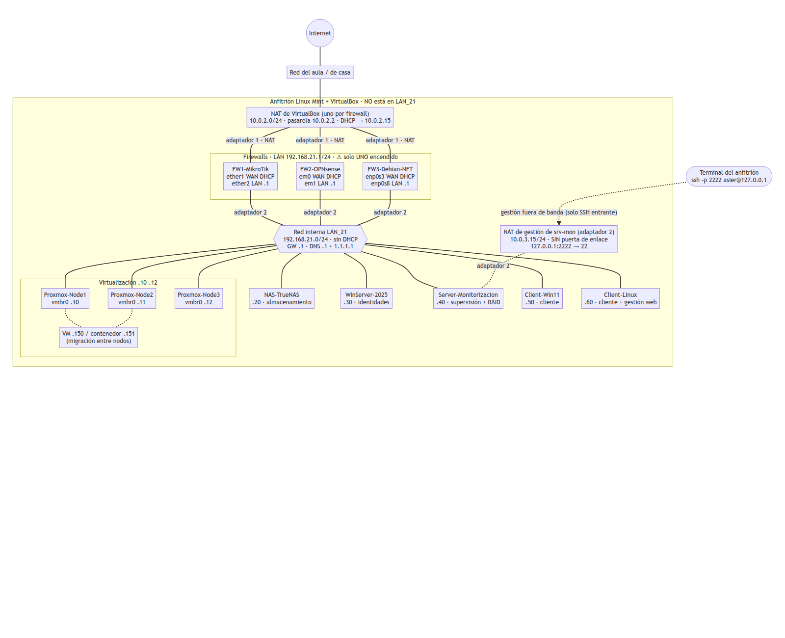
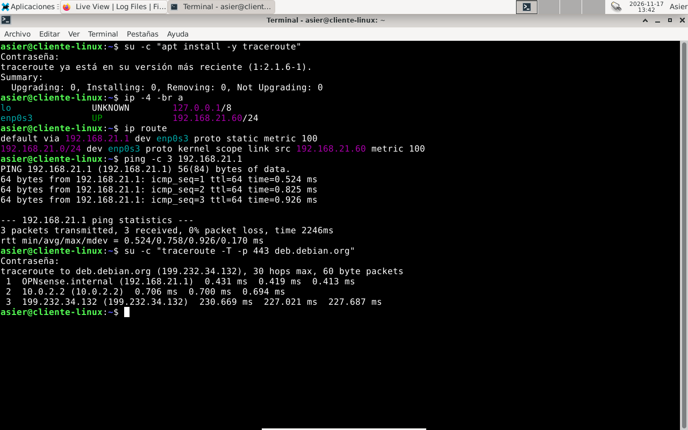

# Tasca 4 · Disseny físic i lògic

Evidencias de esta tarea: [../../evidencias/tasca4/](../../evidencias/tasca4/)

> Entrega individual · Asier · puesto 21 · proyecto «Naix un sistema» V2.0. Documento autocontenido: el contenido sale de [`docs/`](../../docs/) y las evidencias están en [`evidencias/`](../../evidencias/). Uso de IA declarado en [11-us-ia](../../docs/11-us-ia.md).

**Objetivo:** Dibujar el esquema de red individual (192.168.21.0/24, puesto 21), indicar la configuración de cada interfaz, implementarlo y comprobar la conectividad.

**En pocas palabras:** La empresa tiene una red propia (LAN_21) separada del aula: todos los equipos están dentro y solo salen a Internet a través de un firewall con la dirección .1. Cada equipo tiene una IP fija ordenada por bloques según su función. Lo he comprobado con ping, traceroute y las tablas de rutas: el tráfico pasa siempre por el firewall.

## 1. Actividades de la rúbrica

| ID | Nivel | RA | Actividad (texto de la rúbrica) | Estado |
|---|---|---|---|---|
| a128 | Apte | ISO-RA1 | Dibuixar l’esquema de xarxa individual, el muntatge virtual i les adreces previstes. | ✅ hecha |
| a148 | Apte | ISO-RA1 | Indicar la configuració de cada interfície i la LAN 192.168.XX.0/24 segons el lloc a l’aula; la WAN pot obtindre la IP per DHCP (adaptador pont o millor NAT). | ✅ hecha |
| a129 | Apte+ | ISO-RA1 | Implementar la xarxa individual i comprovar la connectivitat amb ping, traceroute i taules d’encaminament. | ✅ hecha |
| a149 | Apte+ | ISO-RA1 | Aportar evidències de ping, traceroute, taula d’encaminament i configuració de les interfícies entre les VM i cap a l’exterior. | ✅ hecha |

## 2. Cómo leer esta entrega
Cada apartado sigue el ThinkLoop: **predicción → decisión → implementación → verificación → análisis**. Cada evidencia va con una línea «Demuestra: …».

## 3. Diseño de red, interfaces, verificación y red de gestión

> Diseño **definitivo** del 17/11/2026: red interna `LAN_21`. Sustituye al primer diseño con red solo-anfitrión (el cambio está explicado en [11-us-ia](../../docs/11-us-ia.md)).
> Esquema: [`diagramas/red-lan21.mmd`](../../diagramas/red-lan21.mmd) (Mermaid, fuente) y [`diagramas/red-lan21.png`](../../diagramas/red-lan21.png).

Demuestra: cómo se conecta cada VM. Los 3 firewalls tienen un pie en el NAT de VirtualBox (WAN) y otro en la red interna LAN_21. Todos los demás equipos solo están en LAN_21, y el anfitrión queda fuera de la LAN.

### 1. Montaje en VirtualBox
| Red | Tipo de adaptador en VirtualBox | Direccionamiento | Quién está |
|---|---|---|---|
| **WAN** | **NAT**. Cada VM tiene su propio NAT, aislado de los demás | DHCP de VirtualBox: **10.0.2.15/24**, puerta de enlace **10.0.2.2**, DNS el del NAT | Adaptador 1 de los 3 firewalls |
| **LAN_21** | **Red interna** con el nombre `LAN_21` (es como un switch virtual que solo ven las VMs) | **192.168.21.0/24**, todo estático, **sin DHCP** | Adaptador 2 de los firewalls + el **único** adaptador de los demás equipos |

- **El anfitrión NO está en LAN_21.** No tiene IP en esa red y no puede hacer ping ni abrir las WebUI.
- **Gestión web:** desde el **navegador de Client-Linux (192.168.21.60)**.
- **Capturas:** `scripts/captura.sh <tasca> <descripción> vm <VM>` usa `VBoxManage controlvm <VM> screenshotpng` desde el anfitrión, sin tocar la VM.
- **Scripts para dentro de las VMs:** se publican en el repo y en la VM se descargan con `git clone https://github.com/asierlinares08-web/thinklab-individual-21.git`.
- **Proxmox:** su adaptador va en modo promiscuo **«Permitir todo»**. Si no, las VM y contenedores de dentro (.150/.151) no tienen red, porque usan MACs que VirtualBox no conoce.

#### ⚠️ Regla de oro: solo UN firewall encendido
FW1, FW2 y FW3 tienen **la misma IP de LAN (192.168.21.1)**, así cualquiera de los tres sirve de puerta de enlace sin cambiar nada en los clientes.
Si se encienden dos a la vez, hay **dos MAC para la misma IP**: un conflicto ARP en el que cada cliente usa la MAC que le contestó la última vez y la conexión se corta a ratos.
Antes de arrancar un firewall, compruébalo con `VBoxManage list runningvms`.

### 2. Plan de direcciones (criterio por bloques)
| Bloque | IP | VM (grupo `/ThinkLab-asier`) | Función |
|---|---|---|---|
| Puerta de enlace | **.1** | `FW1-MikroTik` · `FW2-OPNsense` · `FW3-Debian-NFT` | Firewall/NAT (uno cada vez) |
| Virtualización | **.10 / .11 / .12** | `Proxmox-Node1` / `Proxmox-Node2` / `Proxmox-Node3` | Clúster Proxmox |
| Almacenamiento | **.20** | `NAS-TrueNAS` | Copias de seguridad |
| Identidades | **.30** | `WinServer-2025` | Centralización (el dominio se explica) |
| Supervisión | **.40** | `Server-Monitorizacion` | Infraestructura, RAID, copias automáticas |
| Clientes | **.50** | `Client-Win11` | Cliente Windows |
| Clientes | **.60** | `Client-Linux` | Cliente Linux + puesto de gestión web |
| (dentro de Proxmox) | **.150 / .151** | VM Debian y contenedor LXC | Migración entre nodos |

**Por qué por bloques:** por **orden y facilidad de diagnóstico**, no por rendimiento.
- Al ver una IP en un log o en `ping`, sé enseguida qué tipo de equipo es.
- Puedo escribir reglas de firewall por rangos, por ejemplo «los clientes .50–.60 no entran en la gestión de Proxmox .10–.12».
- Queda hueco para crecer dentro de cada bloque (.13 para un cuarto nodo, .21 para un segundo NAS…).

### 3. Configuración de cada interfaz
Máscara de toda la LAN: **255.255.255.0 (/24)**.

| VM | Interfaz | Adaptador VirtualBox | IP / máscara | Puerta de enlace | DNS | Método |
|---|---|---|---|---|---|---|
| FW1-MikroTik | `ether1` (WAN) | 1 · NAT | 10.0.2.15/24 | 10.0.2.2 | el del DHCP | DHCP |
| FW1-MikroTik | `ether2` (LAN) | 2 · Red interna `LAN_21` | 192.168.21.1/24 | — | — | Estática |
| FW2-OPNsense | `em0` (WAN) | 1 · NAT | 10.0.2.15/24 | 10.0.2.2 | el del DHCP | DHCP |
| FW2-OPNsense | `em1` (LAN) | 2 · Red interna `LAN_21` | 192.168.21.1/24 | — | — | Estática |
| FW3-Debian-NFT | `enp0s3` (WAN) | 1 · NAT | 10.0.2.15/24 | 10.0.2.2 | el del DHCP | DHCP |
| FW3-Debian-NFT | `enp0s8` (LAN) | 2 · Red interna `LAN_21` | 192.168.21.1/24 | — | — | Estática |
| Proxmox-Node1 / 2 / 3 | `vmbr0` (puente sobre la NIC) | 1 · `LAN_21` (promiscuo «Permitir todo») | .10 / .11 / .12 /24 | 192.168.21.1 | 192.168.21.1, 1.1.1.1 | Estática |
| NAS-TrueNAS | LAN | 1 · `LAN_21` | 192.168.21.20/24 | 192.168.21.1 | 192.168.21.1, 1.1.1.1 | Estática |
| WinServer-2025 | Ethernet | 1 · `LAN_21` | 192.168.21.30/24 | 192.168.21.1 | 192.168.21.1, 1.1.1.1 (hasta que tenga el rol DNS) | Estática |
| Server-Monitorizacion | LAN | 1 · `LAN_21` | 192.168.21.40/24 | 192.168.21.1 | 192.168.21.1, 1.1.1.1 | Estática |
| Client-Win11 | Ethernet | 1 · `LAN_21` | 192.168.21.50/24 | 192.168.21.1 | 192.168.21.1, 1.1.1.1 | Estática |
| Client-Linux | LAN | 1 · `LAN_21` | 192.168.21.60/24 | 192.168.21.1 | 192.168.21.1, 1.1.1.1 | Estática |
| VM de migración | `net0` → `vmbr0` | (dentro de Proxmox) | 192.168.21.150/24 | 192.168.21.1 | 192.168.21.1, 1.1.1.1 | Estática |
| Contenedor de migración | `eth0` → `vmbr0` | (dentro de Proxmox) | 192.168.21.151/24 | 192.168.21.1 | 192.168.21.1, 1.1.1.1 | Estática |
| Anfitrión Linux Mint | — | **No está en LAN_21** | — | — | — | — |

Las interfaces de la VM de migración, del contenedor, de TrueNAS, de Server-Monitorizacion y de Client-Linux todavía no las sé: el nombre real (`enp0s3`, `ens18`, `eth0`…) se apunta después de instalarlas.

**DNS:** el primario es el firewall (.1). Con OPNsense (Unbound) y MikroTik (`/ip dns allow-remote-requests=yes`) el firewall resuelve. El Debian con nftables **no tiene DNS**, así que entonces se usa el secundario **1.1.1.1**, que sale por el NAT. Con cualquier firewall activo, los nombres se resuelven.

### 4. Camino del tráfico (de un cliente a Internet)
Client-Linux (192.168.21.60) → red interna `LAN_21` → LAN del firewall activo (192.168.21.1) → **NAT/masquerade del firewall** (cambia el origen por 10.0.2.15) → WAN → **NAT de VirtualBox** (10.0.2.2, cambia el origen por la IP del anfitrión) → red del aula o de casa → Internet.

Hay **dos NAT seguidos**: el del firewall (el que configuro yo) y el de VirtualBox. Se demostrará con `traceroute` desde Client-Linux: el primer salto será 192.168.21.1 y el segundo 10.0.2.2.

### 5. Verificación (Apte+, Fase 3)
| Prueba | Desde | Hacia | Resultado | Evidencia |
|---|---|---|---|---|
| `ip -4 -br a` / `ip route` | Client-Linux | — | `enp0s3` 192.168.21.60/24; `default via 192.168.21.1` | `evidencias/tasca4/2026-11-17_client-linux-ip-ruta-ping-traceroute.png` |
| `ping` puerta de enlace | Client-Linux | 192.168.21.1 | 3/3 · 0 % de pérdida · 0,76 ms | (misma) |
| `traceroute -T -p 443` a Internet | Client-Linux | deb.debian.org | **1 → 192.168.21.1 (OPNsense)** · **2 → 10.0.2.2 (NAT de VirtualBox)** · 3 → 199.232.34.132 (destino) | (misma) |
| Salida a Internet por HTTPS | Client-Linux | deb.debian.org | `HTTP/1.1 200 OK` | `evidencias/tasca5/2026-11-17_client-linux-prueba-http-bloqueado-https-ok.png` |
| Configuración de interfaces y rutas del firewall | FW2-OPNsense | — | WAN em0 10.0.2.15/24 (pasarela 10.0.2.2), LAN em1 192.168.21.1/24 | `evidencias/tasca5/2026-11-17_fw2-opnsense-interfaces-wan-lan.png`, `…login-asier-version-antes.png` |
| `ping` entre VMs | Client-Linux | .20 / .40 | (cuando estén instaladas: P9/P10) | |

Demuestra: el camino del §4 es real. El primer salto es el firewall (**192.168.21.1**), el segundo la pasarela del NAT de VirtualBox (**10.0.2.2**), y luego el destino. Del 2 se pasa directamente al destino porque el NAT de VirtualBox no es un router: abre la conexión desde el anfitrión, así que los routers del aula y de Internet no responden al traceroute. Se usó TCP al 443 porque el aula bloquea el ping.

### 6. Red de gestión fuera de banda (19/11)
**Qué:** `Server-Monitorizacion` tiene un **adaptador 2 NAT** (VirtualBox lo numera 10.0.3.0/24) con IP estática **10.0.3.15/24 y SIN puerta de enlace** (`/etc/network/interfaces.d/gestion`) y un reenvío de puerto **127.0.0.1:2222 → 22**. Desde el terminal del anfitrión: `ssh -p 2222 asier@127.0.0.1` (con clave). Desde srv-mon se salta con **clave SSH** al resto: `fw1`, `fw3`, `pve1-3` (root, la clave se comparte por `/etc/pve/priv/authorized_keys`), `nas`, `vm150` (`~/.ssh/config` de asier). OPNsense **no** necesita SSH: se usa su API con un usuario `copias` que solo tiene los privilegios de copias (la API de firmware devuelve 403).

**Por qué:** el anfitrión no está en LAN_21 y teclear en consolas o leer capturas es lento y propenso a errores. Así las copias, el RAID y las mediciones se hacen con comandos y salidas de texto.

**No se salta el firewall** (evidencia [`2026-11-19_gestion-fuera-banda-srv-mon.txt`](../../evidencias/tasca4/2026-11-19_gestion-fuera-banda-srv-mon.txt)). Demuestra: srv-mon tiene dos tarjetas (`intnet` y `nat`), la de gestión **sin puerta de enlace**, `ip_forward = 0` y el puerto 2222 escuchando solo en `127.0.0.1` del anfitrión:
- La ruta por defecto sigue siendo `default via 192.168.21.1`; `ip route get 1.1.1.1` sale por `enp0s3` y `traceroute` da 1.º salto 192.168.21.1 (firewall) y 2.º 10.0.2.2 (NAT del firewall).
- `ip_forward = 0` en srv-mon: no enruta, nadie de la LAN puede usarlo de atajo.
- El reenvío solo escucha en `127.0.0.1:2222` del anfitrión (no es accesible desde la red del aula) y solo deja **entrar** SSH.

Demuestra: hay una entrada de administración solo para el anfitrión, y todo el tráfico de la LAN hacia Internet sigue pasando por el firewall activo.

## 4. Tabla de máquinas y escenarios de arranque

### 2. Tabla de máquinas (P2 · revisada por Asier el 17/11 y creada con `scripts/11-crear-vms.sh`)
Valores **reales**, comprobados con `VBoxManage showvminfo` después de crearlas: [`evidencias/tasca0/2026-11-17_vms-creadas.txt`](../../evidencias/tasca0/2026-11-17_vms-creadas.txt). Esa evidencia demuestra que las 11 VMs están en `/ThinkLab-asier` con la CPU, la RAM, los discos, la red, la VT-x anidada, el promiscuo, EFI, TPM 2.0 y las claves de Secure Boot de la tabla. La segunda ejecución del script salta las 11, así que el script es repetible.

Para todas las VMs:
- Grupo VirtualBox `/ThinkLab-asier`, en `~/VirtualBox VMs/ThinkLab-asier/` (en el disco USB).
- Discos **VDI dinámicos**: solo ocupan lo que se usa.
- Controlador **SATA (AHCI)**, porque Windows Server no arranca desde IDE.
- Tarjeta de red **Intel PRO/1000 MT** (82540EM), para que las interfaces se llamen `em0/em1`, `enp0s3/enp0s8` y `ether1/ether2`.
- Sin audio ni USB.

| VM | Tipo VBox | vCPU | RAM | Disco(s) | Adaptadores | Extras | Justificación |
|---|---|---|---|---|---|---|---|
| FW1-MikroTik | Linux26_64 | 1 | 288 MB | `chr-7.25.1.vdi` (imagen oficial descomprimida, 128 MB) | 1 NAT · 2 LAN_21 | Arranca del disco, sin ISO | CHR se distribuye ya instalado como disco VDI. RAM: la fórmula oficial de RouterOS v7 es 256 + 8 × CPU × (interfaces − 1) = **264 MB** con 1 CPU y 2 interfaces. Se redondea a **288 MB** para no quedar por debajo del mínimo |
| FW2-OPNsense | FreeBSD_64 | 1 | 3 GB → **1 GB** (P18) | 16 GB | 1 NAT · 2 LAN_21 | ISO OPNsense 26.7 | El manual oficial pide **3 GB para que funcione el instalador**. Después se baja a 1 GB como optimización candidata del **P18**, midiendo antes y después |
| FW3-Debian-NFT | Debian12_64 ¹ | 1 | 512 MB | 8 GB | 1 NAT · 2 LAN_21 | ISO Debian 13.1 | Mínimo oficial de Debian sin escritorio: 512 MB y 4 GB de disco. Se instala con el instalador de **texto** (con < 780 MB el gráfico no va) |
| Proxmox-Node1/2/3 | Debian12_64 ¹ | 2 | 3 GB c/u | 32 GB c/u | 1 LAN_21 (promiscuo «permitir todo») | **VT-x anidada** · ISO Proxmox 9.2 | Mínimo oficial: 1 GB para pruebas. Con 3 GB caben dentro la VM .150 (512 MB) y el contenedor .151 (256 MB). El promiscuo deja pasar las MAC de las VM internas; la VT-x anidada deja a Proxmox virtualizar |
| NAS-TrueNAS | Debian12_64 ¹ | 2 | 8 GB | 16 GB sistema + **20 GB copias** | 1 LAN_21 (virtio desde el P18) | ISO TrueNAS 25.10.7 | **Mínimo oficial de TrueNAS: 8 GB** y 2 núcleos. TrueNAS necesita un disco solo para el sistema y otro aparte para el pool de copias (Tasca 5) |
| WinServer-2025 | Windows2022_64 ¹ | 2 | 4 GB | 50 GB | 1 LAN_21 | **EFI** · VBoxSVGA 128 MB de vídeo · ISO `w2k25.iso` | Oficial: 2 GB, y **4 GB recomendado con escritorio**; disco mínimo 32 GB. EFI como en un servidor actual |
| Server-Monitorizacion | Debian12_64 ¹ | 1 | 1 GB | 10 GB + **7 × 1 GB** | 1 LAN_21 (virtio desde el P18) · 2 NAT de gestión (04 §6) | ISO Debian 13.1 | RAM recomendada de Debian sin escritorio: 1 GB. Los 7 discos de 1 GB son para RAID 0, 1 y 5 y la prueba de fallo (P15) |
| Client-Win11 | Windows11_64 | 2 | 4 GB | 64 GB | 1 LAN_21 | **EFI + Secure Boot + TPM 2.0** · VBoxSVGA 128 MB de vídeo · ISO `win11.iso` (25H2) | **Mínimos oficiales exactos** de Windows 11: 2 núcleos, 4 GB, 64 GB, UEFI con Secure Boot y TPM 2.0 |
| Client-Linux | Debian12_64 ¹ | 2 | 3 GB | 25 GB | 1 LAN_21 | VMSVGA 128 MB de vídeo · ISO Debian 13.1 (el escritorio se elige al instalar) | Debian con escritorio recomienda 2 GB. Se da 1 GB más porque es la **consola de gestión** con navegador (WebUI de OPNsense, Proxmox y TrueNAS) |

¹ VirtualBox 7.0.20 no tiene los tipos «Debian 13» ni «Windows Server 2025». Se usan los más cercanos (`Debian12_64`, `Windows2022_64`), que solo ponen valores por defecto y no limitan nada.

**Disco:** como mucho 312 GB si los discos dinámicos se llenaran del todo. Hay 693 GB libres. Recién creadas, las 11 VMs ocupan **53 MB** (VDI dinámicos vacíos + la CHR).

**RAM con todo encendido** (un solo firewall, OPNsense a 3 GB): 3 + 9 + 8 + 4 + 1 + 4 + 3 = **32 GB** → **no cabe** en los 26 GB disponibles. Por eso se trabaja por escenarios.

**Estado final (19/11, después del P18):** FW2 tiene **1 GB** y srv-mon y TrueNAS usan la tarjeta **virtio-net** (más rápida, 08 §5). Con todo encendido: 1 + 9 + 8 + 4 + 1 + 4 + 3 = **30 GB**, todavía por encima de lo que cabe sin swap (~27–28 GiB). **Medido en el P17:** hasta **8 VMs (28 GiB)** a la vez sin bloquear el equipo; el límite es la RAM y después el disco ([08-rendiment](../../docs/08-rendiment.md) §4).

### 3. Escenarios de arranque (RAM total según la propuesta P2)
Todos llevan **1 firewall** (regla de oro: nunca dos a la vez) y **Client-Linux**, que es el puesto de gestión web.

| Escenario | VMs encendidas | RAM total | ¿Cabe en 26 GB? | Para qué |
|---|---|---|---|---|
| A · Comunicaciones | 1 firewall + Client-Linux | MikroTik: **3,3 GB** · Debian: **3,5 GB** · OPNsense: **6 GB** | ✅ | Instalar y probar cada firewall: NAT, reglas, logs |
| B · Clúster | FW2-OPNsense + Proxmox-Node1/2/3 + Client-Linux | **15 GB** (13 GB con OPNsense a 1 GB) | ✅ | Clúster y migración |
| C · Copias | FW2-OPNsense + NAS-TrueNAS + Server-Monitorizacion + Client-Linux | **15 GB** (+ el equipo que se copia, hasta 4 GB → **19 GB**) | ✅ | Copias y recuperación |
| D · Windows | FW2-OPNsense + WinServer-2025 + Client-Win11 + Client-Linux | **14 GB** | ✅ | Instalación y copias de Windows |

En los escenarios B, C y D va FW2-OPNsense porque no tiene el límite de 1 Mbit/s de la CHR gratuita y tiene DNS propio.
Las RAM son de diseño. Lo que de verdad aguanta el equipo se mide en la Tasca 7 (P17).

## 5. Incidencias de esta tarea
Formato: síntoma → hipótesis → comprobación → solución → tiempo. Lista completa en [10-incidencies](../../docs/10-incidencies.md).

| # | Fecha | Sistema | Síntoma | Hipótesis | Comprobación | Solución | Tiempo |
|---|---|---|---|---|---|---|---|
| 24 | 19/11 | Server-Monitorizacion (red de gestión, 04 §6) | El reenvío 127.0.0.1:2222 → 22 no conecta y, después de probar con DHCP, srv-mon pierde el DNS | a) IP equivocada en el adaptador 2. b) El DHCP del NAT cambia `/etc/resolv.conf` | El NAT del **adaptador 2** de VirtualBox usa **10.0.3.0/24**, no 10.0.2.0/24 (se vio con DHCP). Y `dhclient` escribió su DNS en `/etc/resolv.conf` | IP estática **10.0.3.15/24 sin gateway** y `resolv.conf` restaurado a mano (192.168.21.1 + 1.1.1.1). Lección: cada adaptador NAT tiene su propia red (10.0.2, 10.0.3…) | ~15 min |

## 6. Evidencias de esta tarea
- [2026-11-17_vms-creadas.txt](../../evidencias/tasca0/2026-11-17_vms-creadas.txt)
- [2026-11-17_client-linux-ip-ruta-ping-traceroute.png](../../evidencias/tasca4/2026-11-17_client-linux-ip-ruta-ping-traceroute.png)
- [2026-11-19_gestion-fuera-banda-srv-mon.txt](../../evidencias/tasca4/2026-11-19_gestion-fuera-banda-srv-mon.txt)
