# Tasca 5 · Instal·lació i comunicacions

**Objetivo:** instalar y configurar los 9 sistemas de mi laboratorio. Cada uno con su usuario de administración, su red, sus actualizaciones y su copia en el NAS. En los firewalls, además, probar una conexión permitida y una bloqueada, provocar un fallo y recuperarlo.

Evidencias de esta tarea: [../../evidencias/tasca5/](../../evidencias/tasca5/)

## Actividades de la rúbrica

| ID | Nivel | RA | Actividad (texto de la rúbrica) | Estado |
|---|---|---|---|---|
| a78 | Apte | ISO-RA1 | Comprovar els requisits i l’origen de les imatges d’instal·lació (arquitectura, fiabilitat de l'origen, etc). Verificar la integritat de les imatges quan el fabricant publique el mecanisme | ✅ hecha |
| a79 | Apte | ISO-RA1 | Abans de ficar en producció, realitzar l'actualització i comprovació del correcte funcionament del sistemes instal·lats. | ✅ hecha |
| a105 | Apte+ | ISO-RA3 | Automatitzar les còpies de configuracions o imatges. | ✅ hecha |
| a203 | Apte | ISO-RA1 | MikroTik: instal·lar el sistema previst i comprovar-ne la versió i el funcionament. | ✅ hecha |
| a204 | Apte | ISO-RA1 | MikroTik: configurar l’usuari o usuaris d’administració. | ✅ hecha |
| a205 | Apte | ISO-RA1 | MikroTik: configurar els paràmetres de xarxa de les interfícies WAN i LAN. | ✅ hecha |
| a206 | Apte | ISO-RA1 | MikroTik: permetre l’accés a Internet des dels equips de la LAN. | ✅ hecha |
| a207 | Apte | ISO-RA1 · ISO-RA6 | MikroTik: provar una connexió permesa i una bloquejada i interpretar el registre. | ✅ hecha |
| a208 | Apte | ISO-RA3 | MikroTik: guardar la còpia de configuració o sistema al servidor de còpies. | ✅ hecha |
| a209 | Apte | ISO-RA3 | MikroTik: provocar una errada controlada i comprovar la recuperació de l’equip o la part afectada. | ✅ hecha |
| a210 | Apte | ISO-RA1 | OPNsense: instal·lar el sistema previst i comprovar-ne la versió i el funcionament. | ✅ hecha |
| a211 | Apte | ISO-RA1 | OPNsense: configurar l’usuari o usuaris d’administració. | ✅ hecha |
| a212 | Apte | ISO-RA1 | OPNsense: configurar els paràmetres de xarxa de les interfícies WAN i LAN. | ✅ hecha |
| a213 | Apte | ISO-RA1 | OPNsense: permetre l’accés a Internet des dels equips de la LAN. | ✅ hecha |
| a214 | Apte | ISO-RA1 · ISO-RA6 | OPNsense: provar una connexió permesa i una bloquejada i interpretar el registre. | ✅ hecha |
| a215 | Apte | ISO-RA3 | OPNsense: guardar la còpia de configuració o sistema al servidor de còpies. | ✅ hecha |
| a216 | Apte | ISO-RA3 | OPNsense: provocar una errada controlada i comprovar la recuperació de l’equip o la part afectada. | ✅ hecha |
| a217 | Apte | ISO-RA1 | GNU/Linux amb nftables: instal·lar el sistema previst i comprovar-ne la versió i el funcionament. | ✅ hecha |
| a218 | Apte | ISO-RA1 | GNU/Linux amb nftables: configurar l’usuari o usuaris d’administració. | ✅ hecha |
| a219 | Apte | ISO-RA1 | GNU/Linux amb nftables: configurar els paràmetres de xarxa de les interfícies WAN i LAN. | ✅ hecha |
| a220 | Apte | ISO-RA1 | GNU/Linux amb nftables: permetre l’accés a Internet des dels equips de la LAN. | ✅ hecha |
| a221 | Apte | ISO-RA1 · ISO-RA6 | GNU/Linux amb nftables: provar una connexió permesa i una bloquejada i interpretar el registre. | ✅ hecha |
| a222 | Apte | ISO-RA3 | GNU/Linux amb nftables: guardar la còpia de configuració o sistema al servidor de còpies. | ✅ hecha |
| a223 | Apte | ISO-RA3 | GNU/Linux amb nftables: provocar una errada controlada i comprovar la recuperació de l’equip o la part afectada. | ✅ hecha |
| a224 | Apte | ISO-RA1 | TrueNAS: instal·lar el sistema previst i comprovar-ne la versió i el funcionament. | ✅ hecha |
| a225 | Apte | ISO-RA1 | TrueNAS: configurar l’usuari o usuaris d’administració. | ✅ hecha |
| a226 | Apte | ISO-RA1 | TrueNAS: configurar els paràmetres de xarxa de les interfícies. | ✅ hecha |
| a227 | Apte | ISO-RA3 | TrueNAS: preparar un disc addicional o, si no és possible, una partició addicional per a les còpies dels equips crítics. | ✅ hecha |
| a228 | Apte | ISO-RA1 | Proxmox: instal·lar el sistema previst i comprovar-ne la versió i el funcionament. | ✅ hecha |
| a229 | Apte | ISO-RA1 | Proxmox: configurar l’usuari o usuaris d’administració. | ✅ hecha |
| a230 | Apte | ISO-RA1 | Proxmox: configurar els paràmetres de xarxa de les interfícies. | ✅ hecha |
| a231 | Apte | ISO-RA3 | Proxmox: copiar les configuracions o imatges necessàries al servidor corresponent i justificar què es copia i què no. | ✅ hecha |
| a232 | Apte | ISO-RA1 | Proxmox: configurar el clúster amb els nodes disponibles; si no hi ha nodes suficients, registrar el disseny o la simulació autoritzada. | ✅ hecha |
| a235 | Apte | ISO-RA1 · ISO-RA6 | Proxmox: executar la migració d’un contenidor i una VM entre nodes disponibles. La migració de una VM haurà de ser d'un sistema ubuntu server o debian sense entorn gràfic per a que siga més ràpid. | ✅ hecha |
| a236 | Apte | ISO-RA6 | Proxmox individual: mesurar temps i espai de la migració de VM i contenidor, interpretar-los i valorar millores. | ✅ hecha |
| a237 | Apte | ISO-RA1 | Windows Server 2025: instal·lar el sistema previst i comprovar-ne la versió i el funcionament. | ✅ hecha |
| a238 | Apte | ISO-RA1 | Windows Server 2025: configurar l’usuari o usuaris d’administració. | ✅ hecha |
| a239 | Apte | ISO-RA1 | Windows Server 2025: configurar els paràmetres de xarxa de les interfícies. | ✅ hecha |
| a240 | Apte | ISO-RA3 | Windows Server 2025: copiar les configuracions o imatges necessàries al servidor corresponent i justificar què es copia i què no. | ✅ hecha |
| a241 | Apte | ISO-RA1 | Windows Server 2025: explicar què és un domini i què aporta la gestió centralitzada a l’empresa. | ✅ hecha |
| a242 | Apte | ISO-RA1 | Servidors GNU/Linux d’infraestructura: instal·lar el sistema previst i comprovar-ne la versió i el funcionament. | ✅ hecha |
| a243 | Apte | ISO-RA1 | Servidors GNU/Linux d’infraestructura: configurar l’usuari o usuaris d’administració. | ✅ hecha |
| a244 | Apte | ISO-RA1 | Servidors GNU/Linux d’infraestructura: configurar els paràmetres de xarxa de les interfícies. | ✅ hecha |
| a245 | Apte | ISO-RA3 | Servidors GNU/Linux d’infraestructura: copiar les configuracions o imatges necessàries al servidor corresponent i justificar què es copia i què no. | ✅ hecha |
| a246 | Apte | ISO-RA1 | En cada servidor GNU/Linux d’infraestructura: instal·lar i configurar el programari necessari per a la seua funcionalitat. De moment cap programari addicional, es veurà en tasques posteriors. | ✅ hecha |
| a247 | Apte | ISO-RA1 | Windows 11: instal·lar el sistema previst i comprovar-ne la versió i el funcionament. | ✅ hecha |
| a248 | Apte | ISO-RA1 | Windows 11: configurar l’usuari o usuaris d’administració. | ✅ hecha |
| a249 | Apte | ISO-RA1 | Windows 11: configurar els paràmetres de xarxa de les interfícies. | ✅ hecha |
| a250 | Apte | ISO-RA3 | Windows 11: copiar les configuracions o imatges necessàries al servidor corresponent i justificar què es copia i què no. | ✅ hecha |
| a252 | Apte | ISO-RA1 | GNU/Linux client: instal·lar el sistema previst i comprovar-ne la versió i el funcionament. | ✅ hecha |
| a253 | Apte | ISO-RA1 | GNU/Linux client: configurar l’usuari o usuaris d’administració. | ✅ hecha |
| a254 | Apte | ISO-RA1 | GNU/Linux client: configurar els paràmetres de xarxa de les interfícies. | ✅ hecha |
| a255 | Apte | ISO-RA3 | GNU/Linux client: copiar les configuracions o imatges necessàries al servidor corresponent i justificar què es copia i què no. | ✅ hecha |
| a258 | Apte | ISO-RA1 | Identificar possibles problemes dels diferents sistemes, detectar configuracions crítiques, temps de resposta davant una incidència d’instal·lació o arrencada. | ✅ hecha |
| a259 | Apte | ISO-RA1 | Preparar l’espai de còpies de seguretat en TrueNAS. Justificar què és còpia, com i on. | ✅ hecha |

## En pocas palabras

Instalé los 9 sistemas: 3 firewalls, 3 nodos Proxmox, un NAS, un Windows Server, un Debian de infraestructura y 2 clientes.
A cada uno le puse un usuario de administración con nombre (`asier`), una IP fija en LAN_21 y las últimas actualizaciones.
Todos guardan su configuración en el NAS (TrueNAS, .20). En cada firewall rompí algo a propósito y lo arreglé con su copia, midiendo el tiempo.

**Mis predicciones:**
- Antes de investigar: «El firewall más ligero y fácil será Debian con nftables». **Resultado:** en parte. El más ligero fue MikroTik (288 MB); el más fácil, OPNsense, por la web. En Debian las reglas se escriben a mano.
- Antes de investigar: «Lo que tarde la migración dependerá de la red». **Resultado:** cambié de idea: depende sobre todo del **tamaño del disco** (la VM de 8 GiB tardó 40 s y el contenedor de 4 GiB, 22 s).
- Antes de migrar: «La VM y el contenedor tardarán parecido». **Resultado:** a medias: la VM tardó casi el doble.
- Antes de instalar Windows Server: «No aceptará una contraseña sin mayúsculas». **Resultado:** acertada (`InvalidPasswordException`).

## Comprobaciones generales

### a78 · Origen e integridad de las imágenes

**Qué pedía:** comprobar de dónde salen las imágenes, su arquitectura y, si el fabricante publica la huella, verificarla.

**Qué hice:** todas las imágenes salen de la **web oficial** de cada fabricante y son de 64 bits (amd64/x64). Comparé el **SHA-256** (la «huella» del fichero) con el que publica el fabricante. Además abrí cada ISO para leer su versión real, sin fiarme del nombre del fichero.

```
scripts/verificar-sha256.sh
```

| Sistema | Versión | ¿Hash oficial? |
|---|---|---|
| OPNsense | 26.7 amd64 | ✅ coincide |
| MikroTik CHR | 7.25.1 x86_64 | ✅ coincide |
| Debian (FW3, srv-mon, Client-Linux) | 13.1 amd64 | ✅ coincide |
| Proxmox VE | 9.2-1 amd64 | ✅ coincide |
| TrueNAS CE | 25.10.7 amd64 | ✅ coincide |
| Windows Server 2025 | 26100.1742 x64 | **N/C**: Microsoft no publica el hash de la versión de evaluación |
| Windows 11 | 25H2 (26200.6584) x64 | **N/C**: Microsoft solo publica el de la versión más nueva |

En los dos Windows guardé el SHA-256 calculado, por si algún día se publica.

Evidencia: [`verificacion-isos.txt`](../../evidencias/tasca5/verificacion-isos.txt). Demuestra: el hash calculado y el oficial de cada imagen, y que coinciden.
Evidencia: [`identificacion-isos.txt`](../../evidencias/tasca5/identificacion-isos.txt). Demuestra: la versión y la arquitectura reales de cada ISO, leídas de dentro.

**Dato clave:** **7 de 9** imágenes verificadas con hash oficial; los 2 Windows, N/C porque Microsoft no publica el mecanismo.

### a79 · Actualizar y comprobar antes de producción

**Qué pedía:** actualizar cada sistema antes de usarlo y comprobar que sigue funcionando.

**Qué hice:** cada sistema con su herramienta oficial, y después miré la versión y que seguía haciendo su trabajo.

| Sistema | Antes | Después | Evidencia (Demuestra: la versión nueva) |
|---|---|---|---|
| FW1-MikroTik | 7.25.1 | **7.25.1** (ya era la última) | [captura](../../evidencias/tasca5/fw1-mikrotik-check-for-updates-al-dia.png) |
| FW2-OPNsense | 26.7 | **26.7.9_3** (96 paquetes) | [captura](../../evidencias/tasca5/fw2-opnsense-version-despues-26-7-9.png) |
| FW3-Debian-NFT | 13.7 | **13.7** (0 pendientes) | [captura](../../evidencias/tasca5/fw3-debian-full-upgrade-al-dia.png) |
| Proxmox ×3 | 9.2.2 | **9.2.28** | [captura](../../evidencias/tasca5/proxmox-pve1-version-despues.png) |
| TrueNAS | 25.10.7 | **25.10.8** | [captura](../../evidencias/tasca5/truenas-25-10-8-actualizado.png) |
| WinServer-2025 | 26100.1742 | **26100.33438** | [captura](../../evidencias/tasca5/winserver-winver-despues.png) |
| Server-Monitorizacion | 13.1 | **13.7** | [captura](../../evidencias/tasca5/srv-mon-actualizado.png) |
| Client-Win11 | 26200.6584 | **26200.9974** | [captura](../../evidencias/tasca5/win11-winver-262009974.png) |
| Client-Linux | — | **13.7** (instalado ya al día) | [captura](../../evidencias/tasca5/client-linux-version-usuario.png) |

Que siguen funcionando lo demuestra la comprobación final de la [Tasca 8](../Tasca-8/): todos salen a Internet por el firewall y los servicios responden.

**Dato clave:** **9 de 9** sistemas en su última versión estable.

### a259 · Espacio de copias en TrueNAS: qué, cómo y dónde

**Qué pedía:** preparar el espacio para las copias y justificar qué se copia, cómo y dónde.

- **Qué:** solo lo que costaría horas rehacer: la **configuración** y los **datos**. No copio el sistema operativo ni los programas: se reinstalan desde la ISO en 10–20 min. Tampoco secretos como claves privadas.
- **Dónde:** TrueNAS (.20), pool `copias` en un disco aparte de 20 GB, con **un dataset (una carpeta con sus propios permisos) por equipo**.
- **Cómo:** con el protocolo propio de cada sistema: **SSH** (Linux y firewalls, siempre con clave, sin contraseña), **SMB** (Windows) y **NFS** (Proxmox).

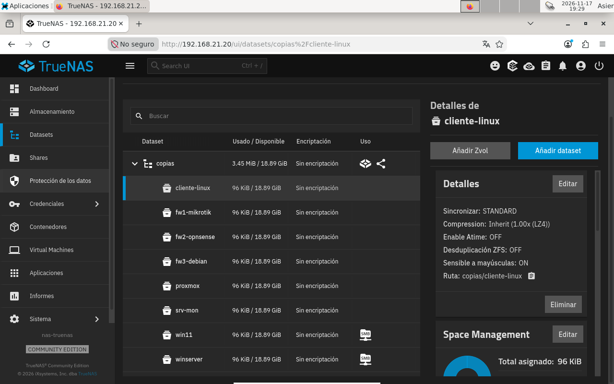

Demuestra: un dataset por equipo dentro de `copias` (los 3 firewalls, proxmox, srv-mon, cliente-linux, winserver y win11).

Evidencia: [`truenas-servicios.png`](../../evidencias/tasca5/truenas-servicios.png). Demuestra: **NFS, SMB y SSH** encendidos y con arranque automático; el resto, parados.

**Dato clave:** **8 datasets**, 3 protocolos. Límite: un solo disco, sin redundancia (en el laboratorio todos los discos están en el mismo SSD, así que un espejo no protegería de nada).

### a105 · Copias automáticas (Apte+)

**Qué pedía:** que las copias se hagan solas.

**Qué hice:** un script en Server-Monitorizacion (srv-mon), lanzado por **cron** (el programador de tareas de Linux) cada día a las **02:30**. Copia por SSH el firewall que esté encendido, srv-mon, la configuración de Proxmox y la de TrueNAS. Las VMs de Proxmox las copia el propio Proxmox cada domingo a las 02:00.
Un solo equipo recoge todo: hay un solo registro que mirar. Borra las copias de más de 30 días para no llenar el disco.

Evidencia: [`copias-auto-cron.txt`](../../evidencias/tasca5/copias-auto-cron.txt).
Demuestra: el `crontab`, lo que escribió cron en el registro a la hora de la prueba (`=== Fin (todo OK)`), los ficheros nuevos en TrueNAS y la tarea semanal de Proxmox.

**Dato clave:** cron lanzó la copia **solo** y acabó «todo OK». N/C: todavía no he visto una ejecución real de madrugada (las VMs están apagadas de noche).

### a258 · Problemas posibles, configuraciones críticas y tiempo de respuesta

**Qué pedía:** saber qué puede fallar en cada sistema, qué configuración es crítica y cuánto tardo en arreglar un fallo de arranque.

| Sistema | Qué puede fallar | Configuración crítica |
|---|---|---|
| Firewalls | Dos encendidos a la vez (IP .1 duplicada) | IP de LAN y NAT |
| Proxmox | Cambiar nombre o IP de un nodo después de crear el clúster | IP de cada nodo y quórum |
| TrueNAS | Sin un disco aparte no hay pool | Pool `copias` y sus recursos compartidos |
| Windows | No arranca del DVD; no detecta la tarjeta de red | IP fija y DNS |
| Debian | Una línea mala en `fstab` (el fichero de discos que se montan al arrancar) lo deja en modo de emergencia | `fstab`, red, `sources.list` |

**Fallo provocado:** en srv-mon puse en `fstab` un disco que no existe. Al reiniciar, entró en **modo de emergencia** y, como root está bloqueado, no dejaba entrar.
Lo arreglé desde **GRUB** (el menú de arranque): le dije que no montara ese disco, entré, corregí la línea y reinicié.

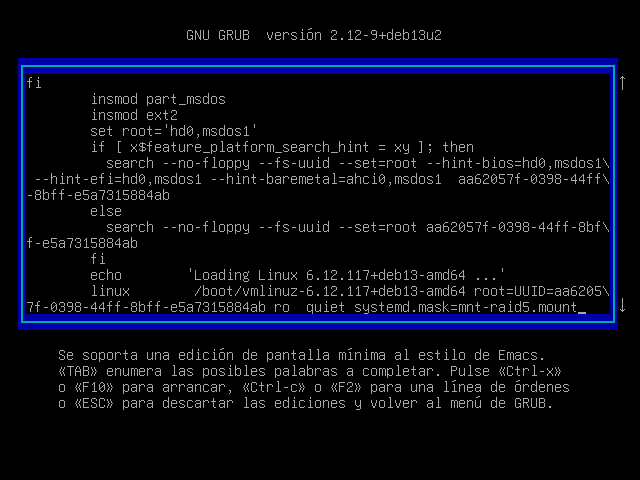

Demuestra: el arreglo sin disco de rescate: en GRUB se añade `systemd.mask=mnt-raid5.mount` para que arranque sin ese disco.

Evidencia: [`srv-mon-p16-incidencia-arranque.txt`](../../evidencias/tasca5/srv-mon-p16-incidencia-arranque.txt). Demuestra: la hora de cada paso, medida con una sonda SSH cada 2 s.

**Dato clave:** **2 min 10 s** desde que vi el fallo hasta dejarlo bien. Lección: poner `nofail` en los discos de datos y comprobar con `findmnt --verify` antes de reiniciar.

## FW1 · MikroTik CHR (a203–a209)

MikroTik no se instala: se descarga como **disco ya instalado** (CHR). Lo configuré con un script comentado ([`fw1-mikrotik.rsc`](../../configs/fw1-mikrotik/fw1-mikrotik.rsc)) que el router descarga e importa.
La licencia gratuita limita cada interfaz a **1 Mbit/s** de subida: medí 1083 kbit/s ([captura](../../evidencias/tasca5/fw1-mikrotik-limite-1mbit.png)). Por eso, para descargas grandes, uso los otros firewalls.

| ID | Qué pide | Evidencia | Demuestra · dato clave |
|---|---|---|---|
| a203 | Instalar, versión y funcionamiento | [versión](../../evidencias/tasca5/fw1-mikrotik-version.png) | **RouterOS 7.25.1**, 288 MiB de RAM (79 libres) |
| a204 | Usuario de administración | [usuarios](../../evidencias/tasca5/fw1-mikrotik-licencia-usuarios.png) | `admin` y **`asier`**, los dos del grupo `full` (todos los permisos) |
| a205 | Red WAN y LAN | [IP y rutas](../../evidencias/tasca5/fw1-mikrotik-ip-rutas.png) | `ether1` **10.0.2.15/24** por DHCP · `ether2` **192.168.21.1/24** · ruta por defecto por 10.0.2.2 |
| a206 | Internet para la LAN | [NAT](../../evidencias/tasca5/fw1-mikrotik-nat-filtro.png) · [traceroute](../../evidencias/tasca5/fw1-mikrotik-traceroute.png) | Regla **masquerade** (NAT) y el cliente sale por .1 → 10.0.2.2 → Internet |
| a207 | Permitida, bloqueada y registro | [prueba](../../evidencias/tasca5/fw1-mikrotik-prueba-bloqueada-permitida.png) · [registro](../../evidencias/tasca5/fw1-mikrotik-log-bloqueo.png) | HTTP (80) **bloqueado**, HTTPS (443) **200 OK**; el registro dice qué regla, quién y adónde |
| a208 | Copia en el NAS | [`fw1-copia-errada-recuperacion.txt`](../../evidencias/tasca5/fw1-copia-errada-recuperacion.txt) | `/export` (texto) + copia binaria en TrueNAS, con SHA-256 **OK** |
| a209 | Fallo y recuperación | el mismo fichero | Borré la regla de NAT; la recuperé de la copia. **25 s** sin Internet |

**Cómo se lee el registro (a207):** `P8-BLOQUEO-HTTP forward: in:ether2 out:ether1 … 192.168.21.60:57090->34.223.124.45:80`.
El prefijo dice **qué regla** actuó; `forward`, que el paquete **atravesaba** el router; `in:ether2 out:ether1`, que iba de la LAN a Internet; y el final, **quién** (Client-Linux) y **adónde** (puerto 80, HTTP). El mismo puerto de origen en varias líneas son reintentos de la misma conexión.

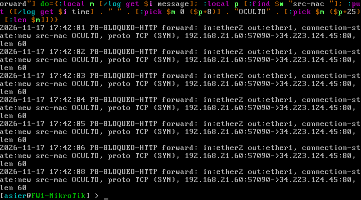

Demuestra: cada intento de Client-Linux al puerto 80 queda registrado con el prefijo de mi regla, `P8-BLOQUEO-HTTP`.

## FW2 · OPNsense (a210–a216)

Lo instalé con UFS (gasta menos RAM que ZFS). Por consola cambié las interfaces, porque el instalador las pone al revés (WAN = em0, LAN = em1). El resto, por su web, desde Client-Linux.
Por defecto, OPNsense ya trae el NAT de salida y una regla que deja salir a la LAN: sin tocar nada, los clientes tienen Internet.

| ID | Qué pide | Evidencia | Demuestra · dato clave |
|---|---|---|---|
| a210 | Instalar, versión y funcionamiento | [versión antes](../../evidencias/tasca5/fw2-opnsense-login-asier-version-antes.png) · [HTTPS](../../evidencias/tasca5/fw2-opnsense-https-internet.png) | **26.7** instalado (luego 26.7.9_3) y el firewall sale a Internet (`HTTP 200`) |
| a211 | Usuario de administración | [usuarios](../../evidencias/tasca5/fw2-opnsense-usuario-asier-admins.png) | `root` y **`asier`**, los dos en el grupo **admins** |
| a212 | Red WAN y LAN | [interfaces](../../evidencias/tasca5/fw2-opnsense-interfaces-wan-lan.png) | WAN `em0` **10.0.2.15/24** por DHCP · LAN `em1` **192.168.21.1/24**, sin servidor DHCP |
| a213 | Internet para la LAN | [Client-Linux](../../evidencias/tasca5/client-linux-red-y-salida-internet.png) | Client-Linux sale por el .1 con **HTTP/1.1 200 OK** sin tocar ninguna regla |
| a214 | Permitida, bloqueada y registro | [regla](../../evidencias/tasca5/fw2-opnsense-regla-bloqueo-http-lan.png) · [prueba](../../evidencias/tasca5/client-linux-prueba-http-bloqueado-https-ok.png) · [registro](../../evidencias/tasca5/fw2-opnsense-log-live-bloqueo-http.png) | Regla «P6 bloqueo HTTP» **la primera**; HTTP se queda colgado, HTTPS **200 OK**; el registro marca `block` con la etiqueta de la regla |
| a215 | Copia en el NAS | [`fw2-copia-errada-recuperacion.txt`](../../evidencias/tasca5/fw2-copia-errada-recuperacion.txt) | `config.xml` (toda la configuración, 40 KB) en TrueNAS. La saca srv-mon por la API (la interfaz para programas) con un usuario que **solo puede hacer copias** |
| a216 | Fallo y recuperación | [fallo](../../evidencias/tasca5/fw2-sintoma-lan-254.png) · [recuperación](../../evidencias/tasca5/fw2-recuperacion-desde-truenas.png) | Cambié la IP de LAN a .254; restauré la copia (mismo SHA-256). **2 min 47 s** sin servicio, casi todo el reinicio |

**Cómo se lee el registro (a214):** interfaz **LAN**, dirección **in**, origen **192.168.21.60** (Client-Linux), destino **34.223.124.45:80** (HTTP), acción **block** y etiqueta **P6 bloqueo HTTP**.
Hay varias líneas por cada intento porque el cliente no recibe respuesta y lo vuelve a intentar.

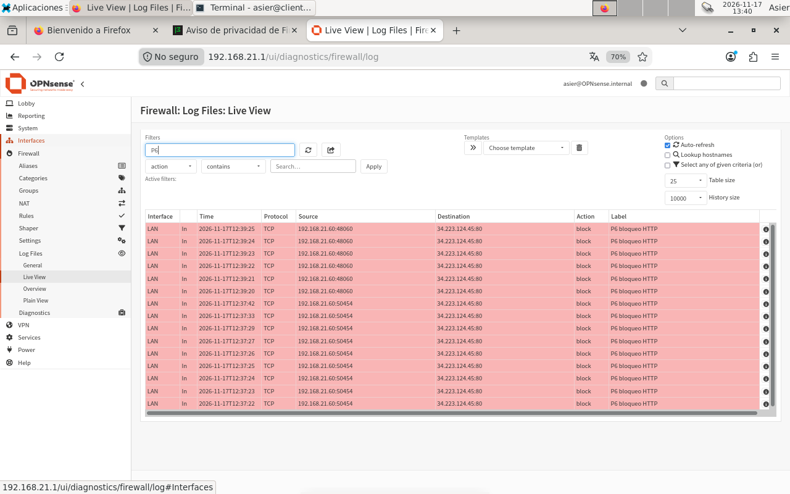

Demuestra: el registro en directo de OPNsense con la acción **block** y la etiqueta **P6 bloqueo HTTP** para Client-Linux (.60) hacia el puerto 80.

**Importante:** el firewall usa **la primera regla que coincide**. Al principio mi regla quedó debajo de «permitir todo» y no bloqueaba nada (incidencia 5); la subí arriba. Después la **desactivé** (sin borrarla) porque los instaladores de Debian y Proxmox necesitan HTTP.

## FW3 · Debian con nftables (a217–a223)

Es el firewall más «a mano»: no tiene web, todo son ficheros de texto. Los preparé comentados en el repositorio ([`configs/fw3-debian/`](../../configs/fw3-debian/)) y un script los aplica dentro de la VM.
Las reglas (`nftables.conf`): todo **prohibido por defecto** (`policy drop`); se deja pasar lo que ya está establecido, SSH solo desde la LAN y la LAN hacia Internet. Antes, una regla bloquea HTTP con registro. Y `ip_forward=1`, para que Linux pase paquetes de una tarjeta a otra.

| ID | Qué pide | Evidencia | Demuestra · dato clave |
|---|---|---|---|
| a217 | Instalar, versión y funcionamiento | [versión y red](../../evidencias/tasca5/fw3-debian-version-red.png) | **Debian 13.7**, nftables 1.1.3, `ip_forward=1` y nftables arranca solo |
| a218 | Usuario de administración | la misma captura | `root` solo para emergencias y **`asier` en el grupo `sudo`** (`27(sudo)`) |
| a219 | Red WAN y LAN | la misma captura | WAN `enp0s3` **10.0.2.15/24** (DHCP) · LAN `enp0s8` **192.168.21.1/24** · una sola ruta por defecto |
| a220 | Internet para la LAN | [HTTPS y traceroute](../../evidencias/tasca5/fw3-debian-https-200-traceroute.png) | Client-Linux: **200 OK** y camino .1 → 10.0.2.2 → Internet (NAT con `masquerade`) |
| a221 | Permitida, bloqueada y registro | [reglas](../../evidencias/tasca5/fw3-debian-nft-ruleset.png) · [prueba](../../evidencias/tasca5/fw3-debian-prueba-bloqueada-permitida.png) · [registro](../../evidencias/tasca5/fw3-debian-log-bloqueo.png) | El bloqueo va **antes** del permiso; HTTP bloqueado, HTTPS permitido; cada intento queda en el registro del kernel |
| a222 | Copia en el NAS | [`fw3-copia-errada-recuperacion.txt`](../../evidencias/tasca5/fw3-copia-errada-recuperacion.txt) | `tar` con `nftables.conf`, `interfaces` y `ip_forward` + lista de paquetes, en TrueNAS con su SHA-256. El sistema no: reinstalar son 10 min |
| a223 | Fallo y recuperación | [fallo](../../evidencias/tasca5/fw3-errada-nftables-vacio.png) · [recuperación](../../evidencias/tasca5/fw3-recuperacion-desde-truenas.png) | Vacié `nftables.conf` (sin reglas ni NAT); lo restauré y comprobé la sintaxis (`nft -c` = 0). **39 s** sin Internet |

**Cómo se lee el registro (a221):** `P7-BLOQUEO-HTTP IN=enp0s8 OUT=enp0s3 SRC=192.168.21.60 DST=34.223.124.45 PROTO=TCP DPT=80 SYN TTL=63`.
Entró por la LAN, iba a salir por la WAN, lo intentó Client-Linux hacia el puerto 80. `SYN` es el primer paquete de la conexión: se corta ahí. `TTL=63` (salió con 64) prueba que el paquete pasó por el router antes de tirarse.

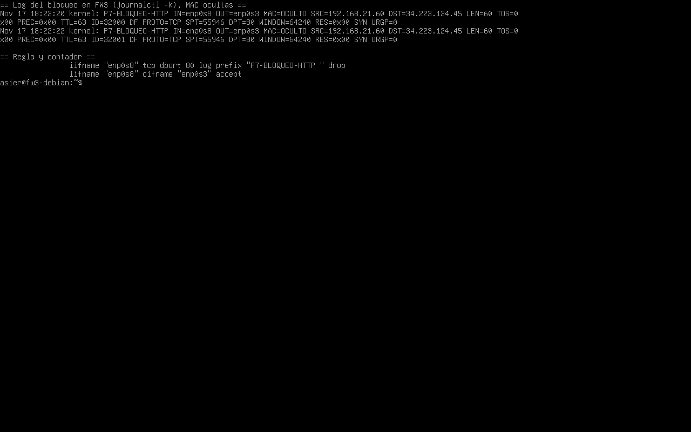

Demuestra: el registro del kernel de FW3 con una línea `P7-BLOQUEO-HTTP` por cada reintento de la misma conexión.

## NAS-TrueNAS (a224–a227)

Es el servidor de copias de todo el laboratorio. TrueNAS exige **un disco solo para el sistema** (16 GB) y otro aparte para los datos (20 GB).

| ID | Qué pide | Evidencia | Demuestra · dato clave |
|---|---|---|---|
| a224 | Instalar, versión y funcionamiento | [instalación](../../evidencias/tasca5/truenas-instalacion-sda.png) · [panel](../../evidencias/tasca5/truenas-dashboard-version.png) | Instalado en el disco de 16 GB; la web responde desde Client-Linux: **25.10.7** (luego 25.10.8) |
| a225 | Usuario de administración | [usuario](../../evidencias/tasca5/truenas-usuario-asier.png) · [login](../../evidencias/tasca5/truenas-login-asier.png) | `truenas_admin` y **`asier`** con rol **Full Admin**; `asier` entra |
| a226 | Red | [red](../../evidencias/tasca5/truenas-red.png) | **192.168.21.20/24**, puerta de enlace .1, DNS .1 y 1.1.1.1 |
| a227 | Disco aparte para copias | [pool](../../evidencias/tasca5/truenas-pool-copias.png) | Pool **`copias`** en el disco de 20 GB, **sin errores**, **18,89 GiB** útiles |

ZFS (el sistema de ficheros de TrueNAS) guarda una parte para sus datos internos; por eso de 20 GB quedan 18,89 útiles.

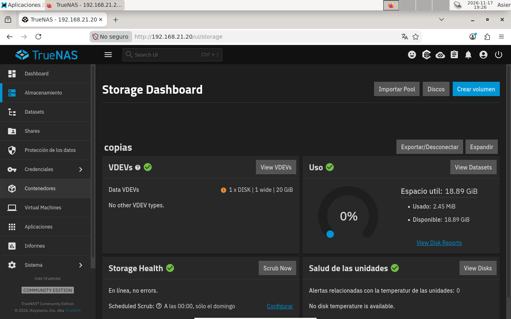

Demuestra: el pool `copias` en el disco de 20 GiB, en línea y sin errores, con 18,89 GiB útiles.

## Proxmox VE: clúster y migración (a228–a232, a235, a236)

Tres nodos de virtualización **dentro de VirtualBox** (virtualización anidada: una VM que crea VMs). Por eso necesitan VT-x anidada y la tarjeta en modo promiscuo (que deje pasar el tráfico de las VMs de dentro).
Disco local con LVM-thin y no ZFS, porque ZFS pide mucha RAM y cada nodo tiene 3 GB.

| ID | Qué pide | Evidencia | Demuestra · dato clave |
|---|---|---|---|
| a228 | Instalar, versión y funcionamiento | [instalación](../../evidencias/tasca5/proxmox-node1-instalacion-ok.png) · [versión](../../evidencias/tasca5/proxmox-pve1-version-despues.png) | Los 3 nodos instalados; **9.2.28** con el repositorio gratuito de actualizaciones |
| a229 | Usuario de administración | [permiso](../../evidencias/tasca5/proxmox-pve1-permiso-asier.png) · [en pve2](../../evidencias/tasca5/proxmox-p11b-asier-en-pve2.png) | **`asier@pve`** con rol **Administrator** en todo el clúster; creado en pve1, entra también en pve2 |
| a230 | Red | [primer arranque](../../evidencias/tasca5/proxmox-node1-primer-arranque.png) · [DNS](../../evidencias/tasca5/proxmox-pve1-dns.png) | IPs fijas **.10 / .11 / .12** en el puente `vmbr0`; DNS .1 y 1.1.1.1 |
| a231 | Copia y qué se copia | [`proxmox-copias-nfs.txt`](../../evidencias/tasca5/proxmox-copias-nfs.txt) | Copia de la VM 150 (**568 MB en 10 s**) y del contenedor 151 (**159 MB en 12 s**) por NFS en TrueNAS, + la configuración del clúster |
| a232 | Clúster | [3 nodos](../../evidencias/tasca5/proxmox-p11b-datacenter-3-nodos.png) · [`pvecm status`](../../evidencias/tasca5/proxmox-p11b-pvecm-status.png) | Clúster `thinklab`: **3 nodos online, Quorate: Yes**, 3 votos |
| a235 | Migrar una VM y un contenedor | [VM](../../evidencias/tasca5/proxmox-p11c-migracion-vm150.png) · [contenedor](../../evidencias/tasca5/proxmox-p11c-migracion-ct151.png) · [VM en pve2](../../evidencias/tasca5/proxmox-p11c-vm150-en-pve2.png) | VM 150 (Debian sin escritorio) pve1 → pve2 y contenedor 151 pve1 → pve3: **TASK OK**, y siguen funcionando |
| a236 | Medir tiempo y espacio | las mismas + [espacio](../../evidencias/tasca5/proxmox-p11c-espacio-pve2-despues.png) | Tabla de abajo |

**Qué copio y qué no (a231):** copio las VMs y la configuración del clúster. No copio Proxmox (se reinstala de la ISO) ni las ISOs y plantillas (se vuelven a descargar).

**Clúster y quórum (a232):** un **clúster** son varios servidores que se gestionan como uno. El **quórum** es la mayoría (2 de 3): sin ella, el clúster no deja hacer cambios, para no estropear nada.

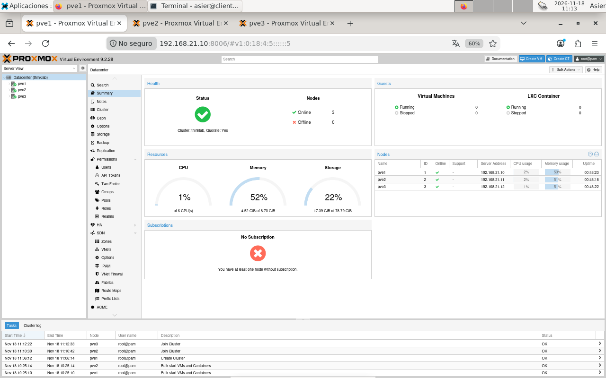

Demuestra: *Cluster: thinklab, Quorate: Yes*, 3 nodos online (.10, .11 y .12) y 0 offline.

**Medidas de la migración (a236):** migración **offline** (apagadas) con disco local.

| | VM 150 → pve2 | Contenedor 151 → pve3 |
|---|---|---|
| Disco asignado / datos de verdad | 8 GiB / ~1,4 GB | 4 GiB / ~0,6 GB |
| Copiado por la red | 8,6 GB (el disco entero) | 4,3 GB (el disco entero) |
| Tiempo total | **40 s** | **22 s** |
| Velocidad | 237 MB/s | 247 MB/s |
| Espacio en el destino | 1,40 GB | 624 MB |

**Interpretación:** la velocidad fue casi igual, así que **tiempo ≈ tamaño del disco ÷ velocidad**. Se copia el disco entero, ceros incluidos; en el destino ocupa solo lo usado.
El contenedor es más ligero: no lleva núcleo propio y su disco es más pequeño. Hay corte de servicio, porque es offline.
**Mejoras:** almacenamiento compartido en el NAS (solo se mueve la configuración: segundos), migración en caliente (sin apagar) y discos ajustados al uso real.

## WinServer-2025 (a237–a241)

Instalación desatendida (sin responder preguntas), con el escritorio. Disco en controlador SATA, porque Windows no arranca desde IDE.

| ID | Qué pide | Evidencia | Demuestra · dato clave |
|---|---|---|---|
| a237 | Instalar, versión y funcionamiento | [antes](../../evidencias/tasca5/winserver-winver-antes.png) · [después](../../evidencias/tasca5/winserver-winver-despues.png) | **Windows Server 2025 Standard**, 26100.1742 → **26100.33438** con Windows Update |
| a238 | Usuarios de administración | [PowerShell](../../evidencias/tasca5/winserver-usuarios-administradores.png) · [GUI](../../evidencias/tasca5/winserver-gui-administradores.png) | **Administrador** y **asier** en el grupo Administradores; el inicio de sesión automático, quitado |
| a239 | Red | [IPv4](../../evidencias/tasca5/winserver-gui-ipv4.png) · [ping](../../evidencias/tasca5/winserver-ipconfig-ping.png) · [DNS y HTTPS](../../evidencias/tasca5/winserver-dns-https.png) | **192.168.21.30/24**, puerta de enlace .1, DNS .1 y 1.1.1.1; ping 0 % de pérdida; HTTPS **200 OK** |
| a240 | Copia y qué se copia | [`winserver-copia-smb.txt`](../../evidencias/tasca5/winserver-copia-smb.txt) | Configuración exportada en texto (roles, red, usuarios, directivas) y documentos, por **SMB** a TrueNAS: **9 ficheros, 17,6 KB en 13 s** |
| a241 | Qué es un dominio | explicación de abajo | — |

**Qué no copio (a240):** Windows y los programas (se reinstalan) ni el «estado del sistema» (ocupa varios GB). Sin dominio, la exportación en texto basta para rehacerlo; **con** Active Directory sí haría falta, porque es la única forma de recuperar el dominio.

**Contraseñas:** Windows Server pide **3 de 4 tipos** de carácter (mayúsculas, minúsculas, números y símbolos). Lo comprobé: sin mayúscula la rechaza ([captura](../../evidencias/tasca5/winserver-complejidad-rechazada.png)).

**Qué es un dominio (a241).** Un **dominio** (en Windows, **Active Directory**) es una base de datos central, en un servidor llamado **controlador de dominio**, con todos los usuarios, los equipos y las normas de la empresa. Los ordenadores se unen al dominio y le preguntan quién puede entrar y qué puede hacer.
Qué aporta a la empresa:
1. **Usuarios en un solo sitio:** con 30 ordenadores, creo el usuario una vez y el trabajador entra en cualquiera. Sin dominio, habría que crearlo 30 veces.
2. **Bajas seguras:** si alguien se va, deshabilito su usuario una vez y pierde el acceso a toda la red al momento.
3. **Normas para todos a la vez (GPO, directivas de grupo):** por ejemplo, bloquear los USB o no dejar instalar programas en todos los equipos.

Necesita un servidor siempre encendido (mejor dos) y DNS. WinServer-2025 (.30) sería el candidato, pero la rúbrica individual solo pide explicarlo, así que no lo monté.

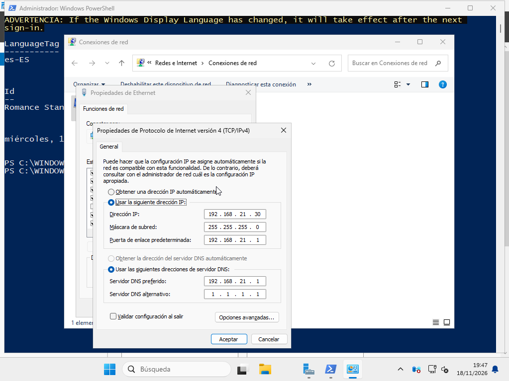

Demuestra: la IP fija **192.168.21.30/24**, puerta de enlace .1 y DNS .1 y 1.1.1.1: lo que necesitaría para ser controlador de dominio.

## Server-Monitorizacion (a242–a246)

Debian sin escritorio. Es el servidor de infraestructura: lanza las copias automáticas y tiene el laboratorio de RAID (Tasca 6).
El instalador no podía descargar paquetes porque mis firewalls bloquean HTTP. No toqué el firewall: puse las fuentes de `apt` por **HTTPS** ([`sources.list`](../../configs/debian/sources.list)).

| ID | Qué pide | Evidencia | Demuestra · dato clave |
|---|---|---|---|
| a242 | Instalar, versión y funcionamiento | [versión y red](../../evidencias/tasca5/srv-mon-version-red.png) · [actualizado](../../evidencias/tasca5/srv-mon-actualizado.png) | **Debian 13.7**, kernel 6.12.117, 0 paquetes pendientes |
| a243 | Usuario de administración | [versión y red](../../evidencias/tasca5/srv-mon-version-red.png) | **`asier` en el grupo `sudo`** y **root bloqueado** (sin contraseña: no se puede atacar) |
| a244 | Red | [versión y red](../../evidencias/tasca5/srv-mon-version-red.png) · [ping y HTTPS](../../evidencias/tasca5/srv-mon-ping-https-discos.png) | **192.168.21.40/24**, ruta por .1, DNS .1 y 1.1.1.1; ping 0 % de pérdida y HTTPS 200 |
| a245 | Copia y qué se copia | [`srv-mon-copia.txt`](../../evidencias/tasca5/srv-mon-copia.txt) | `/etc`, los scripts de copias, el `crontab` y la clave **pública**: **424 KB en ~1 s**, SHA-256 comprobado en el NAS. Nunca la clave privada |
| a246 | Software necesario | [versión y red](../../evidencias/tasca5/srv-mon-version-red.png) | Solo utilidades estándar + **SSH** (`active` y `enabled`). Lo demás, cuando una tarea lo pida |

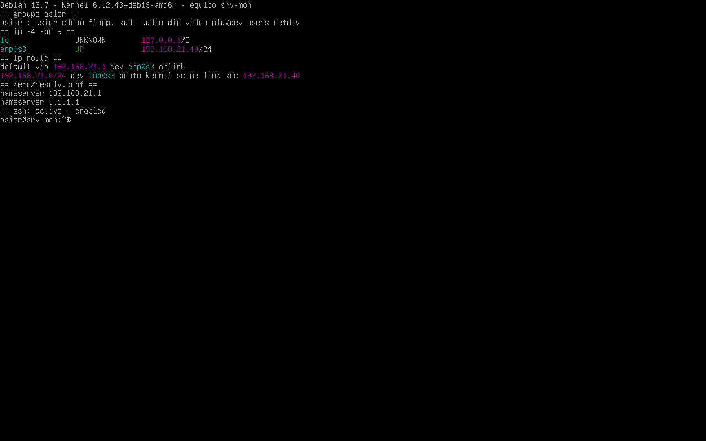

Demuestra: Debian 13.7, `asier` en `sudo`, IP 192.168.21.40/24 con ruta por .1, DNS .1 y 1.1.1.1, y SSH activo.

## Client-Win11 (a247–a250)

Windows 11 **exige** UEFI, Secure Boot (arranque seguro: solo arranca software firmado) y TPM 2.0 (un chip de seguridad). VirtualBox 7 los emula.

| ID | Qué pide | Evidencia | Demuestra · dato clave |
|---|---|---|---|
| a247 | Instalar, versión y funcionamiento | [requisitos](../../evidencias/tasca5/win11-requisitos-tpm-secureboot-uefi.png) · [versión](../../evidencias/tasca5/win11-winver-262009974.png) · [al día](../../evidencias/tasca5/win11-windows-update-al-dia.png) | **UEFI, Secure Boot True, TPM 2.0**; **Windows 11 Pro 25H2** 26200.6584 → **26200.9974**, «Todo está actualizado» |
| a248 | Usuario de administración | [usuarios](../../evidencias/tasca5/win11-usuarios-autologon-off.png) | **asier** en Administradores; el Administrador integrado, deshabilitado; inicio de sesión automático, quitado |
| a249 | Red | [red](../../evidencias/tasca5/win11-ipconfig-ping-https.png) · [teclado y zona](../../evidencias/tasca5/win11-teclado-zona.png) | **192.168.21.50/24**, puerta de enlace .1; ping 0 % de pérdida; HTTPS **200 OK**; teclado español y hora de Madrid |
| a250 | Copia y qué se copia | [`win11-copia-smb.txt`](../../evidencias/tasca5/win11-copia-smb.txt) | Escritorio, Documentos e Imágenes por **SMB** con `robocopy`. No copio Windows ni los programas (se reinstalan) ni las cachés |

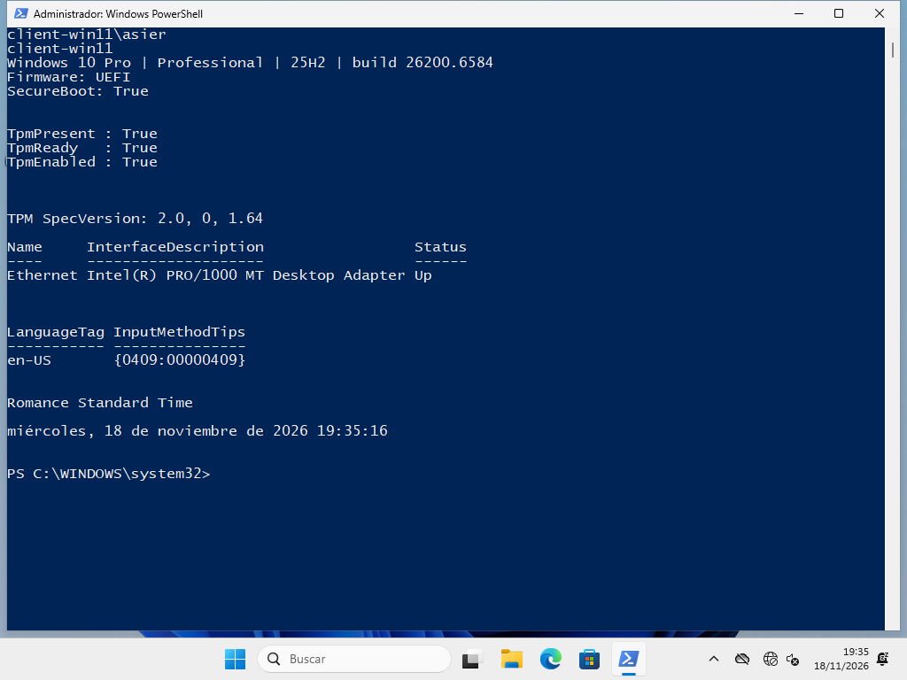

Demuestra: Firmware **UEFI**, **SecureBoot: True** y **TPM 2.0** presente y listo: los tres requisitos de Windows 11.

## Client-Linux (a252–a255)

Debian 13 con escritorio XFCE. Es mi **puesto de gestión**: desde su navegador abro las webs de OPNsense, Proxmox y TrueNAS (el anfitrión no está en LAN_21).

| ID | Qué pide | Evidencia | Demuestra · dato clave |
|---|---|---|---|
| a252 | Instalar, versión y funcionamiento | [versión](../../evidencias/tasca5/client-linux-version-usuario.png) · [descarga](../../evidencias/tasca5/client-linux-tiempos-descarga-instalador.png) | **Debian 13.7** + XFCE; el instalador descargó ~900 MB pasando por el firewall |
| a253 | Usuario de administración | [versión](../../evidencias/tasca5/client-linux-version-usuario.png) | Sesión de **`asier`**, que después metí en el grupo `sudo` (root solo para emergencias) |
| a254 | Red | [red](../../evidencias/tasca5/client-linux-red-y-salida-internet.png) | **192.168.21.60/24**, ruta por .1, DNS .1 y 1.1.1.1; ping 0 % de pérdida; HTTPS **200 OK** |
| a255 | Copia y qué se copia | [copia](../../evidencias/tasca5/cliente-linux-copia-home.png) | `/home/asier` sin la caché: 64 MB → **27 MB en 2 s**, SHA-256 **OK** en el NAS |

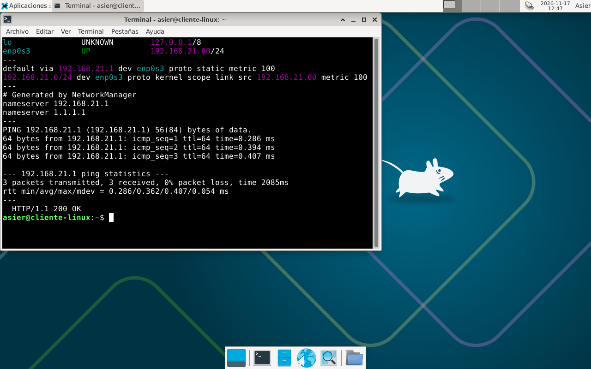

Demuestra: 192.168.21.60/24, ruta por defecto por .1, ping al firewall sin pérdidas y `HTTP/1.1 200 OK` hacia Internet.

**Recuperar un documento (a255):** borré un documento de `asier` y lo recuperé de TrueNAS: mismo SHA-256, mismos permisos y misma fecha ([`recuperar-documento-cliente-linux.txt`](../../evidencias/tasca5/recuperar-documento-cliente-linux.txt)).
No copio el sistema ni el escritorio (se reinstalan) ni la clave privada SSH (un secreto copiado es una fuga más).

## Resumen de los fallos provocados en los firewalls

| Firewall | Qué rompí | Cómo lo recuperé | Sin servicio |
|---|---|---|---|
| FW1-MikroTik | Borré la regla de NAT | Importé solo esa parte de la copia | **25 s** |
| FW3-Debian-NFT | Vacié `nftables.conf` | Restauré el fichero de la copia | **39 s** |
| FW2-OPNsense | IP de LAN cambiada a .254 | Restauré toda la configuración y reinicié | **2 min 47 s** |

**Qué he aprendido:** el tiempo lo marca **cómo** recupero, no la copia. Recuperar solo la parte rota tarda segundos; restaurar todo con reinicio, minutos. Y comprobar el SHA-256 antes de restaurar me asegura que restauro lo mismo que copié.

## Problemas que tuve

- **Mi regla de bloqueo no bloqueaba (incidencia 5).** Estaba debajo de «permitir todo». Los firewalls usan la primera regla que coincide: la subí arriba.
- **Los instaladores de Debian no descargaban (incidencia 12).** Mis firewalls bloquean HTTP y el instalador usa `http://`. Solución: `apt` por HTTPS.
- **TrueNAS decía «al día» con la 25.10.7 (incidencia 22).** El perfil de actualizaciones escondía la 25.10.8; al cambiarlo a GENERAL, apareció.
- **Windows Server no arrancaba del DVD (incidencia 19).** Con UEFI hay que pulsar una tecla en «Press any key»; la instalación desatendida no lo hacía.
- **La consola de emergencia no dejaba entrar (incidencia 27).** Root está bloqueado en srv-mon. Entré por GRUB (ver a258).

Lista completa de incidencias: [10-incidencies](../../docs/10-incidencies.md).

Más detalle técnico: [03-sistemes](../../docs/03-sistemes.md) (imágenes y hashes) · [06-installacions](../../docs/06-installacions.md) (cada instalación paso a paso) · [09-copies-contingencia](../../docs/09-copies-contingencia.md) (copias y recuperaciones).
