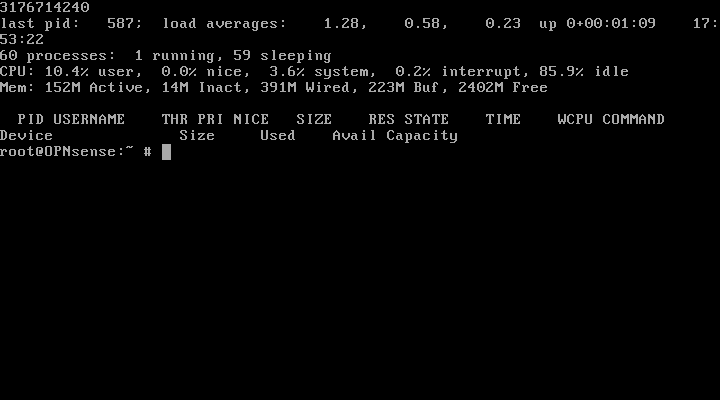

# Tasca 7 · Rendiment i diagnòstic

Evidencias de esta tarea: [../../evidencias/tasca7/](../../evidencias/tasca7/)

> Entrega individual · Asier · puesto 21 · proyecto «Naix un sistema» V2.0. Documento autocontenido: el contenido sale de [`docs/`](../../docs/) y las evidencias están en [`evidencias/`](../../evidencias/). Uso de IA declarado en [11-us-ia](../../docs/11-us-ia.md).

**Objetivo:** Medir CPU, RAM, disco y red con carga, ver qué se satura, cuántas VMs se pueden usar sin bloquear el PC y aplicar dos optimizaciones comparando antes y después.

**En pocas palabras:** he medido cuánto trabajo aguanta el PC con varias máquinas virtuales encendidas y haciendo cosas a la vez (copias, arranques, migraciones). Con 8 máquinas el PC sigue respondiendo bien; lo primero que se acaba es la memoria RAM, y después el disco. Luego he hecho dos mejoras (darle menos memoria al firewall que le sobraba y usar una tarjeta de red virtual más eficiente) y he medido que de verdad mejoran.

## 1. Actividades de la rúbrica

| ID | Nivel | RA | Actividad (texto de la rúbrica) | Estado |
|---|---|---|---|---|
| a22 | Apte | FDM-RA1 | Mesurar CPU, RAM, disc i xarxa durant les càrregues previstes. | ✅ hecha |
| a23 | Apte | FDM-RA1 · ISO-RA6 | Interpretar les mesures i identificar els recursos saturats. | ✅ hecha |
| a24 | Apte | FDM-RA1 | Determinar la capacitat del maquinari per executar les VM. | ✅ hecha |
| a119 | Apte | ISO-RA6 | Analitzar els recursos físics amb diferents càrregues de VM. | ✅ hecha |
| a120 | Apte | ISO-RA6 | Determinar quantes VM permeten treballar sense bloquejar l’equip. | ✅ hecha |
| a121 | Apte | ISO-RA6 | Lliurar l’informe de mesures i conclusions. | ✅ hecha |
| a123 | Apte+ | ISO-RA6 | Proposar i aplicar una primera optimització de les VM. | ✅ hecha |
| a124 | Apte+ | ISO-RA6 | Proposar i aplicar una segona optimització de les VM. | ✅ hecha |
| a125 | Apte+ | ISO-RA6 | Comparar les mesures de rendiment abans i després. | ✅ hecha |

## 2. Cómo leer esta entrega
Cada apartado sigue el ThinkLoop: **predicción → decisión → implementación → verificación → análisis**. Cada evidencia va con una línea «Demuestra: …».

## 3. Mediciones, interpretación y optimizaciones

> **En pocas palabras:** he medido cuánto trabajo aguanta el PC con varias máquinas virtuales encendidas y haciendo cosas a la vez (copias, arranques, migraciones). Con 8 máquinas el PC sigue respondiendo bien; lo primero que se acaba es la memoria RAM, y después el disco. Luego he hecho dos mejoras (darle menos memoria al firewall que le sobraba y usar una tarjeta de red virtual más eficiente) y he medido que de verdad mejoran.
> P17 y P18 (19/11/2026, PC de clase). Reparto del trabajo: ver [11-us-ia](../../docs/11-us-ia.md).

**Predicción (Asier):** no indicada (respondió «paso» el 21/11). **Resultado:** sin predicción, no se puede valorar si acertó o falló.

**Anfitrión (PC de clase):** 12 hilos de CPU, 31 GiB de RAM, 15 GiB de swap, las VMs en `/dev/sda` (ver [02-inventari](../../docs/02-inventari.md)). VirtualBox 7.0.20.

**Cómo se mide:** `scripts/50-medir-rendimiento.sh <escenario> <segundos>` toma una muestra cada 5 s en el **anfitrión** con `vmstat` (CPU, RAM, swap), `iostat -x` (disco donde están las VMs) y `sar -n DEV` (red real). Para saber si el equipo **se bloquea**, mide la **latencia del anfitrión**: cuánto se retrasa un `sleep 0.1` (si la CPU está saturada, se retrasa). Cada escenario se mide **con carga**, no en reposo. Los resultados completos (resumen + todas las muestras) están en `evidencias/tasca7/`.

### 1. Línea base (anfitrión sin VMs)
Todas las VMs apagadas, 60 s: CPU **99 % libre**, **22,7 GiB** libres, disco al 0 %, latencia 2 ms. Evidencia: [`2026-11-19_rendimiento-0-linea-base-sin-vms.txt`](../../evidencias/tasca7/2026-11-19_rendimiento-0-linea-base-sin-vms.txt).

### 2. Medición por escenario — a22, a119
| Escenario (VMs encendidas) | RAM asignada | Carga durante la medida | CPU usada (us+sy) · wa | RAM libre mín. · swap | Disco `sda` (%util media · máx · MB/s) | ¿Se bloquea? (latencia) |
|---|---|---|---|---|---|---|
| **0** · ninguna | 0 GiB | — | 1 % · 0 % | 22,7 GiB · 0 | 0 % · 0 % | No (2 ms) |
| **C** · FW2 + TrueNAS + srv-mon + Client-Linux | 15 GiB | srv-mon envía datos a TrueNAS sin parar (12,5 GB en 95 s ≈ **131 MB/s**) | 22 % · 0 % | 13,7 GiB · 0 | 41 % · 75 % · 144 MB/s escritura | No (2 ms) |
| **B+C** · + los 3 nodos Proxmox (VM 150 y CT 151 encendidos) | 24 GiB | `vzdump` de la VM 150 a TrueNAS sin parar (11 copias de 8 GiB en 129 s) | 18 % · 1 % | 5,0 GiB · 0 | **59 % · 78 %** · 118 MB/s lectura + 71 escritura | No (2 ms) |
| **Máx** · B+C + WinServer-2025 arrancando | **28 GiB** | lo mismo + el arranque de Windows Server | 20 % · 3 % | **0,3 GiB** (disponible ≈ 2,2 GiB) · 0 | **62 % · 91 %** · 118 + 57 MB/s | No (2 ms), y WinServer arranca con normalidad |

Evidencias: [C](../../evidencias/tasca7/2026-11-19_rendimiento-C-copias-con-carga.txt) · [B+C](../../evidencias/tasca7/2026-11-19_rendimiento-BC-cluster-copias-con-carga.txt) · [Máx](../../evidencias/tasca7/2026-11-19_rendimiento-M-maximo-con-winserver.txt). Cada una demuestra los números de su fila (resumen arriba y todas las muestras de `vmstat`/`iostat` debajo).

**Dentro de srv-mon** (1 vCPU) durante la carga del escenario C, `vmstat` da **~94 % de CPU ocupada** (30 % usuario + 64 % sistema): generar datos aleatorios y cifrar el SSH. Está en el mismo fichero del escenario C.

### 3. Interpretación: ¿qué recurso se satura? — a23
- **CPU del anfitrión: nunca.** Como mucho, un 20–22 % usado, y los procesos que esperan CPU (`r`, máx. 10) no llegan a los 12 hilos. La latencia del anfitrión no se mueve de 2 ms.
- **Disco del anfitrión: es lo primero que se acerca al límite.** Pasa del 41 % (copias) al 59 % (con Proxmox) y llega a picos del **91 %** al sumar el arranque de Windows. Todas las VMs leen y escriben en el **mismo disco**. Las esperas (5–7 ms) siguen siendo bajas porque es un SSD.
- **RAM: es lo que marca el límite.** Con 28 GiB asignados quedan ~2,2 GiB disponibles y la RAM «libre» baja a 0,3 GiB (el resto es caché). No ha hecho falta swap, pero **una VM más de 4 GB no cabe** sin usar swap, y con swap el disco (que ya está al 91 %) se saturaría y todo iría lento.
- **Red física (Wi-Fi): no cuenta.** El tráfico de las copias va por la red interna `LAN_21`, que está **dentro** de VirtualBox (memoria), no por la tarjeta. Por la Wi-Fi solo salen unos kB/s.
- **Dentro de las VMs:** las VMs de 1 vCPU (srv-mon, firewalls) se saturan antes que el anfitrión: en una copia por SSH, srv-mon está al ~94 % de CPU. El cuello de botella de una copia está **dentro de la VM**, no en el PC.

### 4. ¿Cuántas VMs puedo usar a la vez? — a24, a120
- **Capacidad del hardware (a24):** el límite es la **RAM**. Hay 31 GiB y el sistema del anfitrión + VirtualBox necesitan ~3–4 GiB, así que caben unos **27–28 GiB de VMs** sin swap. La CPU (12 hilos) aguanta de sobra las 15 vCPU asignadas en el escenario máximo porque casi nunca trabajan todas a la vez.
- **Medido (a120): hasta 8 VMs a la vez** (FW2, 3 nodos Proxmox con 1 VM y 1 contenedor dentro, TrueNAS, srv-mon, Client-Linux y WinServer: **28 GiB**) **sin bloquear el equipo**: latencia de 2 ms, sin swap y con WinServer arrancando normal.
- **9 VMs (+ Client-Win11, 4 GiB → 32 GiB) no:** supera la RAM física. **No se probó** a propósito, para no colgar el PC del aula (N/C). La prueba sería arrancarlo y ver en `vmstat` cómo `si/so` (swap) y `wa` suben.
- **Con la optimización 1 (FW2 a 1 GB, §5) se ganan ~1,7 GiB:** con ella, el escenario de 9 VMs se queda en ~30 GiB, todavía justo. Por eso se trabaja **por escenarios** ([05-recursos](../../docs/05-recursos.md) §3): nunca hacen falta todas a la vez.

### 5. Optimizaciones (Apte+) — a123, a124, a125
| # | Cambio | Por qué debería mejorar | Antes | Después | ¿Mejoró? |
|---|---|---|---|---|---|
| 1 (a123) | **FW2-OPNsense: RAM de 3072 a 1024 MB** (`modifyvm --memory 1024`) | Los 3 GB solo los pide el **instalador**. Por dentro, OPNsense usa ~550 MB (152 MB activos + 391 MB *wired*) y deja 2,4 GB libres. Esa RAM le falta a otras VMs | Gasta **2885 MB** del anfitrión · servicio a los **28 s** del `startvm` | Gasta **1161 MB** · servicio a los **28 s** · NAT, DNS y la API de copias funcionan · le quedan 410 MB libres | **Sí: −1,7 GiB** en el anfitrión con el mismo arranque y el mismo servicio |
| 2 (a124) | **Tarjeta de red virtio-net** en srv-mon y TrueNAS, en lugar de la Intel e1000 emulada (`modifyvm --nictype1 virtio`) | La e1000 **emula** un chip real (cada paquete pasa por la emulación). virtio está pensada para VMs: el sistema invitado sabe que es virtual y habla directamente con VirtualBox → menos trabajo por paquete | iperf3: **7,21 Gbit/s** (envía) y **5,97** (recibe); CPU del receptor 43 % · copia real por SSH **131 MB/s** | iperf3: **12,5 Gbit/s** y **12,4**; CPU del receptor 32 % · copia real **150 MB/s** | **Sí: +73 % y +108 %** en iperf3 con menos CPU; en una copia real, **+14 %** (allí el límite es la CPU de srv-mon, §3) |

Evidencias (a125): [`2026-11-19_optimizaciones-antes-despues.txt`](../../evidencias/tasca7/2026-11-19_optimizaciones-antes-despues.txt). Demuestra: las dos medidas de antes y después, hechas con el mismo método (mismo script de arranque y mismo iperf3 de 20 s en los dos sentidos).

Demuestra: con 3 GB (`hw.physmem` 3 176 714 240), OPNsense usa 152 MB activos + 391 MB *wired* y tiene **2402 MB libres** sin hacer nada.

Demuestra: con 1 GB (`hw.physmem` 1 029 230 592) usa casi lo mismo (153 MB activos + 256 MB *wired*) y le quedan **410 MB libres**: va sobrado.

**Riesgos y límites de las optimizaciones (honestos):**
- **FW2 a 1 GB:** OPNsense no tiene swap. Para una **actualización grande** o para reinstalar, conviene subirlo otra vez a 2–3 GB mientras dura (el instalador lo pide). N/C: cuánta RAM necesita una actualización de versión mayor.
- **virtio:** necesita que el sistema invitado tenga el driver. Linux y FreeBSD (TrueNAS, OPNsense) lo traen. **Windows no**: haría falta instalar los drivers VirtIO (por eso no se ha cambiado en las VMs Windows). Con virtio, iperf3 cuenta **más retransmisiones** (273 000 frente a 87 000): a esa velocidad la cola interna de VirtualBox se llena, pero el total transmitido es casi el doble (N/C la causa exacta).
- **Lo que no mejora:** una copia real por SSH solo gana un 14 % porque la CPU de srv-mon (1 vCPU) ya iba al 94 %. La siguiente optimización sería darle **2 vCPU** a srv-mon (N/C, no medido).

### 6. Conclusiones del informe — a121
1. El PC de clase puede tener **hasta 8 VMs encendidas (28 GiB)** trabajando a la vez sin bloquearse. El límite es la **RAM**, no la CPU.
2. El **disco** es el segundo recurso que se acerca al límite (picos del 91 %): todas las VMs están en el mismo SSD. Una mejora de hardware sería un segundo SSD para separar el NAS y Proxmox.
3. La CPU del anfitrión (12 hilos) va sobrada (máx. ~22 %). Las VMs de 1 vCPU sí se saturan por dentro (srv-mon al 94 % en una copia).
4. Bajar FW2 a 1 GB ahorra **1,7 GiB** sin perder nada, y virtio casi **duplica** la velocidad de la red interna con menos CPU.
5. Trabajar por **escenarios** (05-recursos §3) es la forma correcta de usar este equipo: el escenario más grande que hace falta de verdad (B+C, 24 GiB) va holgado.

## 4. Incidencias de esta tarea
Formato: síntoma → hipótesis → comprobación → solución → tiempo. Lista completa en [10-incidencies](../../docs/10-incidencies.md).

Ninguna incidencia propia de esta tarea.

## 5. Evidencias de esta tarea
- [2026-11-19_fw2-memoria-antes-3gb.png](../../evidencias/tasca7/2026-11-19_fw2-memoria-antes-3gb.png)
- [2026-11-19_fw2-memoria-despues-1gb.png](../../evidencias/tasca7/2026-11-19_fw2-memoria-despues-1gb.png)
- [2026-11-19_optimizaciones-antes-despues.txt](../../evidencias/tasca7/2026-11-19_optimizaciones-antes-despues.txt)
- [2026-11-19_rendimiento-0-linea-base-sin-vms.txt](../../evidencias/tasca7/2026-11-19_rendimiento-0-linea-base-sin-vms.txt)
- [2026-11-19_rendimiento-BC-cluster-copias-con-carga.txt](../../evidencias/tasca7/2026-11-19_rendimiento-BC-cluster-copias-con-carga.txt)
- [2026-11-19_rendimiento-C-copias-con-carga.txt](../../evidencias/tasca7/2026-11-19_rendimiento-C-copias-con-carga.txt)
- [2026-11-19_rendimiento-M-maximo-con-winserver.txt](../../evidencias/tasca7/2026-11-19_rendimiento-M-maximo-con-winserver.txt)
