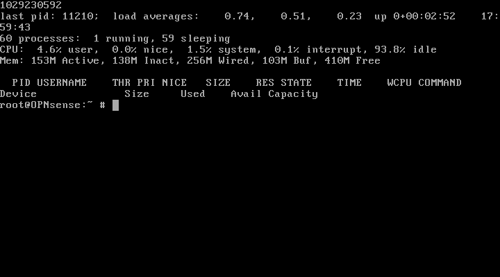

# Tasca 7 · Rendiment i diagnòstic

**Objetivo:** medir CPU, RAM, disco y red con varias VMs trabajando, ver qué se llena primero, cuántas VMs aguanta el PC y aplicar dos mejoras midiendo antes y después.

Evidencias de esta tarea: [../../evidencias/tasca7/](../../evidencias/tasca7/)

## Actividades de la rúbrica

| ID | Nivel | RA | Actividad (texto de la rúbrica) | Estado |
|---|---|---|---|---|
| a22 | Apte | FDM-RA1 | Mesurar CPU, RAM, disc i xarxa durant les càrregues previstes. | ✅ hecha |
| a23 | Apte | FDM-RA1 · ISO-RA6 | Interpretar les mesures i identificar els recursos saturats. | ✅ hecha |
| a24 | Apte | FDM-RA1 | Determinar la capacitat del maquinari per executar les VM. | ✅ hecha |
| a119 | Apte | ISO-RA6 | Analitzar els recursos físics amb diferents càrregues de VM. | ✅ hecha |
| a120 | Apte | ISO-RA6 | Determinar quantes VM permeten treballar sense bloquejar l’equip. | ✅ hecha |
| a121 | Apte | ISO-RA6 | Lliurar l’informe de mesures i conclusions. | ✅ hecha |
| a123 | Apte+ | ISO-RA6 | Proposar i aplicar una primera optimització de les VM. | ✅ hecha |
| a124 | Apte+ | ISO-RA6 | Proposar i aplicar una segona optimització de les VM. | ✅ hecha |
| a125 | Apte+ | ISO-RA6 | Comparar les mesures de rendiment abans i després. | ✅ hecha |

## En pocas palabras

Medí el PC con cada vez más VMs encendidas y trabajando a la vez (copias, arranques). Con **8 VMs** el PC sigue respondiendo bien.
Lo primero que se acaba es la **RAM**, y después el **disco**. La CPU va sobrada. Luego hice dos mejoras y medí que de verdad mejoran.

**Mi predicción (antes de investigar):** «Unas 8 VMs. Se acabará antes la RAM, y quizá vaya corto de núcleos».
**Resultado:** acertada en las 8 VMs y en la RAM. Los núcleos, no: la CPU no pasó del 22 %.

**Cómo medí:** un script que, cada 5 s, apunta en el anfitrión la CPU, la RAM y el swap (`vmstat`), el disco (`iostat`) y la red (`sar`).
Lo lanzo con `scripts/50-medir-rendimiento.sh <escenario> <segundos>`. Para saber si el PC **se bloquea**, mide cuánto se retrasa una espera de 0,1 s: si la CPU está ahogada, se retrasa. Siempre con carga, nunca en reposo.
Anfitrión de las medidas: 12 hilos, 31 GiB de RAM, VMs en el SSD USB.

## a22 · Medir CPU, RAM, disco y red con carga

**Qué pedía:** medir los cuatro recursos mientras las VMs trabajan.

| Escenario | RAM de VMs | Carga | CPU usada | RAM libre mín. | Disco (media · pico) | ¿Se bloquea? |
|---|---|---|---|---|---|---|
| **0** · ninguna VM | 0 GiB | — | 1 % | 22,7 GiB | 0 % | No (2 ms) |
| **C** · firewall + TrueNAS + srv-mon + Client-Linux | 15 GiB | copia sin parar a TrueNAS (**131 MB/s**) | 22 % | 13,7 GiB | 41 % · 75 % | No (2 ms) |
| **B+C** · + 3 nodos Proxmox | 24 GiB | copia de una VM de Proxmox a TrueNAS sin parar | 18 % | 5,0 GiB | 59 % · 78 % | No (2 ms) |
| **Máx** · + WinServer-2025 arrancando | **28 GiB** | lo mismo + arranque de Windows | 20 % | **0,3 GiB** | 62 % · **91 %** | No (2 ms) |

Evidencias: [línea base](../../evidencias/tasca7/rendimiento-0-linea-base-sin-vms.txt) · [C](../../evidencias/tasca7/rendimiento-C-copias-con-carga.txt) · [B+C](../../evidencias/tasca7/rendimiento-BC-cluster-copias-con-carga.txt) · [Máx](../../evidencias/tasca7/rendimiento-M-maximo-con-winserver.txt).
Demuestran: cada fila de la tabla, con un resumen arriba y todas las muestras de `vmstat` e `iostat` debajo.

**Resultado / dato clave:** con 28 GiB de VMs, CPU al **20 %**, disco con picos del **91 %** y solo **0,3 GiB** de RAM libre.

## a119 · Analizar los recursos con distintas cargas

**Qué pedía:** ver cómo cambia cada recurso según cuántas VMs hay encendidas.
- **CPU:** casi no se mueve (18–22 %) aunque pase de 4 a 8 VMs.
- **RAM:** baja mucho en cada escenario (22,7 → 13,7 → 5,0 → 0,3 GiB libres).
- **Disco:** sube en cada escenario (0 → 41 → 59 → 62 % de media).
- **Red física:** casi nada. Las copias van por la red interna `LAN_21`, que está dentro de VirtualBox, no por la tarjeta del PC.

Evidencia: [`rendimiento-M-maximo-con-winserver.txt`](../../evidencias/tasca7/rendimiento-M-maximo-con-winserver.txt). Demuestra: en el escenario más cargado, la columna `free` de `vmstat` cae casi a cero mientras `us`+`sy` (CPU) se quedan bajos.

**Resultado / dato clave:** al añadir VMs, lo que cambia es la **RAM** y el **disco**, no la CPU.

## a23 · Qué recurso se satura

**Qué pedía:** interpretar las medidas y decir qué se llena.
| Recurso | ¿Saturado? | Por qué |
|---|---|---|
| RAM | **Sí, el límite** | Con 28 GiB quedan ~2 GiB disponibles. Una VM más de 4 GB ya no cabe sin **swap** (usar el disco como RAM, mucho más lento) |
| Disco | **Casi** (picos del 91 %) | Todas las VMs leen y escriben en el mismo SSD |
| CPU del anfitrión | No (máx. 22 %) | Las VMs casi nunca trabajan todas a la vez |
| CPU **dentro** de srv-mon | **Sí** (~94 %) | Tiene 1 vCPU y cifra la copia por SSH. El límite de una copia está dentro de la VM |

Evidencia: [`rendimiento-C-copias-con-carga.txt`](../../evidencias/tasca7/rendimiento-C-copias-con-carga.txt). Demuestra: el anfitrión al 22 % de CPU y, en el mismo fichero, srv-mon por dentro al ~94 %.

**Resultado / dato clave:** se satura la **RAM**; después el **disco**; la CPU del anfitrión, nunca.

## a24 · Capacidad del hardware

**Qué pedía:** decir qué puede ejecutar este PC. Hay 31 GiB de RAM. El sistema y VirtualBox necesitan unos 3–4 GiB, así que caben unos **27–28 GiB de VMs** sin swap. La CPU (12 hilos) aguanta las 15 vCPU del escenario máximo sin problema.

Evidencia: [`rendimiento-0-linea-base-sin-vms.txt`](../../evidencias/tasca7/rendimiento-0-linea-base-sin-vms.txt). Demuestra: sin VMs, el PC ya tiene ocupada parte de la RAM (22,7 GiB libres de 31).

**Resultado / dato clave:** capacidad = **27–28 GiB de VMs**; la RAM manda.

## a120 · Cuántas VMs sin bloquear el equipo

**Qué pedía:** el número de VMs con el que se puede trabajar.
- **8 VMs sí** (firewall, 3 nodos Proxmox con una VM y un contenedor dentro, TrueNAS, srv-mon, Client-Linux y WinServer): 28 GiB, sin swap y con la espera fija en 2 ms.
- **9 VMs no** (+ Client-Win11 → 32 GiB): no cabe en la RAM. No lo probé a propósito, para no colgar el PC (N/C). Prueba: arrancarla y ver en `vmstat` cómo sube el swap.

Evidencia: [`rendimiento-M-maximo-con-winserver.txt`](../../evidencias/tasca7/rendimiento-M-maximo-con-winserver.txt). Demuestra: 8 VMs encendidas, swap sin usar y latencia de **2 ms** (igual que sin VMs).

**Resultado / dato clave:** **8 VMs (28 GiB)** a la vez sin bloquear. Por eso trabajo **por escenarios**: nunca hacen falta todas.

## a121 · Informe y conclusiones

**Qué pedía:** entregar el informe con las medidas y las conclusiones.
1. El PC aguanta **8 VMs (28 GiB)** trabajando a la vez. El límite es la **RAM**.
2. El segundo límite es el **disco** (picos del 91 %): todas las VMs están en el mismo SSD.
3. La CPU del anfitrión va sobrada; las VMs de 1 vCPU sí se ahogan por dentro.
4. Las dos mejoras (a123 y a124) ahorran RAM y casi doblan la red interna.

Evidencia: este documento y las 4 medidas de a22, todas con el mismo script. Demuestra: cada conclusión sale de un número medido.

**Resultado / dato clave:** informe con 4 escenarios medidos y 4 conclusiones.

## a123 · Primera mejora: menos RAM para OPNsense

**Qué pedía:** proponer y aplicar una mejora.

**Qué hice y por qué:** OPNsense pide 3 GB **solo para instalarse**. Ya instalado, por dentro usa unos 550 MB. Le bajé la RAM de 3 GB a **1 GB** (`VBoxManage modifyvm --memory 1024`) para dejársela a otras VMs.

Demuestra: con 3 GB, OPNsense tiene **2402 MB libres** sin hacer nada: le sobra casi todo.

Demuestra: con 1 GB usa casi lo mismo y le quedan **410 MB libres**: sigue sobrado.

**Resultado / dato clave:** el anfitrión gasta **1,7 GiB menos**, con el mismo tiempo de arranque (28 s) y todo funcionando.Límite: para una actualización grande hay que subirle la RAM mientras dura.

## a124 · Segunda mejora: tarjeta de red virtio

**Qué pedía:** proponer y aplicar otra mejora.

**Qué hice y por qué:** cambié la tarjeta de red de srv-mon y TrueNAS de la Intel **emulada** (VirtualBox imita un chip real, paquete a paquete) a **virtio**, una tarjeta pensada para VMs, que trabaja menos por paquete. Windows no la trae de serie, así que solo la puse en los Linux.

Evidencia: [`optimizaciones-antes-despues.txt`](../../evidencias/tasca7/optimizaciones-antes-despues.txt). Demuestra: el cambio de tarjeta y que los dos equipos siguen en red después.

**Resultado / dato clave:** la red interna pasa de **7,21 a 12,5 Gbit/s** con menos CPU.

## a125 · Comparar antes y después

**Qué pedía:** medir lo mismo antes y después de las mejoras.
| Mejora | Medida | Antes | Después | Cambio |
|---|---|---|---|---|
| OPNsense a 1 GB | RAM gastada en el anfitrión | 2885 MB | 1161 MB | **−1,7 GiB** |
| OPNsense a 1 GB | Arranque hasta dar servicio | 28 s | 28 s | igual |
| virtio | `iperf3` srv-mon → TrueNAS | 7,21 Gbit/s | 12,5 Gbit/s | **+73 %** |
| virtio | `iperf3` TrueNAS → srv-mon | 5,97 Gbit/s | 12,4 Gbit/s | **+108 %** |
| virtio | Copia real por SSH | 131 MB/s | 150 MB/s | +14 % |

Evidencia: [`optimizaciones-antes-despues.txt`](../../evidencias/tasca7/optimizaciones-antes-despues.txt). Demuestra: las medidas de antes y después, con el mismo método (mismo script de arranque y mismo `iperf3` de 20 s en los dos sentidos).

**Resultado / dato clave:** las dos mejoras funcionan. La copia real solo gana un 14 % porque allí el límite es la CPU de srv-mon (a23).

**Qué he aprendido:** una mejora solo vale si mides lo mismo antes y después. Y quitar un límite deja ver el siguiente: aquí, la CPU de srv-mon.

En esta tarea no tuve incidencias propias. Lista completa: [10-incidencies](../../docs/10-incidencies.md).

Más detalle técnico: [08-rendiment](../../docs/08-rendiment.md) (todas las medidas y riesgos de las mejoras).
