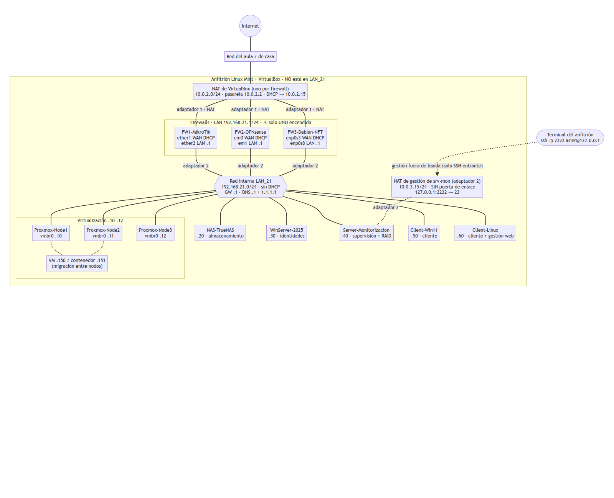

# Tasca 8 · Prova final

**Objetivo:** resolver yo solo un caso práctico sobre mi laboratorio el día del examen y responder el cuestionario.
Aquí está la preparación: la comprobación de que todo funciona y cómo voy a resolver cada actividad.

Evidencias de esta tarea: [../../evidencias/tasca8/](../../evidencias/tasca8/)

## Actividades de la rúbrica

| ID | Nivel | RA | Actividad (texto de la rúbrica) | Estado |
|---|---|---|---|---|
| a25 | Apte | FDM-RA1 | Diagnosticar i resoldre la incidència de maquinari del cas final. | ⏳ el día del examen |
| a26 | Apte | FDM-RA1 · ISO-RA1 · ISO-RA3 · ISO-RA6 | Justificar la solució i comprovar el resultat. | ⏳ el día del examen |
| a50 | Apte | FDM-RA4 | Identificar els equips empresarials i la seua funció en el cas final. | ⏳ el día del examen |
| a51 | Apte | FDM-RA4 | Inventariar les connexions i els ports del cas assignat. | ⏳ el día del examen |
| a52 | Apte | FDM-RA4 | Analitzar alimentació, ventilació i ordre del cablejat. | ⏳ el día del examen |
| a53 | Apte | FDM-RA4 | Aportar l’esquema i l’explicació individual de la solució. | ⏳ el día del examen |
| a80 | Apte | ISO-RA1 | Resoldre la incidència d’instal·lació, actualització o arrencada del cas final. | ⏳ el día del examen |
| a104 | Apte | ISO-RA3 | Recuperar la informació o el sistema previst en el cas final. | ⏳ el día del examen |
| a122 | Apte | ISO-RA6 | Diagnosticar el problema de rendiment del cas final. | ⏳ el día del examen |
| a30 | Apte+ | FDM-RA1 | Respondre el bloc del qüestionari teòric/pràctic corresponent a FDM RA1, justificant les respostes. El bloc ha d’estar identificat per RA; complementa les evidències pràctiques. | ⏳ el día del examen |
| a57 | Apte+ | FDM-RA4 | Respondre el bloc del qüestionari teòric/pràctic corresponent a FDM RA4, justificant les respostes. El bloc ha d’estar identificat per RA; complementa les evidències pràctiques. | ⏳ el día del examen |
| a84 | Apte+ | ISO-RA1 | Respondre el bloc del qüestionari teòric/pràctic corresponent a ISO RA1, justificant les respostes. El bloc ha d’estar identificat per RA; complementa les evidències pràctiques. | ⏳ el día del examen |
| a110 | Apte+ | ISO-RA3 | Respondre el bloc del qüestionari teòric/pràctic corresponent a ISO RA3, justificant les respostes. El bloc ha d’estar identificat per RA; complementa les evidències pràctiques. | ⏳ el día del examen |
| a126 | Apte+ | ISO-RA6 | Respondre el bloc del qüestionari teòric/pràctic corresponent a ISO RA6, justificant les respostes. El bloc ha d’estar identificat per RA; complementa les evidències pràctiques. | ⏳ el día del examen |

## En pocas palabras

El examen es un caso práctico sobre mi propio laboratorio. Lo importante es que todo funcione y que sepa explicarlo.
En el PC de clase encendí todo por escenarios y comprobé que, con cada firewall, los equipos salen a Internet pasando por él. También que el clúster, el NAS, los RAID y las copias siguen bien.

En esta tarea no apunté predicciones antes de empezar.

## Comprobación final: el entorno está listo

**Qué hice:** con un solo firewall encendido cada vez, Client-Linux lanzó un script de comprobación (IP, ping, HTTPS y traceroute). En los servidores miré el estado de cada servicio.

| Escenario | Qué comprobé | Resultado |
|---|---|---|
| FW2-OPNsense | Client-Linux: ping al .1, HTTPS y traceroute (1.er salto .1, 2.º 10.0.2.2) | ✅ |
| FW2-OPNsense | Clúster Proxmox: **Quorate: Yes**, 3 votos; la VM 150 y el contenedor 151 responden | ✅ |
| FW2-OPNsense | TrueNAS: pool `copias` **ONLINE**, 0 errores | ✅ |
| FW2-OPNsense | srv-mon: RAID 1 `[UU]`, RAID 5 `[UUU]`, espejo `[UU]`; copias automáticas «Fin (todo OK)» | ✅ |
| FW3-Debian-NFT | Client-Linux: ping, HTTPS y traceroute por el .1 | ✅ (primer ping fallido: ver abajo) |
| FW1-MikroTik | Client-Linux: ping, HTTPS y traceroute por el .1 | ✅ |
| FW1 + Windows | WinServer (.30) y Win11 (.50): IP /24, puerta de enlace .1, ping 3/3, `tracert` por el .1 | ✅ |

Evidencia: [`chequeo-final.txt`](../../evidencias/tasca8/chequeo-final.txt).
Demuestra: con cada uno de los 3 firewalls, los equipos salen a Internet **pasando por el .1**, y los servicios (clúster, NAS, RAID, espejo y copias) siguen funcionando.

**Dato clave:** 3 firewalls × traceroute con 1.er salto **192.168.21.1**; clúster **Quorate: Yes**; todos los RAID con todos sus discos.

Antes del examen: enchufar el PC, comprobar que hay **un solo firewall** encendido (`VBoxManage list runningvms`) y arrancar el escenario que pida el caso. Todas las VMs tienen una instantánea `P20-final` por si algo se rompe.

## a25 y a26 · Incidencia de hardware: resolverla, justificarla y comprobarla

**Qué pide:** encontrar y arreglar un fallo de hardware, explicar por qué esa solución y comprobar que funciona.

**Cómo lo haré:** síntoma → hipótesis → prueba → solución → **comprobar otra vez**. Las mismas herramientas de la Tasca 2:

```
sudo ./scripts/02-tests-diagnostico.sh clase
```

Además: `sensors` (temperatura), `dmesg -T` (errores del sistema) y `smartctl -H` (salud del disco).

**Evidencia preparada:** [`tests-clase.txt`](../../evidencias/tasca2/tests-clase.txt).
Demuestra: cómo funciona el PC cuando está sano (memoria 18/18 ok, disco ~400 MB/s). El día del examen comparo con estos números.

**Dato clave a comparar:** memoria **18/18 ok**, disco **386 / 409 MB/s**, temperatura **59–65 °C** en reposo.

## a50 a a53 · Equipos, conexiones, alimentación y esquema

**Qué piden:** decir qué equipo hace qué (a50), qué conexiones y puertos usa (a51), cómo va la alimentación, la ventilación y el cableado (a52), y dar el esquema con mi explicación (a53).

**Cómo lo haré:** parto de mi esquema y de la tabla de IPs de la Tasca 4. Los puertos (números que identifican cada servicio en la red) que uso son:

| Puerto | Servicio | Equipo |
|---|---|---|
| 22 | SSH (consola remota cifrada) | Linux, firewalls |
| 80 / 443 | Web de gestión | OPNsense, TrueNAS |
| 8006 | Web de Proxmox | Nodos Proxmox |
| 445 | SMB (carpetas de Windows) | TrueNAS |
| 2049 | NFS (carpetas de Linux) | TrueNAS |
| 3260 | iSCSI (disco por red) | TrueNAS |



Demuestra: los equipos, su IP y cómo se conectan. Es la base del esquema que pide a53.

Para alimentación y ventilación tengo los datos del PC en la [Tasca 2](../Tasca-2/) (cargador, batería al 93,9 % de salud, temperaturas).

**Dato clave:** LAN **192.168.21.0/24**, un solo firewall en el **.1**, servidores de .10 a .40, clientes en .50 y .60.

## a80 · Incidencia de instalación, actualización o arranque

**Qué pide:** arreglar un sistema que no se instala, no se actualiza o no arranca.

**Cómo lo haré:** primero miro el mensaje de error en la pantalla de la VM. Ya practiqué un caso: un Linux que no arrancaba por una línea mala en `fstab` (el fichero con los discos que se montan al arrancar). Se arregla entrando por GRUB (el menú de arranque) y corrigiendo la línea.

**Evidencia preparada:** la incidencia de arranque resuelta en la [Tasca 5](../Tasca-5/) y en [06-installacions](../../docs/06-installacions.md) §11.
Demuestra: el sistema roto, el arreglo y el sistema arrancando otra vez.

**Dato clave:** con `findmnt --verify` compruebo el `fstab` antes de reiniciar.

## a104 · Recuperar información o un sistema

**Qué pide:** recuperar los datos o el sistema que diga el caso.

**Cómo lo haré:** todas las copias están en TrueNAS (`copias/<equipo>/`) con su SHA-256.

| Si se pierde… | Lo recupero con… |
|---|---|
| La configuración de un firewall | Su copia en TrueNAS (OPNsense: importar el `config.xml`) |
| Una VM de Proxmox | *Backup → Restore* desde el almacenamiento del NAS |
| Un fichero de Linux o Windows | Su copia en TrueNAS (`tar` o `robocopy`) |
| Un disco de un RAID | `mdadm --re-add` (Tasca 6) |

**Evidencia preparada:** las recuperaciones de la [Tasca 5](../Tasca-5/) y el espejo de la [Tasca 6](../Tasca-6/).
Demuestra: ya he recuperado ficheros y configuraciones con el mismo SHA-256 que el original.

**Dato clave:** el SHA-256 de antes de borrar y el de después de recuperar tienen que ser **iguales**.

## a122 · Problema de rendimiento

**Qué pide:** encontrar por qué algo va lento.

**Cómo lo haré:** mido con el script de la Tasca 7 y miro dentro de la VM con `top` y `vmstat`.
Busco las causas que ya vi: poca RAM (se usa el swap), demasiadas VMs, una VM de 1 vCPU al 100 % o una tarjeta de red emulada en vez de virtio.

**Evidencia preparada:** [`rendimiento-M-maximo-con-winserver.txt`](../../evidencias/tasca7/rendimiento-M-maximo-con-winserver.txt).
Demuestra: cómo se ve el PC al límite (RAM libre 0,3 GiB, disco al 91 %). Sirve para comparar.

**Dato clave:** el PC aguanta **8 VMs (28 GiB)**; más que eso es el primer sospechoso.

## a30, a57, a84, a110 y a126 · Cuestionario por RA

**Qué pide:** responder un bloque de preguntas por cada RA, justificando cada respuesta.

**Cómo lo preparo:** con mis apuntes de preguntas y respuestas por RA.
Regla: cada respuesta con su prueba (una salida o una captura). Lo que no pueda comprobar, lo digo como **N/C** con la prueba que lo confirmaría.

## Problemas que tuve

- **Al cambiar de firewall, el primer ping al .1 fallaba (incidencia 28).** El cliente recordaba la tarjeta del firewall anterior (caché ARP). Se arregla solo en unos 10 s, o al momento con `sudo ip neigh flush dev enp0s3`.

Lista completa de incidencias: [10-incidencies](../../docs/10-incidencies.md).

